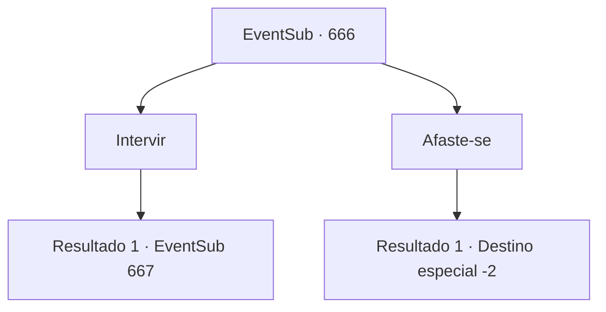

# Eventos secundários · 666

[Índice da tabela](index.md) · [Índice geral](../index.md)

ID: `pt:EventSub:666` · Fonte: `EventSub4` · Versão: 1.2.47.

Mapeamento estático dos arquivos; a disponibilidade e a execução dependem do estado da run.

## Texto do evento

Você está caminhando em uma trilha de montanha, indo em direção a Mavelaine. Embora a estrada seja áspera e perigosa, ao contrário das outras estradas bem pavimentadas, ela oferece um atalho para a cidade. Mas então, você ouve uma voz irritada, gritando, vindo de perto. Você se aproxima para investigar e encontra aventureiros armados ameaçando uma senhora indefesa. Liderando os aventureiros está Osborne, da guilda de comerciantes de Veneprada, e a senhora não é ninguém menos que Edenheart.

## Dados de entrada

```json
{
  "id": 666,
  "grade": 1,
  "subEvent": "",
  "required": "12_10_9"
}
```

## Mapa das escolhas



## Escolhas e resultados

### Escolha 1

Intervir

Requisitos e outros campos da escolha:

```json
{
  "required": ""
}
```

#### Resultado 1.1

Você decide intervir. Ao ver um terceiro entrante, tanto Edenheart quanto Osborne dão um passo para trás, enquanto os aventureiros ficam de guarda com suas armas em punho. Você diz a eles que não está aqui para lutar e prossegue perguntando a Edenheart o que está acontecendo. Mas Osborne é quem responde à sua pergunta. 

 "Aquela vadia é uma ladrazinha que roubou a valiosa propriedade de Veneprada! Isso pode parecer um roubo, mas eu te asseguro - o que estamos fazendo aqui é perfeitamente razoável! Agora vá embora, por favor."


Continuação registrada: [Evento 667](0667.md) na mesma tabela.

```json
{
  "required": "",
  "chance": "1",
  "nextEvent": 667,
  "type": 2,
  "reward": ""
}
```

### Escolha 2

Afaste-se

Requisitos e outros campos da escolha:

```json
{
  "required": ""
}
```

#### Resultado 2.1

Você decide não intervir, passando pela cena. Eles matam Edenheart em um instante, pegando algo do corpo sem vida e entregando para Osborne. Osborne pega os materiais e rapidamente se retira. Logo, tudo o que preenche o lugar é o silêncio.

Continuação registrada: [Destino especial `-2`](../destinos-especiais.md).

```json
{
  "required": "",
  "chance": "1",
  "nextEvent": -2,
  "type": 2,
  "reward": "12_10_-1|14_10_5"
}
```

## Referências que chegam a este evento

Nenhum `nextEvent` positivo da mesma tabela aponta para este nó. Isso não prova que seja inacessível: sorteio e estado de história podem selecioná-lo.

