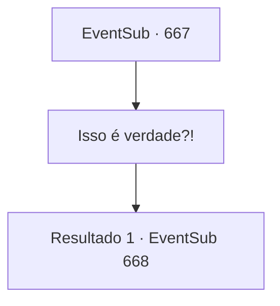

# Eventos secundários · 667

[Índice da tabela](index.md) · [Índice geral](../index.md)

ID: `pt:EventSub:667` · Fonte: `EventSub4` · Versão: 1.2.47.

Mapeamento estático dos arquivos; a disponibilidade e a execução dependem do estado da run.

## Texto do evento

*Sem texto no arquivo.*

## Dados de entrada

```json
{
  "id": 667,
  "grade": 1,
  "subEvent": "",
  "required": ""
}
```

## Mapa das escolhas



## Escolhas e resultados

### Escolha 1

Isso é verdade?!

Requisitos e outros campos da escolha:

```json
{
  "required": ""
}
```

#### Resultado 1.1

Você pergunta a Edenheart se o que Osborne disse é verdade. Ela hesita por um momento antes de assentir. Ela então justifica suas ações, contando a você por que o que ela fez era inevitável. 

 "... Eu não tinha outra escolha! Fheren vai morrer se eu não fizer nada. Para fazer um 'Elixir Completo', essa era minha única opção! {1}...! Por favor, me ajude! Eu te imploro!!"


Continuação registrada: [Evento 668](0668.md) na mesma tabela.

```json
{
  "required": "",
  "chance": "1",
  "nextEvent": 668,
  "type": 2,
  "reward": ""
}
```

## Referências que chegam a este evento

- [Evento 666 · escolha 1 · resultado 1](0666.md#escolha-1)
