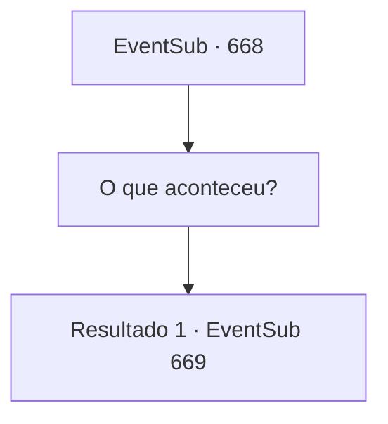

# Eventos secundários · 668

[Índice da tabela](index.md) · [Índice geral](../index.md)

ID: `pt:EventSub:668` · Fonte: `EventSub4` · Versão: 1.2.47.

Mapeamento estático dos arquivos; a disponibilidade e a execução dependem do estado da run.

## Texto do evento

*Sem texto no arquivo.*

## Dados de entrada

```json
{
  "id": 668,
  "grade": 1,
  "subEvent": "",
  "required": ""
}
```

## Mapa das escolhas



## Escolhas e resultados

### Escolha 1

O que aconteceu?

Requisitos e outros campos da escolha:

```json
{
  "required": ""
}
```

#### Resultado 1.1

Edenheart acena em resposta, explicando o que aconteceu. 

 "Da última vez, quando nos separamos, {1}... Eu visitei Veneprada sozinho. Entreguei minhas notas de pesquisa a eles e pedi sua cooperação na pesquisa do Elixir. O vice-presidente, Osborne, aceitou meu pedido. Mas, o Elixir que preparamos era instável - não passou pela última etapa de refinamento."

 Ela conta que pegou o protótipo preparado por Osborne e deu para Fheren. 

 "Sinceramente, mesmo sem a etapa final, o Elixir é uma poção potente. No entanto, Fheren não se levantou. Por um instante, ele estava saudável como um touro, mas foi só isso."

 Ao ouvir isso, Osborne explode de raiva. 

 "HA! Instável, porque não passou por outra tediosa etapa de refinamento? Por favor. O que, então, devemos acreditar em você e entoar uma invocação - toda essa bobagem de sacrificar a alma de uma pessoa apaixonada? COMO você supõe que vamos anunciar isso como um produto?! E o que isso tem a ver com você roubar o Elixir de nós?!"

 Edenheart parece um pouco assustada. Você vê sua postura encolhendo.

Continuação registrada: [Evento 669](0669.md) na mesma tabela.

```json
{
  "required": "",
  "chance": "1",
  "nextEvent": 669,
  "type": 2,
  "reward": ""
}
```

## Referências que chegam a este evento

- [Evento 667 · escolha 1 · resultado 1](0667.md#escolha-1)
