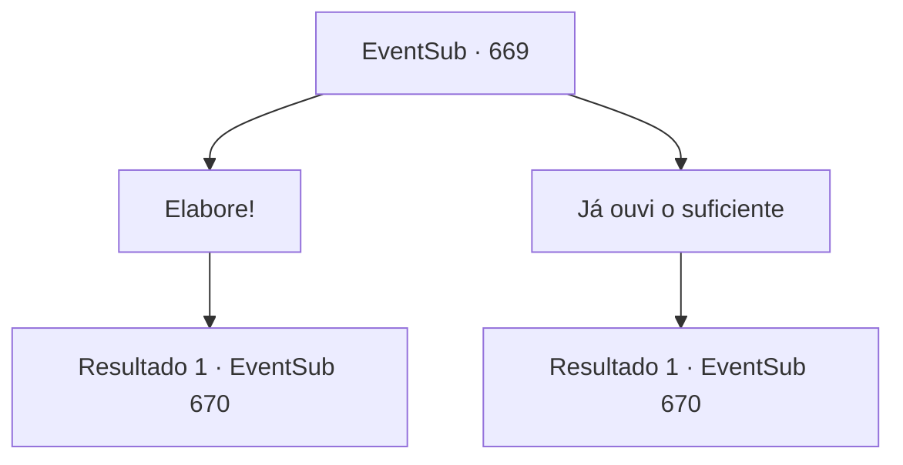

# Eventos secundários · 669

[Índice da tabela](index.md) · [Índice geral](../index.md)

ID: `pt:EventSub:669` · Fonte: `EventSub4` · Versão: 1.2.47.

Mapeamento estático dos arquivos; a disponibilidade e a execução dependem do estado da run.

## Texto do evento

*Sem texto no arquivo.*

## Dados de entrada

```json
{
  "id": 669,
  "grade": 1,
  "subEvent": "",
  "required": ""
}
```

## Mapa das escolhas



## Escolhas e resultados

### Escolha 1

Elabore!

Requisitos e outros campos da escolha:

```json
{
  "required": ""
}
```

#### Resultado 1.1

Você decide deixar Edenheart terminar sua história. Osborne cruza os braços, reclamando. 

 "O que há para ouvir...?"

 Edenheart, com a voz tremendo, continua. 

 "Para curar adequadamente Fheren de sua doença, precisamos de um Elixir Completo. E para preparar um Elixir Completo, eu precisava de uma amostra do protótipo instável do Elixir. Então... eu não tive escolha a não ser roubar. O preço que Osborne estipulou... é... é simplesmente absurdo! Nem mesmo Fheren será capaz de pagar tanto. Você teria que procurar em todo o império para encontrar riquezas que sequer têm o ouro para comprá-lo!"

 Assim que ela termina, Osborne retruca em voz alta. 

 "HA! Ah, você e suas morais e emoções mesquinhas. Comerciantes não podem ganhar a vida pensando em cada pessoa e suas histórias! Você sabe quanto dinheiro e tempo gastamos com isso?! Tivemos que contratar alquimistas, arqueólogos, mercenários, até mesmo magos e bruxas de todo o mundo! Centenas de pessoas, anos de tempo! Sem mencionar o ouro - pelo menos alguns milhares, não, dezenas de milhares! E você tem a vontade de simplesmente, o quê, pegar e ir embora? Só porque operamos uma guilda de comerciantes, não significa que podemos criar ouro do nada!"

 Osborne então solta um longo suspiro e acrescenta. 

 "*suspiro*... Olhe só. Já se perdeu tanto tempo. Olha, você vai nos devolver nosso Elixir, ou NÓS o pegaremos à força."


Continuação registrada: [Evento 670](0670.md) na mesma tabela.

```json
{
  "required": "",
  "chance": "1",
  "nextEvent": 670,
  "type": 2,
  "reward": ""
}
```

### Escolha 2

Já ouvi o suficiente

Requisitos e outros campos da escolha:

```json
{
  "required": ""
}
```

#### Resultado 2.1

Você já ouviu o suficiente. Você decide ficar ao lado de Osborne. Edenheart agarra suas roupas, implorando e chorando. 

 "P-por favor, EU ESTOU IMPLORANDO! Não... não há simplesmente nenhuma maneira de eu poder pagar esse preço... Eu sei que o que fiz está errado. Eu sei disso! Mas... por favor... Sem isso, eu não posso salvar Fheren..."

 Assim que ela termina, Osborne grita alto. 

 "HA! Ah, você e suas pequenas moralidades e emoções. Comerciantes não podem ganhar a vida, pensando em cada pessoa e suas histórias! Você sabe quanto dinheiro e tempo gastamos com isso?!  Tivemos que contratar alquimistas, arqueólogos, mercenários, até mesmo magos e bruxas de todo o mundo! Centenas de pessoas, anos de tempo! Sem mencionar o ouro - pelo menos alguns milhares, não, dezenas de milhares! E você tem a vontade de apenas, o quê, pegar e sair? Só porque operamos uma guilda de comerciantes, não significa que podemos criar ouro do nada!"

 Osborne então solta um longo suspiro e acrescenta. 

 "*suspiro*... Olhe só isso. Já se perdeu tanto tempo. Olhe, você vai nos devolver nosso Elixir, ou NÓS o pegaremos à força."


Continuação registrada: [Evento 670](0670.md) na mesma tabela.

```json
{
  "required": "",
  "chance": "1",
  "nextEvent": 670,
  "type": 2,
  "reward": ""
}
```

## Referências que chegam a este evento

- [Evento 668 · escolha 1 · resultado 1](0668.md#escolha-1)
