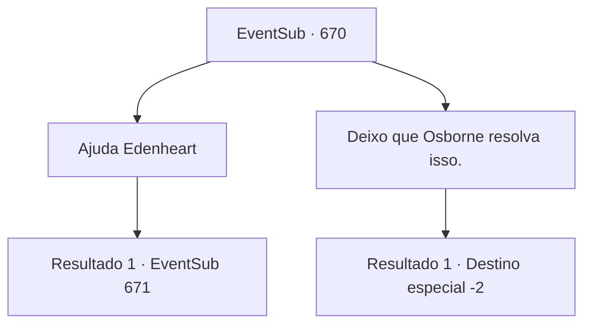

# Eventos secundários · 670

[Índice da tabela](index.md) · [Índice geral](../index.md)

ID: `pt:EventSub:670` · Fonte: `EventSub4` · Versão: 1.2.47.

Mapeamento estático dos arquivos; a disponibilidade e a execução dependem do estado da run.

## Texto do evento

*Sem texto no arquivo.*

## Dados de entrada

```json
{
  "id": 670,
  "grade": 1,
  "subEvent": "",
  "required": ""
}
```

## Mapa das escolhas



## Escolhas e resultados

### Escolha 1

Ajuda Edenheart

Requisitos e outros campos da escolha:

```json
{
  "required": ""
}
```

#### Resultado 1.1

Você dá um passo à frente, protegendo Edenheart contra Osborne. Osborne grita, seu bigode tremendo de raiva. 

 "LIVRE-SE DESSES IDIOTAS E TRAGA-ME O ELIXIR! AGORA!"

 Os mercenários ao seu redor se preparam para lutar.

Continuação registrada: [Evento 671](0671.md) na mesma tabela.

```json
{
  "required": "",
  "chance": "1",
  "nextEvent": 671,
  "type": 2,
  "reward": "6_3_62",
  "place": 1
}
```

### Escolha 2

Deixo que Osborne resolva isso.

Requisitos e outros campos da escolha:

```json
{
  "required": ""
}
```

#### Resultado 2.1

Você deixa Edenheart, recuando do conflito. Ela olha para você em branco, desanimada. Você vira as costas para ela. Edenheart é assassinada instantaneamente. Os homens de Osborne rapidamente pegam o Elixir de seu corpo sem vida, entregando-o a Osborne. Ele pega o Elixir e rapidamente deixa a área. Logo, tudo o que preenche o lugar é o silêncio.

Continuação registrada: [Destino especial `-2`](../destinos-especiais.md).

```json
{
  "required": "",
  "chance": "1",
  "nextEvent": -2,
  "type": 2,
  "reward": "12_10_-1|14_10_10|14_10_5"
}
```

## Referências que chegam a este evento

- [Evento 669 · escolha 1 · resultado 1](0669.md#escolha-1)
- [Evento 669 · escolha 2 · resultado 1](0669.md#escolha-2)
