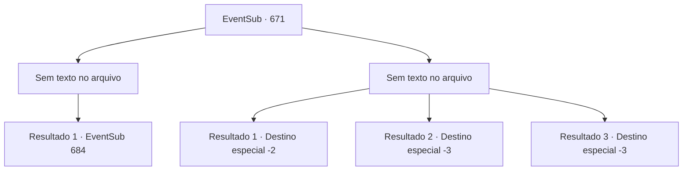

# Eventos secundários · 671

[Índice da tabela](index.md) · [Índice geral](../index.md)

ID: `pt:EventSub:671` · Fonte: `EventSub4` · Versão: 1.2.47.

Mapeamento estático dos arquivos; a disponibilidade e a execução dependem do estado da run.

## Texto do evento

*Sem texto no arquivo.*

## Dados de entrada

```json
{
  "id": 671,
  "grade": 1,
  "subEvent": "",
  "required": ""
}
```

## Mapa das escolhas



## Escolhas e resultados

### Escolha 1

*Sem texto no arquivo; o papel dessa opção depende da interface do jogo.*

Requisitos e outros campos da escolha:

```json
{
  "required": ""
}
```

#### Resultado 1.1

Você lida com os aventureiros contratados, depois se aproxima de Osborne. Sem saber o que fazer, Osborne dá alguns passos para trás antes de fugir com medo. 

 "Obrigado... Eu quero dizer isso."

 Edenheart agradece a você, com lágrimas nos olhos. Ela então pede para você segui-la. Você segue em direção ao laboratório de Edenheart com ela.

Continuação registrada: [Evento 684](0684.md) na mesma tabela.

```json
{
  "required": "",
  "chance": "1",
  "nextEvent": 684,
  "type": 2,
  "reward": "14_10_8"
}
```

### Escolha 2

*Sem texto no arquivo; o papel dessa opção depende da interface do jogo.*

Requisitos e outros campos da escolha:

```json
{
  "required": ""
}
```

#### Resultado 2.1

Você faz o seu melhor para lutar de volta, mas não tem escolha a não ser fugir. Edenheart sozinha oferece uma resistência fútil. Osborne rapidamente pega o Elixir de seu corpo sem vida e vai embora. Logo, tudo o que preenche o lugar é o silêncio.

Continuação registrada: [Destino especial `-2`](../destinos-especiais.md).

```json
{
  "required": "1_0_2|1_1_2",
  "chance": "1",
  "nextEvent": -2,
  "type": 2,
  "reward": "0_0_-1|0_1_-1|12_10_-1|14_10_10|14_10_5"
}
```

#### Resultado 2.2


 "{1}! Não! Afasta-te! AFASTA-TE DE MIM!"

 Os aventureiros contratados se aproximam de Edenheart com armas ensanguentadas. Mas você não tem mais o poder de detê-los.

Continuação registrada: [Destino especial `-3`](../destinos-especiais.md).

```json
{
  "required": "2_0_2",
  "chance": "1",
  "nextEvent": -3,
  "type": 2,
  "reward": "0_0_-1|0_1_-1"
}
```

#### Resultado 2.3


 "{1}! Não! Afaste-se! AFASTE-SE DE MIM!"

 Os aventureiros contratados se aproximam de Edenheart com armas ensanguentadas. Mas você não tem mais o poder de detê-los.

Continuação registrada: [Destino especial `-3`](../destinos-especiais.md).

```json
{
  "required": "2_1_2",
  "chance": "1",
  "nextEvent": -3,
  "type": 2,
  "reward": "0_0_-1|0_1_-1"
}
```

## Referências que chegam a este evento

- [Evento 670 · escolha 1 · resultado 1](0670.md#escolha-1)
