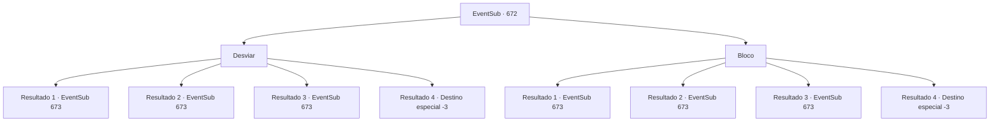

# Eventos secundários · 672

[Índice da tabela](index.md) · [Índice geral](../index.md)

ID: `pt:EventSub:672` · Fonte: `EventSub4` · Versão: 1.2.47.

Mapeamento estático dos arquivos; a disponibilidade e a execução dependem do estado da run.

## Texto do evento

Ah, o momento do pôr do sol. Enquanto você caminha por uma pradaria coberta de juncos altos, você percebe um barulho fora do lugar no meio dos juncos. Assim que você vira o olhar para investigar, você ouve algo passando rapidamente atrás de você.

## Dados de entrada

```json
{
  "id": 672,
  "grade": 1,
  "subEvent": "",
  "required": "12_10_13"
}
```

## Mapa das escolhas



## Escolhas e resultados

### Escolha 1

Desviar 

Requisitos e outros campos da escolha:

```json
{
  "required": ""
}
```

#### Resultado 1.1

Você reúne seus reflexos, desviando do que está atrás de você. Uma adaga afiada perfura o ar, quase acertando sua cabeça. 

 "Tsk.."

 Logo, um grupo de assassinos emerge dos juncos. Eles trocam olhares brevemente e logo começam a te atacar.

Continuação registrada: [Evento 673](0673.md) na mesma tabela.

```json
{
  "required": "",
  "chance": "1|0_6_1",
  "nextEvent": 673,
  "type": 0,
  "reward": "6_3_48",
  "place": 0
}
```

#### Resultado 1.2

Você sente algo afiado perfurando seus ombros. Uma dor ardente percorre seu corpo - você percebe uma adaga afiada presa em seu ombro esquerdo. Parece que ela está revestida com algum tipo de veneno paralisante também. Você sente dormência se espalhando por todo o seu corpo. Logo, um grupo de assassinos emerge dos juncos. Eles trocam olhares brevemente e logo começam a te atacar.

Continuação registrada: [Evento 673](0673.md) na mesma tabela.

```json
{
  "required": "1_0_2|21_15_3",
  "chance": "16",
  "nextEvent": 673,
  "type": 1,
  "reward": "6_3_48|0_0_-1",
  "place": 0
}
```

#### Resultado 1.3

Você sente algo afiado perfurando seus ombros. Uma dor intensa percorre seu corpo - você percebe uma adaga afiada presa em seu ombro esquerdo. Logo, um grupo de assassinos emerge dos juncos. Eles trocam olhares breves e logo começam a te atacar.

Continuação registrada: [Evento 673](0673.md) na mesma tabela.

```json
{
  "required": "1_0_2|20_15_3",
  "chance": "16",
  "nextEvent": 673,
  "type": 1,
  "reward": "6_0_48|0_0_-1",
  "place": 0
}
```

#### Resultado 1.4

Você sente algo afiado perfurando seu pescoço. Uma dor ardente percorre seu corpo. Seu corpo está paralisado. Você não consegue respirar e sua visão começa a escurecer. Logo, você não consegue se mover mais. 

 "Maldição... ele nos disse para capturá-los vivos..."

 A voz resmungante do assassino é a última coisa que você ouve antes de sua consciência desaparecer.

Continuação registrada: [Destino especial `-3`](../destinos-especiais.md).

```json
{
  "required": "2_0_2",
  "chance": "16",
  "nextEvent": -3,
  "type": 1,
  "reward": "0_0_-1"
}
```

### Escolha 2

Bloco

Requisitos e outros campos da escolha:

```json
{
  "required": "20_9_1"
}
```

#### Resultado 2.1

Você bloqueia o que quer que estivesse voando em sua direção. Uma adaga afiada cai no chão. 

 "Tsk..."

 Logo, um grupo de assassinos emerge dos juncos. Eles trocam olhares brevemente e logo começam a te atacar.

Continuação registrada: [Evento 673](0673.md) na mesma tabela.

```json
{
  "required": "",
  "chance": "1|0_6_1",
  "nextEvent": 673,
  "type": 0,
  "reward": "6_3_48",
  "place": 0
}
```

#### Resultado 2.2

Você sente algo afiado perfurando seus ombros. Uma dor ardente percorre seu corpo - você percebe uma adaga afiada presa em seu ombro esquerdo. Parece que ela está revestida com algum tipo de veneno paralisante também. Você sente dormência se espalhando por todo o seu corpo. Logo, um grupo de assassinos emerge dos juncos. Eles trocam olhares brevemente e logo começam a te atacar.

Continuação registrada: [Evento 673](0673.md) na mesma tabela.

```json
{
  "required": "1_0_2|21_15_3",
  "chance": "11",
  "nextEvent": 673,
  "type": 1,
  "reward": "6_3_48|0_0_-1",
  "place": 0
}
```

#### Resultado 2.3

Você sente algo afiado perfurando seus ombros. Uma dor ardente percorre seu corpo - você percebe uma adaga afiada presa em seu ombro esquerdo. Logo, um grupo de assassinos emerge dos juncos. Eles trocam olhares breves e logo começam a te atacar.

Continuação registrada: [Evento 673](0673.md) na mesma tabela.

```json
{
  "required": "1_0_2|20_15_3",
  "chance": "11",
  "nextEvent": 673,
  "type": 1,
  "reward": "6_0_48|0_0_-1",
  "place": 0
}
```

#### Resultado 2.4

Você sente algo afiado perfurando seu pescoço. Uma dor intensa percorre seu corpo. Seu corpo está paralisado. Você não consegue respirar e sua visão começa a escurecer. Logo, você não consegue mais se mover. 

 "Maldição... ele nos disse para capturá-los vivos..."

 A voz resmungante do assassino é a última coisa que você ouve antes de sua consciência desaparecer.

Continuação registrada: [Destino especial `-3`](../destinos-especiais.md).

```json
{
  "required": "2_0_2",
  "chance": "11",
  "nextEvent": -3,
  "type": 1,
  "reward": "0_0_-1"
}
```

## Referências que chegam a este evento

Nenhum `nextEvent` positivo da mesma tabela aponta para este nó. Isso não prova que seja inacessível: sorteio e estado de história podem selecioná-lo.

