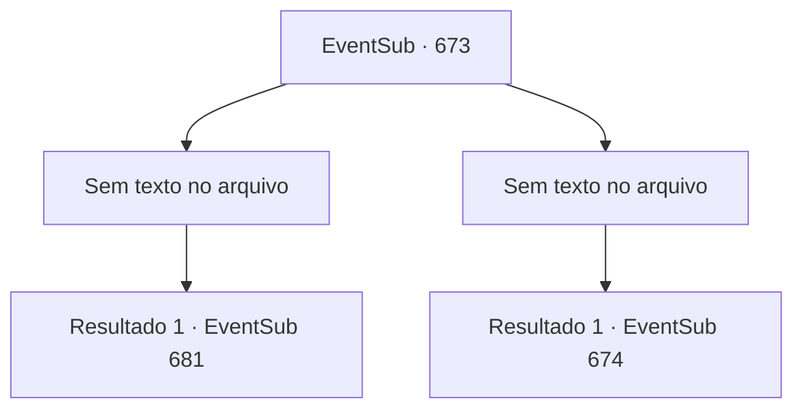

# Eventos secundários · 673

[Índice da tabela](index.md) · [Índice geral](../index.md)

ID: `pt:EventSub:673` · Fonte: `EventSub4` · Versão: 1.2.47.

Mapeamento estático dos arquivos; a disponibilidade e a execução dependem do estado da run.

## Texto do evento

*Sem texto no arquivo.*

## Dados de entrada

```json
{
  "id": 673,
  "grade": 1,
  "subEvent": "",
  "required": ""
}
```

## Mapa das escolhas



## Escolhas e resultados

### Escolha 1

*Sem texto no arquivo; o papel dessa opção depende da interface do jogo.*

Requisitos e outros campos da escolha:

```json
{
  "required": ""
}
```

#### Resultado 1.1

Você derrota os assassinos, capturando um deles no processo. Você pergunta a ele quem ordenou o assassinato. Mas ele não vai te contar nada.

Continuação registrada: [Evento 681](0681.md) na mesma tabela.

```json
{
  "required": "",
  "chance": "1",
  "nextEvent": 681,
  "type": 2,
  "reward": ""
}
```

### Escolha 2

*Sem texto no arquivo; o papel dessa opção depende da interface do jogo.*

Requisitos e outros campos da escolha:

```json
{
  "required": ""
}
```

#### Resultado 2.1

Você é derrotado pelos assassinos. Mas em vez de acabarem com sua vida, eles te amarram com cordas, te deixando imóvel. Em seguida, eles cobrem seus olhos com um pano preto, te colocando na sela de um de seus cavalos. 

 "Descanse seus olhos. Faça um movimento errado e te mataremos."

 Logo, você é jogado no chão duro e o pano que cobria seus olhos é removido. Você olha ao redor e se vê dentro de um prédio abandonado. Aquele que te espera não é outro senão Fheren. Ele te encara, seus olhos queimando de raiva. |drawing_Fheren|

Continuação registrada: [Evento 674](0674.md) na mesma tabela.

```json
{
  "required": "",
  "chance": "1",
  "nextEvent": 674,
  "type": 2,
  "reward": ""
}
```

## Referências que chegam a este evento

- [Evento 672 · escolha 1 · resultado 1](0672.md#escolha-1)
- [Evento 672 · escolha 1 · resultado 2](0672.md#escolha-1)
- [Evento 672 · escolha 1 · resultado 3](0672.md#escolha-1)
- [Evento 672 · escolha 2 · resultado 1](0672.md#escolha-2)
- [Evento 672 · escolha 2 · resultado 2](0672.md#escolha-2)
- [Evento 672 · escolha 2 · resultado 3](0672.md#escolha-2)
