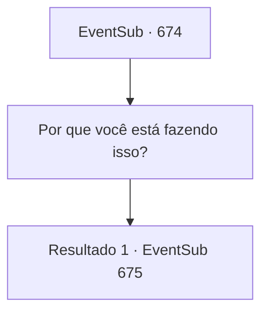

# Eventos secundários · 674

[Índice da tabela](index.md) · [Índice geral](../index.md)

ID: `pt:EventSub:674` · Fonte: `EventSub4` · Versão: 1.2.47.

Mapeamento estático dos arquivos; a disponibilidade e a execução dependem do estado da run.

## Texto do evento

*Sem texto no arquivo.*

## Dados de entrada

```json
{
  "id": 674,
  "grade": 1,
  "subEvent": "",
  "required": ""
}
```

## Mapa das escolhas



## Escolhas e resultados

### Escolha 1

Por que você está fazendo isso?

Requisitos e outros campos da escolha:

```json
{
  "required": ""
}
```

#### Resultado 1.1

Fheren responde com desdém. 

 "Ha. Isso é o que eu queria te perguntar, {1}. Por que você matou Edenheart?"

 Ele te encara, aguardando uma resposta.

Continuação registrada: [Evento 675](0675.md) na mesma tabela.

```json
{
  "required": "",
  "chance": "1",
  "nextEvent": 675,
  "type": 2,
  "reward": ""
}
```

## Referências que chegam a este evento

- [Evento 673 · escolha 2 · resultado 1](0673.md#escolha-2)
