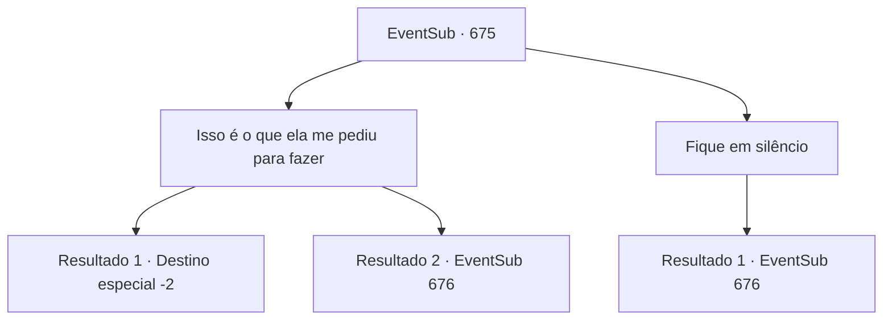

# Eventos secundários · 675

[Índice da tabela](index.md) · [Índice geral](../index.md)

ID: `pt:EventSub:675` · Fonte: `EventSub4` · Versão: 1.2.47.

Mapeamento estático dos arquivos; a disponibilidade e a execução dependem do estado da run.

## Texto do evento

*Sem texto no arquivo.*

## Dados de entrada

```json
{
  "id": 675,
  "grade": 1,
  "subEvent": "",
  "required": ""
}
```

## Mapa das escolhas



## Escolhas e resultados

### Escolha 1

Isso é o que ela me pediu para fazer

Requisitos e outros campos da escolha:

```json
{
  "required": ""
}
```

#### Resultado 1.1

Você lembra sua promessa com Edenheart, citando exatamente o que ela lhe disse. Fheren começa a murmurar para si mesmo, gemendo. 

 "... O Elixir... Ele requer a alma de um humano apaixonado? Então Edenheart sacrificou a própria...? Meu Deus... Mas... por que você fugiu? Por que não me contou imediatamente?!"

 Você diz a ele que Edenheart estritamente lhe disse para não deixar Fheren saber de assuntos relacionados ao Elixir. Tudo o que você fez foi honrar o pedido dela. Fheren, depois de ouvir sua história, morde os lábios. Depois de pensar por muito tempo, ele solta um longo suspiro e continua. 

 "Eu... Eu peço desculpas. Parece que eu entendi errado."

 Fheren ordena aos assassinos que o libertem, salta em seu cavalo e retorna à sua mansão.

Continuação registrada: [Destino especial `-2`](../destinos-especiais.md).

```json
{
  "required": "",
  "chance": "1|0_7_1",
  "nextEvent": -2,
  "type": 0,
  "reward": "12_10_-1|14_10_0"
}
```

#### Resultado 1.2

Você diz a Fheren que foi Edenheart quem quis se sacrificar. Mas, você está muito ansioso para explicar corretamente tudo o que aconteceu. Fheren franze a testa. Ele grita com você. 

 "Então, Edenheart QUIS que você a matasse? Você deve pensar que sou um idiota."

 Ele então ordena que seus assassinos o arrastem até um penhasco próximo.

Continuação registrada: [Evento 676](0676.md) na mesma tabela.

```json
{
  "required": "",
  "chance": "12",
  "nextEvent": 676,
  "type": 1,
  "reward": ""
}
```

### Escolha 2

Fique em silêncio

Requisitos e outros campos da escolha:

```json
{
  "required": ""
}
```

#### Resultado 2.1

Você fica em silêncio. Você vê os olhos de Fheren se acendendo de raiva enquanto ele grita. 

 "Minha empregada já me disse que ela VIU você matando-a! Então você deve ser o assassino! Vendo que você está em silêncio."

 Ele então ordena que seus assassinos o arrastem até um penhasco próximo.

Continuação registrada: [Evento 676](0676.md) na mesma tabela.

```json
{
  "required": "",
  "chance": "1",
  "nextEvent": 676,
  "type": 2,
  "reward": ""
}
```

## Referências que chegam a este evento

- [Evento 674 · escolha 1 · resultado 1](0674.md#escolha-1)
- [Evento 683 · escolha 2 · resultado 1](0683.md#escolha-2)
