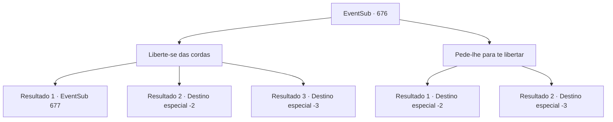

# Eventos secundários · 676

[Índice da tabela](index.md) · [Índice geral](../index.md)

ID: `pt:EventSub:676` · Fonte: `EventSub4` · Versão: 1.2.47.

Mapeamento estático dos arquivos; a disponibilidade e a execução dependem do estado da run.

## Texto do evento

*Sem texto no arquivo.*

## Dados de entrada

```json
{
  "id": 676,
  "grade": 1,
  "subEvent": "",
  "required": ""
}
```

## Mapa das escolhas



## Escolhas e resultados

### Escolha 1

Liberte-se das cordas

Requisitos e outros campos da escolha:

```json
{
  "required": ""
}
```

#### Resultado 1.1

Você se liberta das cordas que te prendem com pura força. Fheren e os assassinos ficam surpresos com a reviravolta inesperada, enquanto você imediatamente avança em direção aos assassinos.

Continuação registrada: [Evento 677](0677.md) na mesma tabela.

```json
{
  "required": "",
  "chance": "1|0_5_1",
  "nextEvent": 677,
  "type": 0,
  "reward": "6_0_48",
  "place": 0
}
```

#### Resultado 1.2

Tentas libertar-te das cordas que te prendem. Mas são demasiado grossas para quebrar. Os assassinos colocam-te à beira do penhasco, aguardando as ordens de Fheren. Sem dizer uma palavra, Fheren faz um gesto com a cabeça. Um sinal para te empurrarem do penhasco. Os assassinos seguem essa ordem, empurrando-te da beira do penhasco. 

 Felizmente, és interrompido a meio da queda por uma árvore que cresce no lado do penhasco. O ramo que te salvou acaba por quebrar, mas é muito melhor do que cair do topo do penhasco. A queda também te liberta das cordas. Consegues levantar-te e fugir dos assassinos.

Continuação registrada: [Destino especial `-2`](../destinos-especiais.md).

```json
{
  "required": "1_0_2",
  "chance": "16",
  "nextEvent": -2,
  "type": 1,
  "reward": "12_10_-1|0_0_-1|14_10_14"
}
```

#### Resultado 1.3

Você tenta se libertar das cordas que te prendem. Mas elas são muito grossas para serem quebradas. Os assassinos te colocam à beira do penhasco, aguardando as ordens de Fheren. Sem dizer uma palavra, Fheren faz um gesto com a cabeça. Um sinal para te empurrar do penhasco. Os assassinos seguem essa ordem, te empurrando da beira do penhasco. Você cai no chão, batendo na superfície dura e rochosa com um estrondo alto.

Continuação registrada: [Destino especial `-3`](../destinos-especiais.md).

```json
{
  "required": "2_0_2",
  "chance": "16",
  "nextEvent": -3,
  "type": 1,
  "reward": "0_0_-1"
}
```

### Escolha 2

Pede-lhe para te libertar

Requisitos e outros campos da escolha:

```json
{
  "required": ""
}
```

#### Resultado 2.1

Você pede a Fheren para te libertar, mas ele nem pisca os olhos. Os assassinos te colocam à beira do penhasco, aguardando as ordens de Fheren. Sem dizer uma palavra, Fheren faz um gesto com a cabeça. Um sinal para te empurrar do penhasco. Os assassinos seguem essa ordem, te empurrando da beira do penhasco. 

 Felizmente, você é interrompido pela metade da queda por uma árvore que cresce no lado do penhasco. O galho que te salvou logo se quebra, mas é muito melhor do que cair do topo do penhasco. A queda também te liberta das cordas. Você consegue se levantar e fugir dos assassinos.

Continuação registrada: [Destino especial `-2`](../destinos-especiais.md).

```json
{
  "required": "1_0_2",
  "chance": "1",
  "nextEvent": -2,
  "type": 2,
  "reward": "12_10_-1|0_0_-1|14_10_14"
}
```

#### Resultado 2.2

Você pede a Fheren para te libertar, mas ele nem pisca os olhos. Os assassinos te colocam à beira do penhasco, aguardando as ordens de Fheren. Sem dizer uma palavra, Fheren faz um gesto com a cabeça. Um sinal para te empurrar do penhasco. Os assassinos seguem essa ordem, te empurrando da beira do penhasco. Você cai no chão, batendo na superfície dura e rochosa com um estrondo alto.

Continuação registrada: [Destino especial `-3`](../destinos-especiais.md).

```json
{
  "required": "2_0_2",
  "chance": "1",
  "nextEvent": -3,
  "type": 2,
  "reward": "0_0_-1"
}
```

## Referências que chegam a este evento

- [Evento 675 · escolha 1 · resultado 2](0675.md#escolha-1)
- [Evento 675 · escolha 2 · resultado 1](0675.md#escolha-2)
