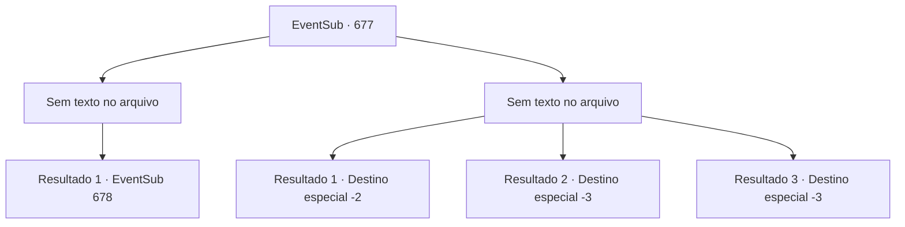

# Eventos secundários · 677

[Índice da tabela](index.md) · [Índice geral](../index.md)

ID: `pt:EventSub:677` · Fonte: `EventSub4` · Versão: 1.2.47.

Mapeamento estático dos arquivos; a disponibilidade e a execução dependem do estado da run.

## Texto do evento

*Sem texto no arquivo.*

## Dados de entrada

```json
{
  "id": 677,
  "grade": 1,
  "subEvent": "",
  "required": ""
}
```

## Mapa das escolhas



## Escolhas e resultados

### Escolha 1

*Sem texto no arquivo; o papel dessa opção depende da interface do jogo.*

Requisitos e outros campos da escolha:

```json
{
  "required": ""
}
```

#### Resultado 1.1

Você lida com os assassinos e se aproxima de Fheren. Ele bloqueia seu caminho, puxando um bastão com formato único. 

 "...Parece que devo ser o único a vingá-la."

 Você sente determinação na expressão de Fheren, mas também pode sentir suas mãos tremendo de medo. Não apenas suas mãos - suas pernas também. Você não tem certeza se ele está tremendo por medo ou porque não faz muito tempo desde que ele se levantou de sua cama doente.

Continuação registrada: [Evento 678](0678.md) na mesma tabela.

```json
{
  "required": "",
  "chance": "1",
  "nextEvent": 678,
  "type": 2,
  "reward": ""
}
```

### Escolha 2

*Sem texto no arquivo; o papel dessa opção depende da interface do jogo.*

Requisitos e outros campos da escolha:

```json
{
  "required": ""
}
```

#### Resultado 2.1

Você é esfaqueado pelas lâminas dos assassinos. Você se sente impotente ao ser empurrado do topo do penhasco. 

 Mas você consegue sobreviver. Felizmente, você é interrompido no meio da queda por uma árvore crescendo no lado do penhasco. O galho que te salvou logo se quebra, mas é muito melhor do que cair do topo do penhasco. A queda também te liberta das cordas. Você consegue se levantar e fugir dos assassinos.

Continuação registrada: [Destino especial `-2`](../destinos-especiais.md).

```json
{
  "required": "",
  "chance": "1",
  "nextEvent": -2,
  "type": 2,
  "reward": "12_10_-1|0_0_-1|0_1_-1|14_10_14"
}
```

#### Resultado 2.2

Você é esfaqueado pelas lâminas dos assassinos. Você se sente impotente enquanto é empurrado do topo do penhasco.

Continuação registrada: [Destino especial `-3`](../destinos-especiais.md).

```json
{
  "required": "",
  "chance": "1",
  "nextEvent": -3,
  "type": 2,
  "reward": "0_0_-1|0_1_-1"
}
```

#### Resultado 2.3

Você é esfaqueado pelas lâminas dos assassinos. Você se sente impotente enquanto é empurrado do topo do penhasco.

Continuação registrada: [Destino especial `-3`](../destinos-especiais.md).

```json
{
  "required": "",
  "chance": "1",
  "nextEvent": -3,
  "type": 2,
  "reward": "0_0_-1|0_1_-1"
}
```

## Referências que chegam a este evento

- [Evento 676 · escolha 1 · resultado 1](0676.md#escolha-1)
