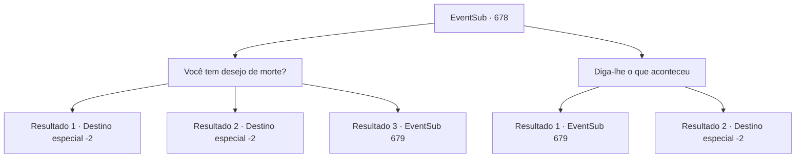

# Eventos secundários · 678

[Índice da tabela](index.md) · [Índice geral](../index.md)

ID: `pt:EventSub:678` · Fonte: `EventSub4` · Versão: 1.2.47.

Mapeamento estático dos arquivos; a disponibilidade e a execução dependem do estado da run.

## Texto do evento

*Sem texto no arquivo.*

## Dados de entrada

```json
{
  "id": 678,
  "grade": 1,
  "subEvent": "",
  "required": ""
}
```

## Mapa das escolhas



## Escolhas e resultados

### Escolha 1

Você tem desejo de morte?

Requisitos e outros campos da escolha:

```json
{
  "required": ""
}
```

#### Resultado 1.1

Você intimida Fheren, exalando uma aura de hostilidade. Ele treme de medo antes de desmoronar. Você passa por Fheren e vai embora.

Continuação registrada: [Destino especial `-2`](../destinos-especiais.md).

```json
{
  "required": "21_1_4",
  "chance": "1|0_12_1",
  "nextEvent": -2,
  "type": 0,
  "reward": "12_10_-1|14_10_3"
}
```

#### Resultado 1.2

Você intimida Fheren, exalando uma aura de hostilidade. Ele treme de medo antes de desmoronar. Você passa por Fheren e vai embora.

Continuação registrada: [Destino especial `-2`](../destinos-especiais.md).

```json
{
  "required": "20_1_4",
  "chance": "1",
  "nextEvent": -2,
  "type": 2,
  "reward": "12_10_-1|14_10_3"
}
```

#### Resultado 1.3

Você intimida Fheren, exalando uma aura de hostilidade. Mas ele responde fortalecendo sua determinação. 

 "Não temo a morte. Mesmo que minha vida termine aqui, eu irei te remover deste mundo."

 Assim que ele termina, seu cajado começa a projetar uma força mágica.

Continuação registrada: [Evento 679](0679.md) na mesma tabela.

```json
{
  "required": "21_1_4",
  "chance": "16",
  "nextEvent": 679,
  "type": 1,
  "reward": "6_0_164",
  "place": 13
}
```

### Escolha 2

Diga-lhe o que aconteceu

Requisitos e outros campos da escolha:

```json
{
  "required": ""
}
```

#### Resultado 2.1

Ele não tem intenção de te ouvir agora. 

 "Mesmo que eu morresse aqui... Eu acabaria com a sua vida."

 Assim que ele termina, seu cajado começa a projetar força mágica.

Continuação registrada: [Evento 679](0679.md) na mesma tabela.

```json
{
  "required": "",
  "chance": "36",
  "nextEvent": 679,
  "type": 1,
  "reward": "6_0_164",
  "place": 13
}
```

#### Resultado 2.2

Não é fácil acalmar Fheren, mas sua língua de prata consegue tornar isso possível. Você explica tudo o que aconteceu - o que você e Edenheart estavam fazendo e o último pedido de Edenheart. Fheren ouve silenciosamente enquanto você continua. Finalmente, Fheren abaixa seu cajado. 

 "...O Elixir... Ele requer a alma de um humano apaixonado? Então Edenheart sacrificou a própria...? Meu Deus... Mas... por que você fugiu? Por que não me contou imediatamente?!"

 Você diz a ele que Edenheart estritamente pediu para você não deixar Fheren saber de assuntos relacionados ao Elixir. Tudo o que você fez foi honrar o pedido dela. Fheren, depois de ouvir sua história, morde os lábios. Depois de pensar por muito tempo, ele solta um longo suspiro e continua. 

 "Eu... Eu peço desculpas. Parece que eu entendi errado."

 Depois de terminar, Fheren retorna à sua mansão.

Continuação registrada: [Destino especial `-2`](../destinos-especiais.md).

```json
{
  "required": "",
  "chance": "1|0_12_1|0_7_1",
  "nextEvent": -2,
  "type": 0,
  "reward": "12_10_-1|14_10_0"
}
```

## Referências que chegam a este evento

- [Evento 677 · escolha 1 · resultado 1](0677.md#escolha-1)
- [Evento 683 · escolha 1 · resultado 1](0683.md#escolha-1)
