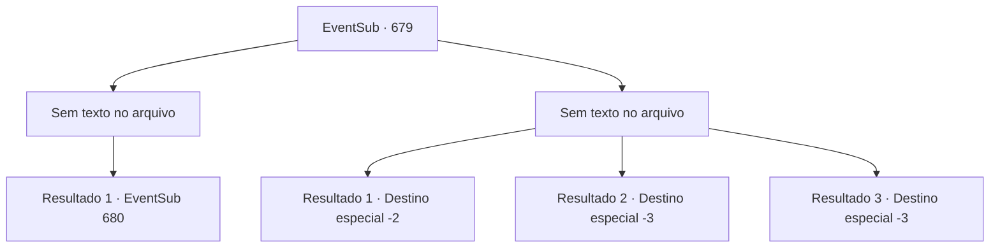

# Eventos secundários · 679

[Índice da tabela](index.md) · [Índice geral](../index.md)

ID: `pt:EventSub:679` · Fonte: `EventSub4` · Versão: 1.2.47.

Mapeamento estático dos arquivos; a disponibilidade e a execução dependem do estado da run.

## Texto do evento

*Sem texto no arquivo.*

## Dados de entrada

```json
{
  "id": 679,
  "grade": 1,
  "subEvent": "",
  "required": ""
}
```

## Mapa das escolhas



## Escolhas e resultados

### Escolha 1

*Sem texto no arquivo; o papel dessa opção depende da interface do jogo.*

Requisitos e outros campos da escolha:

```json
{
  "required": ""
}
```

#### Resultado 1.1


 "Ack.... uck..."

 Fheren não é páreo para você. Seu cajado mal o mantém em pé no chão, mas logo Fheren desmorona no chão como uma estátua quebrada.

Continuação registrada: [Evento 680](0680.md) na mesma tabela.

```json
{
  "required": "",
  "chance": "1",
  "nextEvent": 680,
  "type": 2,
  "reward": "12_10_-1"
}
```

### Escolha 2

*Sem texto no arquivo; o papel dessa opção depende da interface do jogo.*

Requisitos e outros campos da escolha:

```json
{
  "required": ""
}
```

#### Resultado 2.1

O cajado de Fheren projeta uma poderosa onda de choque em sua direção. Impulsionado pela onda de choque, você é jogado para fora do penhasco. 

 Mas você consegue sobreviver. Felizmente, você é parado no meio da queda por uma árvore que cresce no lado do penhasco. O galho que te salvou logo se quebra, mas é muito melhor do que cair do topo do penhasco. A queda também te liberta das cordas. Você consegue se levantar e correr para longe dos assassinos.

Continuação registrada: [Destino especial `-2`](../destinos-especiais.md).

```json
{
  "required": "1_0_2|1_1_2",
  "chance": "1",
  "nextEvent": -2,
  "type": 2,
  "reward": "12_10_-1|0_0_-1|0_1_-1|14_10_14"
}
```

#### Resultado 2.2

O cajado de Fheren projeta uma poderosa onda de choque em sua direção. Impulsionado pela onda de choque, você é jogado para fora do penhasco.

Continuação registrada: [Destino especial `-3`](../destinos-especiais.md).

```json
{
  "required": "2_0_2",
  "chance": "1",
  "nextEvent": -3,
  "type": 2,
  "reward": "0_0_-1|0_1_-1"
}
```

#### Resultado 2.3

O cajado de Fheren projeta uma poderosa onda de choque em sua direção. Impulsionado pela onda de choque, você é jogado para fora do penhasco.

Continuação registrada: [Destino especial `-3`](../destinos-especiais.md).

```json
{
  "required": "2_1_2",
  "chance": "1",
  "nextEvent": -3,
  "type": 2,
  "reward": "0_0_-1|0_1_-1"
}
```

## Referências que chegam a este evento

- [Evento 678 · escolha 1 · resultado 3](0678.md#escolha-1)
- [Evento 678 · escolha 2 · resultado 1](0678.md#escolha-2)
