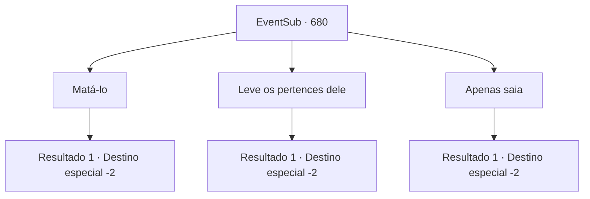

# Eventos secundários · 680

[Índice da tabela](index.md) · [Índice geral](../index.md)

ID: `pt:EventSub:680` · Fonte: `EventSub4` · Versão: 1.2.47.

Mapeamento estático dos arquivos; a disponibilidade e a execução dependem do estado da run.

## Texto do evento

*Sem texto no arquivo.*

## Dados de entrada

```json
{
  "id": 680,
  "grade": 1,
  "subEvent": "",
  "required": ""
}
```

## Mapa das escolhas



## Escolhas e resultados

### Escolha 1

Matá-lo

Requisitos e outros campos da escolha:

```json
{
  "required": "2_3_0"
}
```

#### Resultado 1.1

Você empurra Fheren do penhasco. Ele perde o controle de seu cajado e cai do penhasco gritando. Ele será um jantar adequado para as feras selvagens na floresta. Infelizmente, seus esforços e os de Edenheart não levaram a nada.

Continuação registrada: [Destino especial `-2`](../destinos-especiais.md).

```json
{
  "required": "",
  "chance": "1",
  "nextEvent": -2,
  "type": 2,
  "reward": "0_3_-5|3_298_1|12_10_-1|14_10_12"
}
```

### Escolha 2

Leve os pertences dele

Requisitos e outros campos da escolha:

```json
{
  "required": ""
}
```

#### Resultado 2.1

Recordando tudo o que você fez com Edenheart, você decide deixá-lo viver. Em vez disso, você pega o cajado de Fheren e vai embora.

Continuação registrada: [Destino especial `-2`](../destinos-especiais.md).

```json
{
  "required": "",
  "chance": "1",
  "nextEvent": -2,
  "type": 2,
  "reward": "3_298_1|12_10_-1|14_10_3"
}
```

### Escolha 3

Apenas saia

Requisitos e outros campos da escolha:

```json
{
  "required": ""
}
```

#### Resultado 3.1

Recordando tudo o que você fez com Edenheart, você decide deixá-lo viver. Você simplesmente o deixa lá, inconsciente.

Continuação registrada: [Destino especial `-2`](../destinos-especiais.md).

```json
{
  "required": "",
  "chance": "1",
  "nextEvent": -2,
  "type": 2,
  "reward": "12_10_-1|14_10_3|0_3_5"
}
```

## Referências que chegam a este evento

- [Evento 679 · escolha 1 · resultado 1](0679.md#escolha-1)
