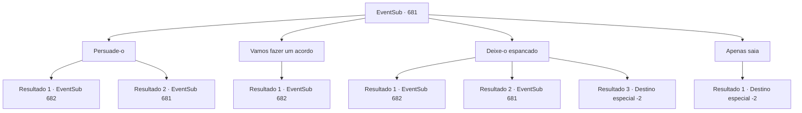

# Eventos secundários · 681

[Índice da tabela](index.md) · [Índice geral](../index.md)

ID: `pt:EventSub:681` · Fonte: `EventSub4` · Versão: 1.2.47.

Mapeamento estático dos arquivos; a disponibilidade e a execução dependem do estado da run.

## Texto do evento

*Sem texto no arquivo.*

## Dados de entrada

```json
{
  "id": 681,
  "grade": 1,
  "subEvent": "",
  "required": ""
}
```

## Mapa das escolhas



## Escolhas e resultados

### Escolha 1

Persuade-o

Requisitos e outros campos da escolha:

```json
{
  "required": "5_610_0"
}
```

#### Resultado 1.1

Você cria empatia com o assassino, enfraquecendo sua vontade. Ele te conta tudo o que sabe. De acordo com ele, Fheren de Mavelaine ordenou sua captura. 

 "Eu... Eu não sei por que, mas ele queria você vivo. Provavelmente ele ainda está esperando por nós, não muito longe daqui. Você pode ir e perguntar a ele mesmo, se estiver interessado."

 Ele até te diz onde Fheren está esperando.

Continuação registrada: [Evento 682](0682.md) na mesma tabela.

```json
{
  "required": "",
  "chance": "1|0_12_1",
  "nextEvent": 682,
  "type": 0,
  "reward": "5_610_1"
}
```

#### Resultado 1.2

Você não consegue persuadir o assassino. Ele não vai te contar nada tão cedo.

Continuação registrada: [Evento 681](0681.md) na mesma tabela.

```json
{
  "required": "",
  "chance": "18",
  "nextEvent": 681,
  "type": 1,
  "reward": "5_610_2"
}
```

### Escolha 2

Vamos fazer um acordo

Requisitos e outros campos da escolha:

```json
{
  "required": "1_4_150"
}
```

#### Resultado 2.1

Você oferece um acordo ao assassino. 

 "Ha..! Você ousa tentar subornar um assassino...?"

 Inicialmente ele zomba, mas ao ver a quantidade de ouro que você está oferecendo, ele muda de atitude. Um brilho dourado floresce diante de seus olhos e logo ele toma uma decisão. 

 "Tudo bem. Vamos fazer um acordo..."

 Segundo ele, Fheren de Mavelaine ordenou sua captura. 

 "Eu... Eu não sei por que, mas ele queria você vivo. Provavelmente ele ainda está nos esperando, não muito longe daqui. Você pode ir e perguntar a ele mesmo, se estiver interessado."

 Ele até mesmo lhe diz onde Fheren está esperando.

Continuação registrada: [Evento 682](0682.md) na mesma tabela.

```json
{
  "required": "",
  "chance": "1",
  "nextEvent": 682,
  "type": 2,
  "reward": "0_4_-150"
}
```

### Escolha 3

Deixe-o espancado

Requisitos e outros campos da escolha:

```json
{
  "required": "5_611_0"
}
```

#### Resultado 3.1

Você o espancou, obrigando-o a lhe contar o que ele sabe. De acordo com ele, Fheren de Mavelaine ordenou sua captura. 

 "Eu... Eu não sei por que, mas ele queria você vivo. Provavelmente ele ainda está esperando por nós, não muito longe daqui. Você pode ir e perguntar a ele mesmo, se estiver interessado."

 Ele até lhe diz onde Fheren está esperando.

Continuação registrada: [Evento 682](0682.md) na mesma tabela.

```json
{
  "required": "21_60_2",
  "chance": "1|0_5_1",
  "nextEvent": 682,
  "type": 0,
  "reward": "5_611_1"
}
```

#### Resultado 3.2

Você tenta vencê-lo para obter informações. Mas sua boca permanece fechada, em silêncio.

Continuação registrada: [Evento 681](0681.md) na mesma tabela.

```json
{
  "required": "21_60_2",
  "chance": "14",
  "nextEvent": 681,
  "type": 1,
  "reward": "5_611_2"
}
```

#### Resultado 3.3

Você tenta vencê-lo até que ele se renda por informações. Mas sua boca permanece fechada, em silêncio. Em uma análise mais detalhada, você percebe que o assassino está morto. Sua força bárbara tirou sua vida. Você deixa o corpo do assassino e vai embora.

Continuação registrada: [Destino especial `-2`](../destinos-especiais.md).

```json
{
  "required": "20_60_2",
  "chance": "1",
  "nextEvent": -2,
  "type": 2,
  "reward": "12_10_-1|14_10_3"
}
```

### Escolha 4

Apenas saia

Requisitos e outros campos da escolha:

```json
{
  "required": ""
}
```

#### Resultado 4.1

Você deixa o assassino e vai embora.

Continuação registrada: [Destino especial `-2`](../destinos-especiais.md).

```json
{
  "required": "",
  "chance": "1",
  "nextEvent": -2,
  "type": 2,
  "reward": "12_10_-1|14_10_3"
}
```

## Referências que chegam a este evento

- [Evento 673 · escolha 1 · resultado 1](0673.md#escolha-1)
- [Evento 681 · escolha 1 · resultado 2](0681.md#escolha-1)
- [Evento 681 · escolha 3 · resultado 2](0681.md#escolha-3)
