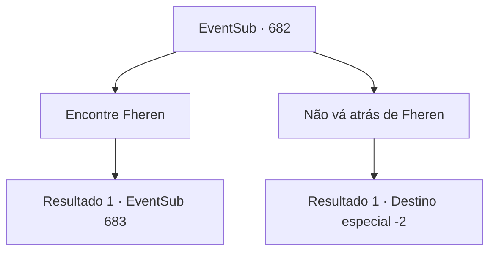

# Eventos secundários · 682

[Índice da tabela](index.md) · [Índice geral](../index.md)

ID: `pt:EventSub:682` · Fonte: `EventSub4` · Versão: 1.2.47.

Mapeamento estático dos arquivos; a disponibilidade e a execução dependem do estado da run.

## Texto do evento

*Sem texto no arquivo.*

## Dados de entrada

```json
{
  "id": 682,
  "grade": 1,
  "subEvent": "",
  "required": ""
}
```

## Mapa das escolhas



## Escolhas e resultados

### Escolha 1

Encontre Fheren

Requisitos e outros campos da escolha:

```json
{
  "required": ""
}
```

#### Resultado 1.1

Você se dirige ao local onde Fheren deveria estar. É um prédio antigo e abandonado, construído no topo de um penhasco íngreme. Julgando pela aparência, ele já teve dias melhores operando como um moinho de vento. Você encontra Fheren e os outros assassinos lá dentro. Assim que Fheren te vê, ele grita ordens para os assassinos, olhos ardendo de fúria. |drawing_Fheren| 

 "Capturem esse monstro. Agora mesmo!"

 Os assassinos avançam em sua direção.

Continuação registrada: [Evento 683](0683.md) na mesma tabela.

```json
{
  "required": "",
  "chance": "1",
  "nextEvent": 683,
  "type": 2,
  "reward": "6_0_48",
  "place": 0
}
```

### Escolha 2

Não vá atrás de Fheren

Requisitos e outros campos da escolha:

```json
{
  "required": ""
}
```

#### Resultado 2.1

Você decide não ir atrás de Fheren.

Continuação registrada: [Destino especial `-2`](../destinos-especiais.md).

```json
{
  "required": "",
  "chance": "1",
  "nextEvent": -2,
  "type": 2,
  "reward": "12_10_-1|14_10_3"
}
```

## Referências que chegam a este evento

- [Evento 681 · escolha 1 · resultado 1](0681.md#escolha-1)
- [Evento 681 · escolha 2 · resultado 1](0681.md#escolha-2)
- [Evento 681 · escolha 3 · resultado 1](0681.md#escolha-3)
