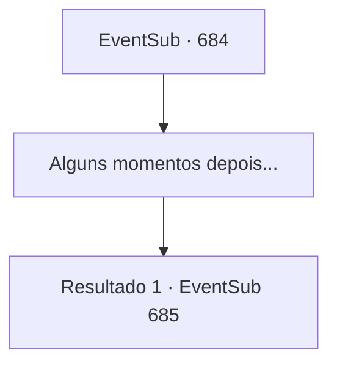

# Eventos secundários · 684

[Índice da tabela](index.md) · [Índice geral](../index.md)

ID: `pt:EventSub:684` · Fonte: `EventSub4` · Versão: 1.2.47.

Mapeamento estático dos arquivos; a disponibilidade e a execução dependem do estado da run.

## Texto do evento

*Sem texto no arquivo.*

## Dados de entrada

```json
{
  "id": 684,
  "grade": 1,
  "subEvent": "",
  "required": ""
}
```

## Mapa das escolhas



## Escolhas e resultados

### Escolha 1

Alguns momentos depois...

Requisitos e outros campos da escolha:

```json
{
  "required": ""
}
```

#### Resultado 1.1

Logo depois, você segue Edenheart até o laboratório dela. O lugar está repleto de diversos pergaminhos e instrumentos alquímicos, todos usados na criação do Elixir. Edenheart apresenta o laboratório a você e também explica o processo de preparação do Elixir. 

 "O passo final para criar o Elixir... é a alma humana."

 Ela explica em detalhes como extrair uma alma, como contê-la em uma solução e como dissolvê-la. Após detalhar o passo final, ela pega uma foice feita de correntes e ossos de uma criatura desconhecida. 

 "Esta foice é uma arma que devora almas."

 Edenheart olha para você com olhos determinados e diz: 

 "{1}, por favor, use isto para acabar com minha vida, completar o elixir e salvar Feren."

 Ela adiciona um aviso: 

 "Antes que minha alma seja completamente consumida e desapareça, você deve destruir esta foice. Você consegue fazer isso?"


Continuação registrada: [Evento 685](0685.md) na mesma tabela.

```json
{
  "required": "",
  "chance": "1",
  "nextEvent": 685,
  "type": 2,
  "reward": ""
}
```

## Referências que chegam a este evento

- [Evento 671 · escolha 1 · resultado 1](0671.md#escolha-1)
