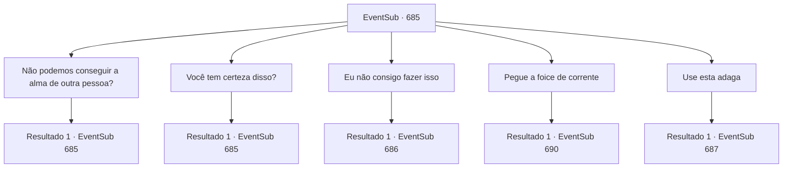

# Eventos secundários · 685

[Índice da tabela](index.md) · [Índice geral](../index.md)

ID: `pt:EventSub:685` · Fonte: `EventSub4` · Versão: 1.2.47.

Mapeamento estático dos arquivos; a disponibilidade e a execução dependem do estado da run.

## Texto do evento

*Sem texto no arquivo.*

## Dados de entrada

```json
{
  "id": 685,
  "grade": 1,
  "subEvent": "",
  "required": ""
}
```

## Mapa das escolhas



## Escolhas e resultados

### Escolha 1

Não podemos conseguir a alma de outra pessoa?

Requisitos e outros campos da escolha:

```json
{
  "required": "5_600_0"
}
```

#### Resultado 1.1

Você pergunta a Edenheart por que sua alma deve ser usada. Ela balança a cabeça e explica. 

 "Não. O Elixir só pode ser completado com um coração amoroso. Qualquer alma aleatória não serviria."

 Ela fica em silêncio por um momento, mas logo continua. 

 "É por isso... que eu devo fazer isso. Eu... amo Fheren. Com certeza."


Continuação registrada: [Evento 685](0685.md) na mesma tabela.

```json
{
  "required": "",
  "chance": "1",
  "nextEvent": 685,
  "type": 2,
  "reward": "5_600_1"
}
```

### Escolha 2

Você tem certeza disso?

Requisitos e outros campos da escolha:

```json
{
  "required": "5_600_1"
}
```

#### Resultado 2.1

Você pergunta a Edenheart se ela está falando sério. 

 "Agora é minha chance de retribuir sua bondade. Eu estaria mentindo se dissesse que não estou com medo. Estou... profundamente com medo, na verdade. De não poder mais vê-lo. Mas... isso não deve ser nada comparado à dor que eu teria que suportar ao vê-lo morrer enquanto eu vivo."

 Após garantir sua determinação, ela coloca a adaga em suas mãos e pergunta mais uma vez. 

 "Eu te imploro, {1}. Você é o único em quem posso confiar para isso. Por toda a ajuda que você me deu até agora... E mais uma coisa? Por favor, não deixe que Fheren saiba disso. Nem um pouco."


Continuação registrada: [Evento 685](0685.md) na mesma tabela.

```json
{
  "required": "",
  "chance": "1",
  "nextEvent": 685,
  "type": 2,
  "reward": "5_600_2"
}
```

### Escolha 3

Eu não consigo fazer isso

Requisitos e outros campos da escolha:

```json
{
  "required": "5_600_2"
}
```

#### Resultado 3.1

Você diz a Edenheart que não pode fazer isso. Mas ela agarra seus pulsos com firmeza, fazendo o mesmo pedido mais uma vez. 

 "Por favor, {1}... Você é o único em quem posso confiar!"


Continuação registrada: [Evento 686](0686.md) na mesma tabela.

```json
{
  "required": "",
  "chance": "1",
  "nextEvent": 686,
  "type": 2,
  "reward": ""
}
```

### Escolha 4

Pegue a foice de corrente

Requisitos e outros campos da escolha:

```json
{
  "required": "5_600_2"
}
```

#### Resultado 4.1

Você pega a foice de corrente em suas mãos. Edenheart sorri enquanto lágrimas escorrem pelo seu rosto. Vocês trocam despedidas finais, e então você usa a foice de corrente para acabar com a vida dela. A foice de corrente absorve avidamente a alma dela.

Continuação registrada: [Evento 690](0690.md) na mesma tabela.

```json
{
  "required": "",
  "chance": "1",
  "nextEvent": 690,
  "type": 2,
  "reward": "0_2_1|3_167_1"
}
```

### Escolha 5

Use esta adaga

Requisitos e outros campos da escolha:

```json
{
  "required": "8_296_1"
}
```

#### Resultado 5.1

Você saca uma adaga de forma retorcida. Ela a reconhece e seus olhos se arregalam em surpresa. 

 "Como... como você conseguiu essa adaga? Não, não importa. Com isso, podemos completar o elixir de forma muito mais segura do que usando esta foice de corrente. Obrigada... Estou em dívida com você até o final."

 Edenheart irrompe em lágrimas, sorrindo. Você se despede pela última vez, completando a etapa final do Elixir. Finalmente, o lendário Elixir é completado - ele emite um calor intenso. Você pega o Elixir engarrafado e coloca o corpo de Edenheart gentilmente em sua cama. Ela parece em paz, como se tivesse caído em um longo sono.

Continuação registrada: [Evento 687](0687.md) na mesma tabela.

```json
{
  "required": "",
  "chance": "1",
  "nextEvent": 687,
  "type": 2,
  "reward": ""
}
```

## Referências que chegam a este evento

- [Evento 684 · escolha 1 · resultado 1](0684.md#escolha-1)
- [Evento 685 · escolha 1 · resultado 1](0685.md#escolha-1)
- [Evento 685 · escolha 2 · resultado 1](0685.md#escolha-2)
