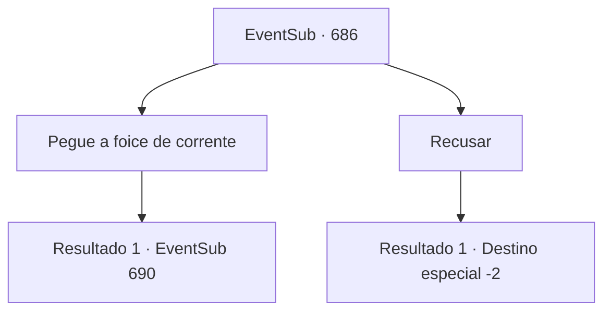

# Eventos secundários · 686

[Índice da tabela](index.md) · [Índice geral](../index.md)

ID: `pt:EventSub:686` · Fonte: `EventSub4` · Versão: 1.2.47.

Mapeamento estático dos arquivos; a disponibilidade e a execução dependem do estado da run.

## Texto do evento

*Sem texto no arquivo.*

## Dados de entrada

```json
{
  "id": 686,
  "grade": 1,
  "subEvent": "",
  "required": ""
}
```

## Mapa das escolhas



## Escolhas e resultados

### Escolha 1

Pegue a foice de corrente

Requisitos e outros campos da escolha:

```json
{
  "required": ""
}
```

#### Resultado 1.1

Você pega a foice de corrente em suas mãos. Edenheart sorri enquanto lágrimas escorrem pelo seu rosto. Vocês trocam despedidas finais, e então você usa a foice de corrente para acabar com a vida dela. A foice de corrente absorve avidamente a alma dela.

Continuação registrada: [Evento 690](0690.md) na mesma tabela.

```json
{
  "required": "",
  "chance": "1",
  "nextEvent": 690,
  "type": 2,
  "reward": "0_2_1|3_167_1"
}
```

### Escolha 2

Recusar

Requisitos e outros campos da escolha:

```json
{
  "required": ""
}
```

#### Resultado 2.1

Você mais uma vez recusa o pedido de Edenheart. Sem palavras, Edenheart olha para você por um momento antes de deixar cair a adaga no chão. 

 "...Entendo. Tudo bem."

 Você fecha a porta do laboratório dela e sai.

Continuação registrada: [Destino especial `-2`](../destinos-especiais.md).

```json
{
  "required": "",
  "chance": "1",
  "nextEvent": -2,
  "type": 2,
  "reward": "12_10_-1|14_10_1"
}
```

## Referências que chegam a este evento

- [Evento 685 · escolha 3 · resultado 1](0685.md#escolha-3)
