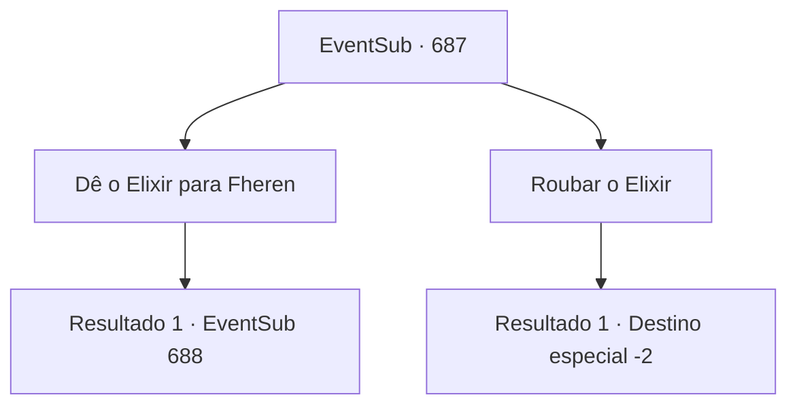

# Eventos secundários · 687

[Índice da tabela](index.md) · [Índice geral](../index.md)

ID: `pt:EventSub:687` · Fonte: `EventSub4` · Versão: 1.2.47.

Mapeamento estático dos arquivos; a disponibilidade e a execução dependem do estado da run.

## Texto do evento

*Sem texto no arquivo.*

## Dados de entrada

```json
{
  "id": 687,
  "grade": 1,
  "subEvent": "",
  "required": ""
}
```

## Mapa das escolhas



## Escolhas e resultados

### Escolha 1

Dê o Elixir para Fheren

Requisitos e outros campos da escolha:

```json
{
  "required": ""
}
```

#### Resultado 1.1

Você segue direto para a Mansão de Fheren. Ele ainda está pálido, descansando imóvel na cama. Ele parece que poderia morrer a qualquer momento. Mas com o Elixir derramado em sua boca, seu corpo logo recupera a vitalidade. 

 "...O que é isso? Sinto-me... quase estranhamente tranquilo. Isso é... simplesmente maravilhoso!"

 Quando o conteúdo da garrafa está vazio, Fheren abre lentamente os olhos. Sua pele emana um calor saudável, e as olheiras também desapareceram. Você diz a Fheren que ele recebeu um Elixir. Ele concorda, e então faz uma pergunta. 

 "Entendo... Parece que tenho que agradecer a você, aventureiro. Mas... como diabos você conseguiu colocar as mãos em um Elixir? Eu pensei que fosse um mito!"


Continuação registrada: [Evento 688](0688.md) na mesma tabela.

```json
{
  "required": "",
  "chance": "1",
  "nextEvent": 688,
  "type": 2,
  "reward": ""
}
```

### Escolha 2

Roubar o Elixir

Requisitos e outros campos da escolha:

```json
{
  "required": ""
}
```

#### Resultado 2.1

Você silenciosamente pega o Elixir para si mesmo e sai do laboratório de Edenheart.

Continuação registrada: [Destino especial `-2`](../destinos-especiais.md).

```json
{
  "required": "",
  "chance": "1",
  "nextEvent": -2,
  "type": 2,
  "reward": "12_10_-1|14_10_10|0_3_-5|3_297_1"
}
```

## Referências que chegam a este evento

- [Evento 685 · escolha 5 · resultado 1](0685.md#escolha-5)
- [Evento 690 · escolha 1 · resultado 1](0690.md#escolha-1)
- [Evento 690 · escolha 2 · resultado 1](0690.md#escolha-2)
- [Evento 691 · escolha 1 · resultado 1](0691.md#escolha-1)
- [Evento 691 · escolha 2 · resultado 1](0691.md#escolha-2)
