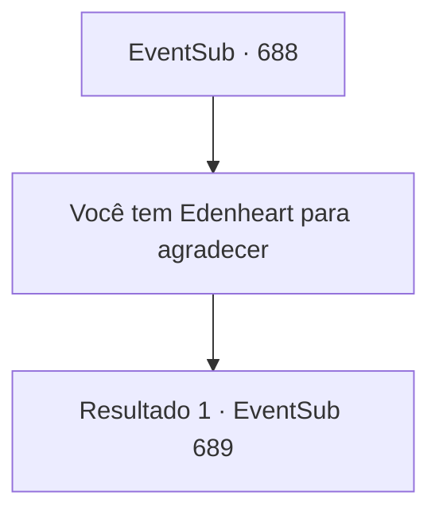

# Eventos secundários · 688

[Índice da tabela](index.md) · [Índice geral](../index.md)

ID: `pt:EventSub:688` · Fonte: `EventSub4` · Versão: 1.2.47.

Mapeamento estático dos arquivos; a disponibilidade e a execução dependem do estado da run.

## Texto do evento

*Sem texto no arquivo.*

## Dados de entrada

```json
{
  "id": 688,
  "grade": 1,
  "subEvent": "",
  "required": ""
}
```

## Mapa das escolhas



## Escolhas e resultados

### Escolha 1

Você tem Edenheart para agradecer

Requisitos e outros campos da escolha:

```json
{
  "required": ""
}
```

#### Resultado 1.1

Você diz a Fheren que tudo isso é graças a Edenheart. Fheren parece satisfeito com a resposta e logo ri. 

 "Phahaha! Eu sabia. De vez em quando, quando eu tinha minha consciência comigo, eu sempre a via, ao meu lado como uma guardiã sagrada. Tenho uma eternidade para agradecê-la, então! E você também! Você ajudou Edenheart a salvar minha vida, presumo?"

 Fheren então ordena a uma das empregadas que traga um pequeno baú. Dentro há um punhado de ouro. 

 "Eu sei, eu sei. Isso não se compara ao que você fez por mim. Por favor, você está livre para ficar aqui como um hóspede. Um hóspede muito bem-vindo e estimado! Ah, eu também devo chamar Edenheart."


Continuação registrada: [Evento 689](0689.md) na mesma tabela.

```json
{
  "required": "",
  "chance": "1",
  "nextEvent": 689,
  "type": 2,
  "reward": "0_4_200"
}
```

## Referências que chegam a este evento

- [Evento 687 · escolha 1 · resultado 1](0687.md#escolha-1)
