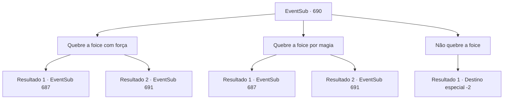

# Eventos secundários · 690

[Índice da tabela](index.md) · [Índice geral](../index.md)

ID: `pt:EventSub:690` · Fonte: `EventSub4` · Versão: 1.2.47.

Mapeamento estático dos arquivos; a disponibilidade e a execução dependem do estado da run.

## Texto do evento

*Sem texto no arquivo.*

## Dados de entrada

```json
{
  "id": 690,
  "grade": 1,
  "subEvent": "",
  "required": ""
}
```

## Mapa das escolhas



## Escolhas e resultados

### Escolha 1

Quebre a foice com força

Requisitos e outros campos da escolha:

```json
{
  "required": ""
}
```

#### Resultado 1.1

Você quebra a foice e prossegue com o processo restante para fazer o elixir. Finalmente, o lendário Elixir é completado - ele emite um calor intenso. Você pega o Elixir engarrafado e coloca delicadamente o corpo de Edenheart em sua cama. Ela parece em paz, como se tivesse caído em um longo sono.

Continuação registrada: [Evento 687](0687.md) na mesma tabela.

```json
{
  "required": "",
  "chance": "1|0_5_1",
  "nextEvent": 687,
  "type": 0,
  "reward": "0_2_1|3_296_1|4_167_1"
}
```

#### Resultado 1.2

Você tenta quebrar a foice de corrente, mas ela é muito mais forte do que você pensava e não se quebra. Você recupera o fôlego e se posiciona novamente diante da foice de corrente. Ela emite uma aura ameaçadora e faz um som zumbindo.

Continuação registrada: [Evento 691](0691.md) na mesma tabela.

```json
{
  "required": "",
  "chance": "10",
  "nextEvent": 691,
  "type": 1,
  "reward": ""
}
```

### Escolha 2

Quebre a foice por magia

Requisitos e outros campos da escolha:

```json
{
  "required": "20_0_2"
}
```

#### Resultado 2.1

Você quebra a foice e prossegue com o processo restante para fazer o elixir. Finalmente, o lendário Elixir é completado - ele emite um calor intenso. Você pega o Elixir engarrafado e coloca delicadamente o corpo de Edenheart em sua cama. Ela parece em paz, como se tivesse caído em um longo sono.

Continuação registrada: [Evento 687](0687.md) na mesma tabela.

```json
{
  "required": "",
  "chance": "1|0_7_1|0_12_1",
  "nextEvent": 687,
  "type": 0,
  "reward": "0_2_1|3_296_1|4_167_1"
}
```

#### Resultado 2.2

Você tenta quebrar a foice de corrente, mas ela é muito mais forte do que você pensava e não se quebra. Você recupera o fôlego e se posiciona novamente diante da foice de corrente. Ela emite uma aura ameaçadora e faz um som zumbindo.

Continuação registrada: [Evento 691](0691.md) na mesma tabela.

```json
{
  "required": "",
  "chance": "20",
  "nextEvent": 691,
  "type": 1,
  "reward": ""
}
```

### Escolha 3

Não quebre a foice

Requisitos e outros campos da escolha:

```json
{
  "required": ""
}
```

#### Resultado 3.1

Você pega a foice com corrente que devorou a alma de Edenheart e sai do laboratório dela.

Continuação registrada: [Destino especial `-2`](../destinos-especiais.md).

```json
{
  "required": "",
  "chance": "1",
  "nextEvent": -2,
  "type": 2,
  "reward": "12_10_-1|14_10_10|14_10_8|0_3_-5|0_2_1"
}
```

## Referências que chegam a este evento

- [Evento 685 · escolha 4 · resultado 1](0685.md#escolha-4)
- [Evento 686 · escolha 1 · resultado 1](0686.md#escolha-1)
