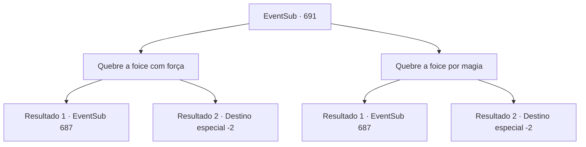

# Eventos secundários · 691

[Índice da tabela](index.md) · [Índice geral](../index.md)

ID: `pt:EventSub:691` · Fonte: `EventSub4` · Versão: 1.2.47.

Mapeamento estático dos arquivos; a disponibilidade e a execução dependem do estado da run.

## Texto do evento

*Sem texto no arquivo.*

## Dados de entrada

```json
{
  "id": 691,
  "grade": 1,
  "subEvent": "",
  "required": ""
}
```

## Mapa das escolhas



## Escolhas e resultados

### Escolha 1

Quebre a foice com força

Requisitos e outros campos da escolha:

```json
{
  "required": ""
}
```

#### Resultado 1.1

Você quebra a foice e prossegue com o processo restante para fazer o elixir. Finalmente, o lendário Elixir é completado - ele emite um calor intenso. Você pega o Elixir engarrafado e coloca delicadamente o corpo de Edenheart em sua cama. Ela parece em paz, como se tivesse caído em um longo sono.

Continuação registrada: [Evento 687](0687.md) na mesma tabela.

```json
{
  "required": "",
  "chance": "1|0_5_1",
  "nextEvent": 687,
  "type": 0,
  "reward": "0_2_1|3_296_1|4_167_1"
}
```

#### Resultado 1.2

Você falha novamente. Enquanto isso, o zumbido da foice de corrente diminui. Um silêncio pesado e ameaçador desce sobre o laboratório. Esse silêncio parece sinalizar seu fracasso na criação do elixir. Você presta suas homenagens a Edenheart e é forçado a deixar o laboratório.

Continuação registrada: [Destino especial `-2`](../destinos-especiais.md).

```json
{
  "required": "",
  "chance": "6",
  "nextEvent": -2,
  "type": 1,
  "reward": "12_10_-1|14_10_10|14_10_8|0_2_1"
}
```

### Escolha 2

Quebre a foice por magia

Requisitos e outros campos da escolha:

```json
{
  "required": "20_0_2"
}
```

#### Resultado 2.1

Você quebra a foice e prossegue com o processo restante para fazer o elixir. Finalmente, o lendário Elixir é completado - ele emite um calor intenso. Você pega o Elixir engarrafado e coloca delicadamente o corpo de Edenheart em sua cama. Ela parece em paz, como se tivesse caído em um longo sono.

Continuação registrada: [Evento 687](0687.md) na mesma tabela.

```json
{
  "required": "",
  "chance": "1|0_7_1|0_12_1",
  "nextEvent": 687,
  "type": 0,
  "reward": "0_2_1|3_296_1|4_167_1"
}
```

#### Resultado 2.2

Você falha novamente. Enquanto isso, o zumbido da foice de corrente diminui. Um silêncio pesado e ameaçador desce sobre o laboratório. Esse silêncio parece sinalizar seu fracasso na criação do elixir. Você presta suas homenagens a Edenheart e é forçado a deixar o laboratório.

Continuação registrada: [Destino especial `-2`](../destinos-especiais.md).

```json
{
  "required": "",
  "chance": "12",
  "nextEvent": -2,
  "type": 1,
  "reward": "12_10_-1|14_10_10|14_10_8|0_2_1"
}
```

## Referências que chegam a este evento

- [Evento 690 · escolha 1 · resultado 2](0690.md#escolha-1)
- [Evento 690 · escolha 2 · resultado 2](0690.md#escolha-2)
