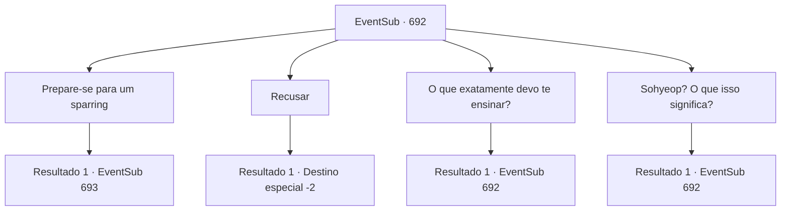

# Eventos secundários · 692

[Índice da tabela](index.md) · [Índice geral](../index.md)

ID: `pt:EventSub:692` · Fonte: `EventSub4` · Versão: 1.2.47.

Mapeamento estático dos arquivos; a disponibilidade e a execução dependem do estado da run.

## Texto do evento

Você está descansando relaxadamente, observando o rio fluir, quando de repente um estranho se aproxima de você cuidadosamente. |drawing_Lei| O estranho está vestido com trajes orientais exóticos, não comumente vistos pela região. Ele tem cabelos e olhos pretos, juntamente com uma constituição compacta e um rosto bonito para um homem. Ele limpa a garganta e junta as mãos em um gesto de saudação. Uma maneira de cumprimentar alguém respeitosamente, tradicionalmente usada no Oriente. 

 "Meu nome é 'Lei'. Se não for muito incômodo, Sohyeop, meu humilde eu posso aprender com você?"


## Dados de entrada

```json
{
  "id": 692,
  "grade": 1,
  "subEvent": "",
  "required": "12_11_0|1_2_30"
}
```

## Mapa das escolhas



## Escolhas e resultados

### Escolha 1

Prepare-se para um sparring

Requisitos e outros campos da escolha:

```json
{
  "required": ""
}
```

#### Resultado 1.1

Você instantaneamente reconhece o que ele está pedindo, então se prepara para um combate. Lei agradece em resposta, então puxa sua espada. 

 "Muito obrigado. Agora... vamos começar!"

 Sua espada voa em sua direção, na velocidade de uma andorinha voando.

Continuação registrada: [Evento 693](0693.md) na mesma tabela.

```json
{
  "required": "",
  "chance": "1",
  "nextEvent": 693,
  "type": 2,
  "reward": "6_0_177",
  "place": 0
}
```

### Escolha 2

Recusar

Requisitos e outros campos da escolha:

```json
{
  "required": ""
}
```

#### Resultado 2.1

Você educadamente recusa o pedido dele. Retornando sua gentileza, o estranho faz novamente a saudação oriental e se afasta.

Continuação registrada: [Destino especial `-2`](../destinos-especiais.md).

```json
{
  "required": "",
  "chance": "1",
  "nextEvent": -2,
  "type": 2,
  "reward": "12_11_-1"
}
```

### Escolha 3

O que exatamente devo te ensinar?

Requisitos e outros campos da escolha:

```json
{
  "required": "5_742_0"
}
```

#### Resultado 3.1

Lei tem uma mudança repentina de expressão, como se percebesse que cometeu um erro. 

 "Oh... Na verdade, eu estava pedindo para treinar com você. De onde eu venho, quando alguém 'pede uma lição', queremos realmente dizer uma troca das artes marciais um do outro."


Continuação registrada: [Evento 692](0692.md) na mesma tabela.

```json
{
  "required": "",
  "chance": "1",
  "nextEvent": 692,
  "type": 2,
  "reward": "5_742_1"
}
```

### Escolha 4

Sohyeop? O que isso significa?

Requisitos e outros campos da escolha:

```json
{
  "required": "5_765_0"
}
```

#### Resultado 4.1

Lei responde à sua pergunta, coçando a cabeça. 

 "Oh... É uma forma respeitosa de se dirigir aos outros, usada de onde eu venho. Se eu fosse traduzir... hmm... significa 'jovem e justo herói'."


Continuação registrada: [Evento 692](0692.md) na mesma tabela.

```json
{
  "required": "",
  "chance": "1",
  "nextEvent": 692,
  "type": 2,
  "reward": "5_765_1"
}
```

## Referências que chegam a este evento

- [Evento 692 · escolha 3 · resultado 1](0692.md#escolha-3)
- [Evento 692 · escolha 4 · resultado 1](0692.md#escolha-4)
