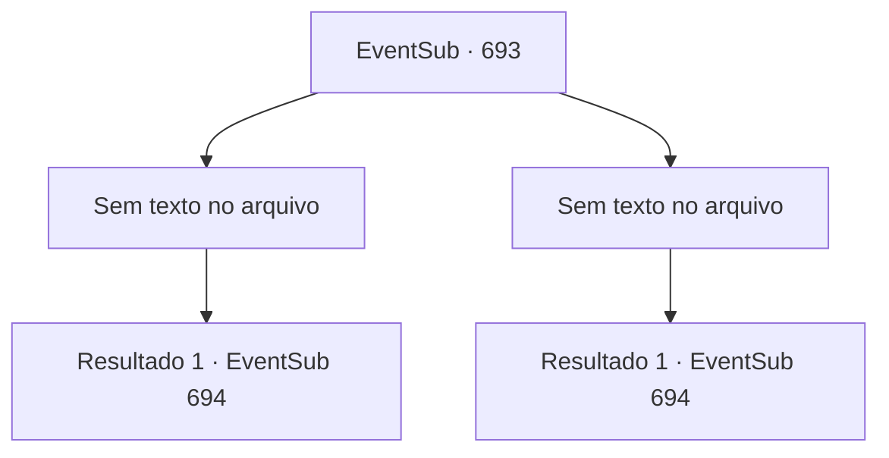

# Eventos secundários · 693

[Índice da tabela](index.md) · [Índice geral](../index.md)

ID: `pt:EventSub:693` · Fonte: `EventSub4` · Versão: 1.2.47.

Mapeamento estático dos arquivos; a disponibilidade e a execução dependem do estado da run.

## Texto do evento

*Sem texto no arquivo.*

## Dados de entrada

```json
{
  "id": 693,
  "grade": 1,
  "subEvent": "",
  "required": ""
}
```

## Mapa das escolhas



## Escolhas e resultados

### Escolha 1

*Sem texto no arquivo; o papel dessa opção depende da interface do jogo.*

Requisitos e outros campos da escolha:

```json
{
  "required": ""
}
```

#### Resultado 1.1

O manejo da lâmina de Lei era ótimo, mas não era páreo para sua destreza. 

 "*ofegante*... *ofegante*... Eu... Eu perdi. Obrigado pela lição."

 Após admitir a derrota, ele faz novamente a saudação oriental e agradece você.

Continuação registrada: [Evento 694](0694.md) na mesma tabela.

```json
{
  "required": "",
  "chance": "1",
  "nextEvent": 694,
  "type": 2,
  "reward": ""
}
```

### Escolha 2

*Sem texto no arquivo; o papel dessa opção depende da interface do jogo.*

Requisitos e outros campos da escolha:

```json
{
  "required": ""
}
```

#### Resultado 2.1

O trabalho impecável de espada de Lei eventualmente te coloca de joelhos. 

 "*ofegante*... *ofegante*... Muito obrigado. Aprendi muito com isso."

 Ele faz a saudação oriental juntando os punhos novamente e te agradece. Você pode perceber que ele também está cansado do treino, mas sua postura é perfeita.

Continuação registrada: [Evento 694](0694.md) na mesma tabela.

```json
{
  "required": "",
  "chance": "1",
  "nextEvent": 694,
  "type": 2,
  "reward": ""
}
```

## Referências que chegam a este evento

- [Evento 692 · escolha 1 · resultado 1](0692.md#escolha-1)
