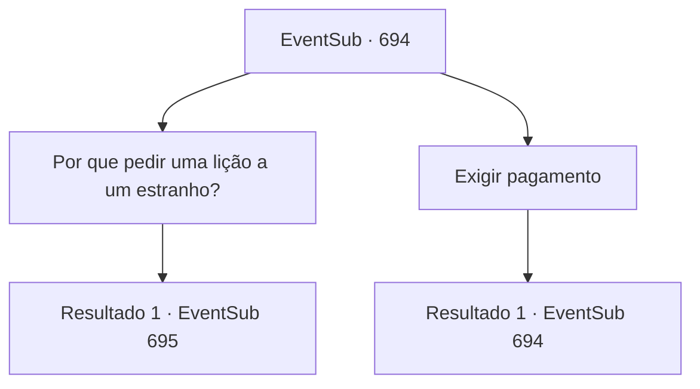

# Eventos secundários · 694

[Índice da tabela](index.md) · [Índice geral](../index.md)

ID: `pt:EventSub:694` · Fonte: `EventSub4` · Versão: 1.2.47.

Mapeamento estático dos arquivos; a disponibilidade e a execução dependem do estado da run.

## Texto do evento

*Sem texto no arquivo.*

## Dados de entrada

```json
{
  "id": 694,
  "grade": 1,
  "subEvent": "",
  "required": ""
}
```

## Mapa das escolhas



## Escolhas e resultados

### Escolha 1

Por que pedir uma lição a um estranho?

Requisitos e outros campos da escolha:

```json
{
  "required": ""
}
```

#### Resultado 1.1

Você pergunta a ele por que ele pediu uma lição. Lei responde, limpando o suor da testa com as mãos. 

 "Eu estava me testando contra os aventureiros dessas partes, antes de competir no Torneio de Lutadores de Battra."

 Ele pede desculpas por ter interrompido seu descanso e continua. 

 "Há um ensinamento que passa pelo meu clã. 'A grandeza começa com a tolerância. Por favor, me conceda tolerância, se de alguma forma fui desrespeitoso."


Continuação registrada: [Evento 695](0695.md) na mesma tabela.

```json
{
  "required": "",
  "chance": "1",
  "nextEvent": 695,
  "type": 2,
  "reward": ""
}
```

### Escolha 2

Exigir pagamento

Requisitos e outros campos da escolha:

```json
{
  "required": "5_706_0"
}
```

#### Resultado 2.1

Você pede a ele o pagamento pelo treino. Lei te encara com um olhar vazio por alguns segundos, então apressadamente procura em seus bolsos. Ele tira um punhado de ouro e te entrega. 

 "M- minhas desculpas! Não estou acostumado com a cultura daqui."


Continuação registrada: [Evento 694](0694.md) na mesma tabela.

```json
{
  "required": "",
  "chance": "1",
  "nextEvent": 694,
  "type": 2,
  "reward": "0_4_20|5_706_10"
}
```

## Referências que chegam a este evento

- [Evento 693 · escolha 1 · resultado 1](0693.md#escolha-1)
- [Evento 693 · escolha 2 · resultado 1](0693.md#escolha-2)
- [Evento 694 · escolha 2 · resultado 1](0694.md#escolha-2)
