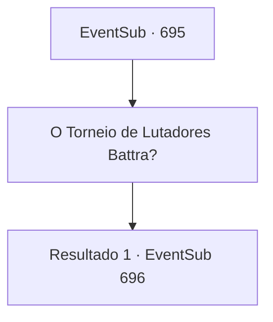

# Eventos secundários · 695

[Índice da tabela](index.md) · [Índice geral](../index.md)

ID: `pt:EventSub:695` · Fonte: `EventSub4` · Versão: 1.2.47.

Mapeamento estático dos arquivos; a disponibilidade e a execução dependem do estado da run.

## Texto do evento

*Sem texto no arquivo.*

## Dados de entrada

```json
{
  "id": 695,
  "grade": 1,
  "subEvent": "",
  "required": ""
}
```

## Mapa das escolhas



## Escolhas e resultados

### Escolha 1

O Torneio de Lutadores Battra?

Requisitos e outros campos da escolha:

```json
{
  "required": ""
}
```

#### Resultado 1.1

Os olhos de Lei se arregalam ao ouvir sua pergunta. Aparentemente, ele está surpreso ao saber que você não conhece o que é o Torneio de Lutadores de Battra. Ele começa a explicar animadamente. 

 "O Torneio de Lutadores de Battra é uma competição tradicional que acontece no Grande Deserto. Lá, os participantes honram Batt, o Deus da Guerra, e celebram o surgimento de heróis poderosos. O vencedor do torneio ganha o título honroso de 'Mestre de Batalha', junto com o prêmio em dinheiro."

 Você acena continuamente, ouvindo atentamente. O local exato da competição é uma cidade chamada 'Gladio', localizada dentro do Grande Deserto que separa o Leste do Oeste. 

 "É chamado de Torneio de Lutadores, mas aparentemente eles também permitem a entrada de feiticeiros."


Continuação registrada: [Evento 696](0696.md) na mesma tabela.

```json
{
  "required": "",
  "chance": "1",
  "nextEvent": 696,
  "type": 2,
  "reward": ""
}
```

## Referências que chegam a este evento

- [Evento 694 · escolha 1 · resultado 1](0694.md#escolha-1)
