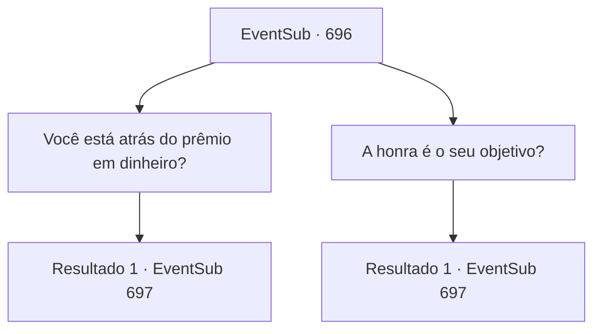

# Eventos secundários · 696

[Índice da tabela](index.md) · [Índice geral](../index.md)

ID: `pt:EventSub:696` · Fonte: `EventSub4` · Versão: 1.2.47.

Mapeamento estático dos arquivos; a disponibilidade e a execução dependem do estado da run.

## Texto do evento

*Sem texto no arquivo.*

## Dados de entrada

```json
{
  "id": 696,
  "grade": 1,
  "subEvent": "",
  "required": ""
}
```

## Mapa das escolhas



## Escolhas e resultados

### Escolha 1

Você está atrás do prêmio em dinheiro?

Requisitos e outros campos da escolha:

```json
{
  "required": ""
}
```

#### Resultado 1.1

Você pergunta a Lei se ele está atrás do prêmio em dinheiro. Ele balança a cabeça e diz que está nisso pela honra de seu clã. 

 "O Clã Ryu - de onde eu venho - costumava ser um clã famoso de lutadores, uma vez chamado de um dos Quatro Clãs. Mas hoje em dia, nosso clã está sem poder, nossa reputação arruinada e empoeirada. Outros clãs já nos superaram há muito tempo. As pessoas que costumavam trabalhar conosco nos deixaram também, em busca de melhores oportunidades, provavelmente com outros clãs. Grandes lutadores, comerciantes habilidosos... todos...!"

 Lei para de falar, fica em silêncio por um tempo, depois desvia o olhar para o leste, onde fica sua cidade natal. 

 "No entanto...! Assim que eu vencer o torneio e me tornar um Mestre de Batalha, as pessoas voltarão a trabalhar com meu clã mais uma vez. Afinal, a habilidade é o que importa acima de tudo no Oriente. Eu deveria ser capaz de colocar meu clã de volta nos trilhos com isso."

 Lei não esconde suas ambições, olhando de volta para você.

Continuação registrada: [Evento 697](0697.md) na mesma tabela.

```json
{
  "required": "",
  "chance": "1",
  "nextEvent": 697,
  "type": 2,
  "reward": ""
}
```

### Escolha 2

A honra é o seu objetivo?

Requisitos e outros campos da escolha:

```json
{
  "required": ""
}
```

#### Resultado 2.1

Você pergunta a Lei se ele está atrás da honra. Ele acena com a cabeça em resposta e diz que está nisso pela honra de seu clã. 

 "O Clã Ryu - de onde eu venho - costumava ser um clã famoso de lutadores, uma vez chamado de um dos Quatro Clãs. Mas hoje em dia, nosso clã está sem poder, nossa reputação arruinada e empoeirada. Outros clãs já nos superaram há muito tempo. As pessoas que costumavam trabalhar conosco nos deixaram também, em busca de melhores oportunidades, provavelmente com outros clãs. Grandes lutadores, comerciantes habilidosos... todos..."

 Lei para de falar, fica em silêncio por um tempo, depois desvia o olhar para o leste, onde fica sua cidade natal. 

 "No entanto...! Assim que eu vencer o torneio e me tornar um Mestre de Batalha, as pessoas voltarão a trabalhar com meu clã novamente. Afinal, a destreza é o que importa acima de tudo no Oriente. Eu deveria ser capaz de colocar meu clã de volta nos trilhos com isso."

 Lei não esconde suas ambições, olhando de volta para você.

Continuação registrada: [Evento 697](0697.md) na mesma tabela.

```json
{
  "required": "",
  "chance": "1",
  "nextEvent": 697,
  "type": 2,
  "reward": ""
}
```

## Referências que chegam a este evento

- [Evento 695 · escolha 1 · resultado 1](0695.md#escolha-1)
