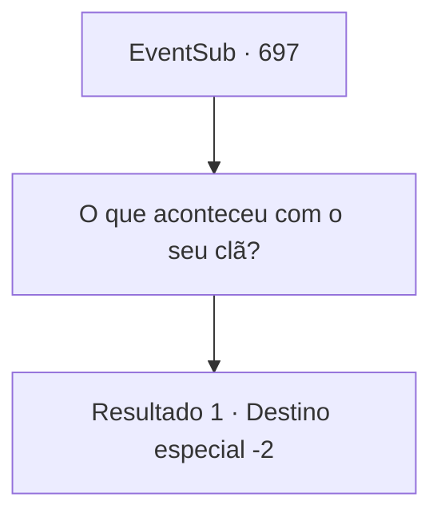

# Eventos secundários · 697

[Índice da tabela](index.md) · [Índice geral](../index.md)

ID: `pt:EventSub:697` · Fonte: `EventSub4` · Versão: 1.2.47.

Mapeamento estático dos arquivos; a disponibilidade e a execução dependem do estado da run.

## Texto do evento

*Sem texto no arquivo.*

## Dados de entrada

```json
{
  "id": 697,
  "grade": 1,
  "subEvent": "",
  "required": ""
}
```

## Mapa das escolhas



## Escolhas e resultados

### Escolha 1

O que aconteceu com o seu clã?

Requisitos e outros campos da escolha:

```json
{
  "required": ""
}
```

#### Resultado 1.1


 "Ah, bem... A Grande Guerra do Oriente aconteceu."

 A expressão de Lei fica sombria enquanto ele responde. Esta 'Grande Guerra', travada por muitas seitas e escolas de artes marciais em busca de honra e interesses, chegou ao fim apenas alguns anos atrás. 

 "O Clã Ryu perdeu a maioria de seus membros durante a guerra. O que é pior, é que meu pa- quero dizer, nosso Chefe do Clã, ficou acamado devido a uma doença..."

 Lei faz um sorriso constrangido e muda de assunto. 

 "Bem... Temo que o tema da nossa conversa tenha se tornado bastante sombrio. Agradeço novamente por concordar em treinar comigo. Vou me retirar, então."

 Lei se despede e sai.

Continuação registrada: [Destino especial `-2`](../destinos-especiais.md).

```json
{
  "required": "",
  "chance": "1",
  "nextEvent": -2,
  "type": 2,
  "reward": "12_11_1"
}
```

## Referências que chegam a este evento

- [Evento 696 · escolha 1 · resultado 1](0696.md#escolha-1)
- [Evento 696 · escolha 2 · resultado 1](0696.md#escolha-2)
