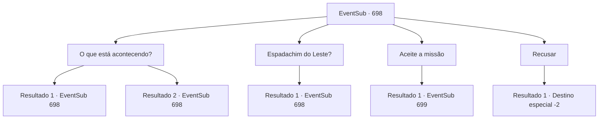

# Eventos secundários · 698

[Índice da tabela](index.md) · [Índice geral](../index.md)

ID: `pt:EventSub:698` · Fonte: `EventSub4` · Versão: 1.2.47.

Mapeamento estático dos arquivos; a disponibilidade e a execução dependem do estado da run.

## Texto do evento

A estrada para o Grande Deserto abriga muitas cidades. 'Heta', onde você acabou de chegar, é um desses lugares. Você atravessa os portões da cerca e caminha até a praça da cidade. Você sente a atmosfera incomumente tensa da cidade. O que você normalmente veria em cidades como esta não está em lugar nenhum. Crianças correndo por aí brincando, moças fofoqueiras ou até bêbados... Em lugar nenhum. As poucas pessoas que você consegue encontrar andam apressadamente, muitas vezes olhando para o céu preocupadas.

## Dados de entrada

```json
{
  "id": 698,
  "grade": 1,
  "subEvent": "",
  "required": "12_11_1"
}
```

## Mapa das escolhas



## Escolhas e resultados

### Escolha 1

O que está acontecendo?

Requisitos e outros campos da escolha:

```json
{
  "required": "5_707_0"
}
```

#### Resultado 1.1

Você pergunta por aí, sobre a tensão que parece ter engolido a cidade inteira. A maioria dos moradores simplesmente evita falar com você, um estrangeiro. O único que responde é um velho, que se identificou como o prefeito da cidade. 

 "Há alguns dias, um 'Roc' apareceu perto da cidade. Esse enorme monstro continua atacando nossas cabras e ovelhas... e não há nada que possamos fazer para detê-lo."

 Você evoca a imagem de um Roc com facilidade. Uma ave carnívora ostentando um tamanho enorme - um Roc adulto é considerado tão perigoso quanto um jovem dragão. O prefeito solta um longo suspiro, então continua. 

 "*suspiro*... Fizemos tudo ao nosso alcance para nos livrarmos dele, veja bem. Um grupo de jovens da nossa cidade tentou. Até pedimos ajuda a aventureiros como você. Até mesmo aquele estranho espadachim do Oriente. Tudo em vão. Nenhum deles voltou, receio."


Continuação registrada: [Evento 698](0698.md) na mesma tabela.

```json
{
  "required": "",
  "chance": "1|0_7_1",
  "nextEvent": 698,
  "type": 0,
  "reward": "5_707_1"
}
```

#### Resultado 1.2

Você pergunta por aí, sobre a tensão que parece ter engolido a cidade inteira. A maioria dos moradores simplesmente evita falar com você, um estrangeiro. O único que responde é um velho, que se identificou como o prefeito da cidade. 

 "Alguns dias atrás, um 'Roc' apareceu perto da cidade. Esse enorme monstro continua atacando nossas cabras e ovelhas... e não há nada que possamos fazer para detê-lo."

 O prefeito solta um longo suspiro, então continua. 

 "*suspiro*... Fizemos tudo ao nosso alcance para nos livrar dele, veja bem. Um grupo de jovens da nossa cidade tentou. Até pedimos ajuda a aventureiros como você. Até mesmo aquele estranho espadachim do Oriente. Tudo em vão. Nenhum deles voltou, receio."


Continuação registrada: [Evento 698](0698.md) na mesma tabela.

```json
{
  "required": "",
  "chance": "10",
  "nextEvent": 698,
  "type": 1,
  "reward": "5_707_1"
}
```

### Escolha 2

Espadachim do Leste?

Requisitos e outros campos da escolha:

```json
{
  "required": "5_707_1"
}
```

#### Resultado 2.1

O prefeito faz o melhor que pode para relembrar suas memórias, dando-lhe uma breve descrição do espadachim. Cabelos pretos, olhos pretos, aparência suave e corpo compacto. A aparência que combina perfeitamente com a de Lei, aquele com quem você se deparou da última vez. O velho lê sua expressão e continua. 

 "Hmm... Pelo que posso ver, você parece conhecer este homem também. Poderia, por favor, se livrar deste Roc em vez disso? Parece que o espadachim também está morto..."


Continuação registrada: [Evento 698](0698.md) na mesma tabela.

```json
{
  "required": "",
  "chance": "1",
  "nextEvent": 698,
  "type": 2,
  "reward": "5_707_2"
}
```

### Escolha 3

Aceite a missão

Requisitos e outros campos da escolha:

```json
{
  "required": "5_707_2"
}
```

#### Resultado 3.1

Obrigado, aventureiro! Que a sorte esteja a seu favor."

 Ele também te informa que o ninho do Roc está localizado em uma cidadela abandonada, não muito longe da cidade. Você vai para lá imediatamente. 

 Poucos momentos depois, você avista uma cidadela em ruínas e para para explorar a área. O lugar é mais escombros do que cidadela. As paredes já estão desmoronando, e os edifícios dentro estão destruídos além do uso. Marcas de sangue e cadáveres não identificáveis decoram o chão. Mas não importa quanto tempo você espere, o roc não dá sinal de aparecer. Você olha para o céu por alguns momentos, então lentamente faz seu caminho para dentro da cidadela.

 "

Continuação registrada: [Evento 699](0699.md) na mesma tabela.

```json
{
  "required": "",
  "chance": "1",
  "nextEvent": 699,
  "type": 2,
  "reward": ""
}
```

### Escolha 4

Recusar

Requisitos e outros campos da escolha:

```json
{
  "required": "5_707_2"
}
```

#### Resultado 4.1

Você se recusa a atender o pedido do prefeito e deixar a cidade.

Continuação registrada: [Destino especial `-2`](../destinos-especiais.md).

```json
{
  "required": "",
  "chance": "1",
  "nextEvent": -2,
  "type": 2,
  "reward": "12_11_-1"
}
```

## Referências que chegam a este evento

- [Evento 698 · escolha 1 · resultado 1](0698.md#escolha-1)
- [Evento 698 · escolha 1 · resultado 2](0698.md#escolha-1)
- [Evento 698 · escolha 2 · resultado 1](0698.md#escolha-2)
