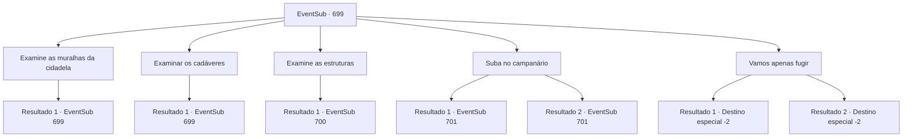

# Eventos secundários · 699

[Índice da tabela](index.md) · [Índice geral](../index.md)

ID: `pt:EventSub:699` · Fonte: `EventSub4` · Versão: 1.2.47.

Mapeamento estático dos arquivos; a disponibilidade e a execução dependem do estado da run.

## Texto do evento

*Sem texto no arquivo.*

## Dados de entrada

```json
{
  "id": 699,
  "grade": 1,
  "subEvent": "",
  "required": ""
}
```

## Mapa das escolhas



## Escolhas e resultados

### Escolha 1

Examine as muralhas da cidadela

Requisitos e outros campos da escolha:

```json
{
  "required": "5_708_0"
}
```

#### Resultado 1.1

Você anda ao redor da cidadela, abraçando as paredes, examinando-as cuidadosamente. As paredes de pedra já perderam a maior parte de sua funcionalidade, quebradas além do reparo. Enquanto você anda, encontra algo nos caminhos próximos. Um caminho de pegadas de apenas alguns dias leva para dentro da cidadela. Lá você também encontra uma espada quebrada, que você pega e examina também. É exatamente a mesma arma que Lei estava usando quando ele te encontrou pela primeira vez.

Continuação registrada: [Evento 699](0699.md) na mesma tabela.

```json
{
  "required": "",
  "chance": "1",
  "nextEvent": 699,
  "type": 2,
  "reward": "5_708_1"
}
```

### Escolha 2

Examinar os cadáveres

Requisitos e outros campos da escolha:

```json
{
  "required": "5_709_0"
}
```

#### Resultado 2.1

Você examina os corpos no chão. Eles estão em condições variadas - alguns estão relativamente frescos, mortos provavelmente há apenas alguns dias, e alguns já estão completamente desprovidos de carne. A única característica que todos compartilham é que todos os corpos têm algum tipo de grande buraco perfurado neles, como se feito por algum tipo de enorme bico ou garra. Você examina os cadáveres, procurando por Lei. Nenhum dos cadáveres se parece com Lei, no entanto.

Continuação registrada: [Evento 699](0699.md) na mesma tabela.

```json
{
  "required": "",
  "chance": "1",
  "nextEvent": 699,
  "type": 2,
  "reward": "5_709_1"
}
```

### Escolha 3

Examine as estruturas

Requisitos e outros campos da escolha:

```json
{
  "required": "5_708_1|5_709_1"
}
```

#### Resultado 3.1

Você verifica os prédios dentro da cidadela. Assim como a própria cidadela, a maioria deles está destruída além do reconhecimento. Então, você ouve alguém gemer. O som vem da estalagem - bem, do primeiro andar da estalagem, porque as partes superiores não estão em lugar algum. Você rapidamente se dirige para lá para verificar a origem do gemido. Lá você encontra Lei, o espadachim do Leste, segurando seu flanco, com as costas apoiadas nas paredes de madeira. 

 "*ofegante*... *ofegante*... {1}? Como você...?"

 Você pergunta a ele o que aconteceu. Lei recupera o fôlego e responde. Assim como você, ele foi encarregado de lidar com o roc de Heta e veio para a cidadela. 

 "Aquele 'Roc' me pegou bem. Ugh...!"

 Você examina os ferimentos de Lei. Seus ossos ainda estão intactos, mas o ferimento é profundo - ele não deveria conseguir se mover por um tempo. 

 "Culpo minha arrogância... Pensar que monstros tão perigosos habitavam o Oeste...!"

 Lei morde os lábios com uma expressão amarga.

Continuação registrada: [Evento 700](0700.md) na mesma tabela.

```json
{
  "required": "",
  "chance": "1",
  "nextEvent": 700,
  "type": 2,
  "reward": "5_708_2"
}
```

### Escolha 4

Suba no campanário

Requisitos e outros campos da escolha:

```json
{
  "required": "5_708_2"
}
```

#### Resultado 4.1

Você e Lei se dirigem ao campanário. Fora da bagunça que é a cidadela, o campanário é o único edifício que não estava desmoronando ou destruído. Segundo Lei, o roc está no topo do campanário. 

 "Ainda não me recuperei totalmente, mas com sua ajuda, Sohyeop, acredito que podemos derrotar o monstro."

 Você concorda com um aceno e rapidamente sobe a torre. Depois de subir as escadas em espiral por cerca de dez minutos, vocês dois finalmente chegam ao topo. O roc e seu ninho ocupam o lugar onde o sino deveria estar. Sentindo invasores, o roc lentamente levanta seu corpo e abre suas magníficas asas. Você e Lei se preparam para lutar também, observando as ações da criatura. Logo, o roc bate suas asas poderosamente, convocando uma forte rajada de vento.

Continuação registrada: [Evento 701](0701.md) na mesma tabela.

```json
{
  "required": "5_707_3",
  "chance": "1",
  "nextEvent": 701,
  "type": 2,
  "reward": "6_2_176",
  "place": 13
}
```

#### Resultado 4.2

Você e Lei se dirigem ao campanário. Fora da bagunça que é a cidadela, o campanário é o único edifício que não estava desmoronando ou destruído. De acordo com Lei, o roc está no topo do campanário. 

 "Eu serei a distração. Você deve atacá-lo quando estiver vulnerável, Sohyeop."

 Você concorda com um aceno e rapidamente sobe a torre. Depois de subir as escadas em espiral por cerca de dez minutos, vocês dois finalmente chegam ao topo. O roc e seu ninho ocupam o lugar onde o sino deveria estar. Sentindo invasores, o roc lentamente levanta seu corpo e abre suas magníficas asas. Você e Lei se preparam para lutar também, observando as ações da criatura. Logo, o roc bate suas asas poderosamente, convocando uma forte rajada de vento.

Continuação registrada: [Evento 701](0701.md) na mesma tabela.

```json
{
  "required": "5_707_4",
  "chance": "1",
  "nextEvent": 701,
  "type": 2,
  "reward": "6_0_176",
  "place": 13
}
```

### Escolha 5

Vamos apenas fugir

Requisitos e outros campos da escolha:

```json
{
  "required": "5_708_2"
}
```

#### Resultado 5.1

Você sugere fugir, mas Lei balança a cabeça em negativa. Ele endireita as mangas e aperta o punho em sua espada intacta. 

 "...Se deixarmos o roc assim, ele continuará a atacar aquela cidade. Eu devo resolver isso aqui e agora, não importa como termine."

 Lei parte sozinho para o campanário, e você volta para a cidade.

Continuação registrada: [Destino especial `-2`](../destinos-especiais.md).

```json
{
  "required": "5_707_3",
  "chance": "1",
  "nextEvent": -2,
  "type": 2,
  "reward": "12_11_-1"
}
```

#### Resultado 5.2

Você traz Lei de volta para a cidade. Ferido e cansado, você relata ao prefeito da cidade que falhou em derrubar o roc. O prefeito suspira com as más notícias e simplesmente acena com a cabeça. Lei lhe diz que ficará na cidade por um tempo para se recuperar. Você se despede dele e deixa a cidade.

Continuação registrada: [Destino especial `-2`](../destinos-especiais.md).

```json
{
  "required": "5_707_4",
  "chance": "1",
  "nextEvent": -2,
  "type": 2,
  "reward": "12_11_-1"
}
```

## Referências que chegam a este evento

- [Evento 698 · escolha 3 · resultado 1](0698.md#escolha-3)
- [Evento 699 · escolha 1 · resultado 1](0699.md#escolha-1)
- [Evento 699 · escolha 2 · resultado 1](0699.md#escolha-2)
- [Evento 700 · escolha 1 · resultado 1](0700.md#escolha-1)
- [Evento 700 · escolha 1 · resultado 2](0700.md#escolha-1)
- [Evento 700 · escolha 2 · resultado 1](0700.md#escolha-2)
