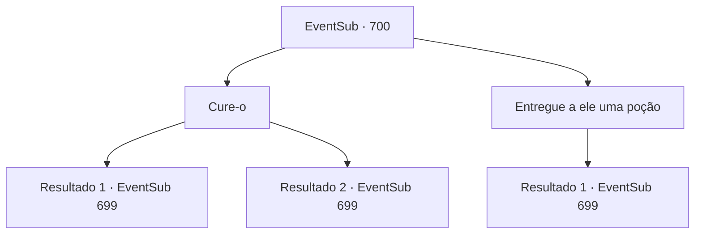

# Eventos secundários · 700

[Índice da tabela](index.md) · [Índice geral](../index.md)

ID: `pt:EventSub:700` · Fonte: `EventSub4` · Versão: 1.2.47.

Mapeamento estático dos arquivos; a disponibilidade e a execução dependem do estado da run.

## Texto do evento

*Sem texto no arquivo.*

## Dados de entrada

```json
{
  "id": 700,
  "grade": 1,
  "subEvent": "",
  "required": ""
}
```

## Mapa das escolhas



## Escolhas e resultados

### Escolha 1

Cure-o

Requisitos e outros campos da escolha:

```json
{
  "required": ""
}
```

#### Resultado 1.1

Habilidosamente, você trata os ferimentos de Lei. Sua saúde começa a se recuperar rapidamente. Após algumas horas, ele recuperou sua força e mobilidade. 

 "Estou em dívida com você, Sohyeop."

 Lei não esquece de mostrar sua gratidão. Ele endireita as mangas e aperta o punho em sua espada intacta. 

 "...Se deixarmos o roc assim, ele continuará a atacar aquela cidade. Eu devo resolver isso aqui e agora, não importa como termine."


Continuação registrada: [Evento 699](0699.md) na mesma tabela.

```json
{
  "required": "",
  "chance": "1|0_14_1",
  "nextEvent": 699,
  "type": 0,
  "reward": "5_707_3"
}
```

#### Resultado 1.2

Você tenta tratar os ferimentos dele, mas suas habilidades medicinais não são suficientes. Tudo o que você pode fazer é colocar bandagens em suas feridas. No entanto, a expressão de Lei se ilumina. 

 "*suspiro*... Oh... Obrigado, Sohyeop."

 Alguns momentos depois, Lei mal consegue se levantar novamente. Ele endireita as mangas e aperta o punho em sua espada intacta. 

 "...Se deixarmos o roc assim, ele continuará a atacar aquela cidade. Eu devo resolver isso aqui e agora, não importa como termine."


Continuação registrada: [Evento 699](0699.md) na mesma tabela.

```json
{
  "required": "",
  "chance": "13",
  "nextEvent": 699,
  "type": 1,
  "reward": "5_707_4"
}
```

### Escolha 2

Entregue a ele uma poção

Requisitos e outros campos da escolha:

```json
{
  "required": "23_6_1"
}
```

#### Resultado 2.1

Você dá uma poção para Lei. Lei rapidamente termina a poção e logo se torna visivelmente mais saudável do que antes. Após algumas horas, ele recuperou sua força e mobilidade. 

 "Estou em dívida com você, Sohyeop."

 Lei não esquece de mostrar sua gratidão. Ele endireita as mangas e aperta o punho em sua espada intacta. 

 "...Se deixarmos o roc assim, ele continuará a atacar aquela cidade. Eu devo resolver isso aqui e agora, não importa como termine."


Continuação registrada: [Evento 699](0699.md) na mesma tabela.

```json
{
  "required": "",
  "chance": "1",
  "nextEvent": 699,
  "type": 2,
  "reward": "5_707_3|25_6_1"
}
```

## Referências que chegam a este evento

- [Evento 699 · escolha 3 · resultado 1](0699.md#escolha-3)
