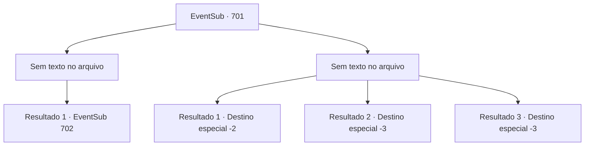

# Eventos secundários · 701

[Índice da tabela](index.md) · [Índice geral](../index.md)

ID: `pt:EventSub:701` · Fonte: `EventSub4` · Versão: 1.2.47.

Mapeamento estático dos arquivos; a disponibilidade e a execução dependem do estado da run.

## Texto do evento

*Sem texto no arquivo.*

## Dados de entrada

```json
{
  "id": 701,
  "grade": 1,
  "subEvent": "",
  "required": ""
}
```

## Mapa das escolhas



## Escolhas e resultados

### Escolha 1

*Sem texto no arquivo; o papel dessa opção depende da interface do jogo.*

Requisitos e outros campos da escolha:

```json
{
  "required": ""
}
```

#### Resultado 1.1

O roc morto mergulha no campanário. Você verifica novamente o corpo do roc para ter certeza de que ele está morto, depois examina o ninho. O lugar está cheio de cadáveres e carcaças. Os itens anteriormente usados pelos mortos estão todos destruídos. Nada de muito útil. No entanto, os olhos de Lei brilham de curiosidade ao avistar o que para você parece um tomo antigo. 

 "Espere - eu reconheço essas letras. Devo dar uma olhada mais de perto."

 Ele pega o livro e o coloca em seus bolsos. Logo, você e Lei retornam à cidade e contam ao prefeito que o roc foi morto. O prefeito felizmente paga a vocês dois. 

 "Ótimo trabalho! Agora nossos moradores podem viver em paz novamente!"

 Lei se recusa a aceitar a recompensa, dizendo que apenas fez a coisa certa, e creditando a você todo o trabalho pesado. Após serem recompensados, você e Lei saem da casa do prefeito. 

 "É justo que você aceite minha parte, Sohyeop. Eu estaria morto se não fosse por você."

 Ele lhe entrega a recompensa que recebeu do prefeito, depois puxa o livro que pegou no ninho do roc. Após folhear rapidamente as páginas, os olhos de Lei se arregalam e ele grita. 

 "Este... este é o diário do próprio 'Mestre Long'!"


Continuação registrada: [Evento 702](0702.md) na mesma tabela.

```json
{
  "required": "",
  "chance": "1",
  "nextEvent": 702,
  "type": 2,
  "reward": "0_4_60"
}
```

### Escolha 2

*Sem texto no arquivo; o papel dessa opção depende da interface do jogo.*

Requisitos e outros campos da escolha:

```json
{
  "required": ""
}
```

#### Resultado 2.1

Os dois não são páreo para o roc. A cada batida de asas vinha uma rajada de vento feroz, e seu enorme bico e garras afiadas dilaceravam sua carne. 

 "...Isso não vai dar, Sohyeop. Devemos recuar."

 O roc solta um grito alto, como se celebrasse sua própria vitória. Sem outras opções, você e Lei admitem a derrota e fogem. 

 Feridos e cansados, vocês relatam ao prefeito da cidade que falharam em derrubar o roc. O prefeito suspira com a má notícia e simplesmente acena com a cabeça. Lei diz que ficará na cidade por um tempo para se recuperar. Você se despede dele e deixa a cidade.

Continuação registrada: [Destino especial `-2`](../destinos-especiais.md).

```json
{
  "required": "1_0_2|1_1_2",
  "chance": "1",
  "nextEvent": -2,
  "type": 2,
  "reward": "0_0_-1|0_1_-1|12_11_-1"
}
```

#### Resultado 2.2

Vocês dois não são páreo para o roc. A cada batida de asas vinha uma rajada feroz de vento, e seu enorme bico e garras afiadas dilaceravam sua carne. 

 "...Isso não vai dar certo, Sohyeop. Devemos recuar."

 Lei sugere fugir. Mas suas pernas estão tremendo demais para você sequer se mover. O roc solta um grito alto, como se celebrasse sua própria vitória. Outra rajada de vento empurra você e Lei para baixo do campanário.

Continuação registrada: [Destino especial `-3`](../destinos-especiais.md).

```json
{
  "required": "2_0_2",
  "chance": "1",
  "nextEvent": -3,
  "type": 2,
  "reward": "0_0_-1|0_1_-1"
}
```

#### Resultado 2.3

Vocês dois não são páreo para o roc. A cada batida de asas vinha uma rajada feroz de vento, e seu enorme bico e garras afiadas dilaceravam sua carne. 

 "...Isso não vai dar certo, Sohyeop. Devemos recuar."

 Lei sugere fugir. Mas suas pernas estão tremendo demais para você sequer se mover. O roc solta um grito alto, como se celebrasse sua própria vitória. Outra rajada de vento empurra você e Lei para baixo do campanário.

Continuação registrada: [Destino especial `-3`](../destinos-especiais.md).

```json
{
  "required": "2_1_2",
  "chance": "1",
  "nextEvent": -3,
  "type": 2,
  "reward": "0_0_-1|0_1_-1"
}
```

## Referências que chegam a este evento

- [Evento 699 · escolha 4 · resultado 1](0699.md#escolha-4)
- [Evento 699 · escolha 4 · resultado 2](0699.md#escolha-4)
