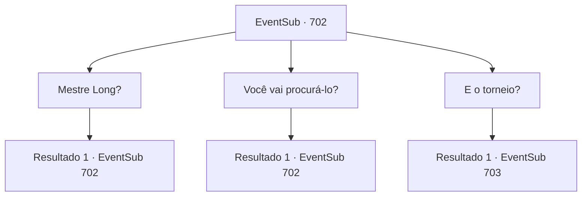

# Eventos secundários · 702

[Índice da tabela](index.md) · [Índice geral](../index.md)

ID: `pt:EventSub:702` · Fonte: `EventSub4` · Versão: 1.2.47.

Mapeamento estático dos arquivos; a disponibilidade e a execução dependem do estado da run.

## Texto do evento

*Sem texto no arquivo.*

## Dados de entrada

```json
{
  "id": 702,
  "grade": 1,
  "subEvent": "",
  "required": ""
}
```

## Mapa das escolhas



## Escolhas e resultados

### Escolha 1

Mestre Long?

Requisitos e outros campos da escolha:

```json
{
  "required": "5_710_0"
}
```

#### Resultado 1.1

Lei engole sua empolgação e começa a explicar. 

 "Mestre Long é famoso como um monge lendário e artista marcial. Durante toda a sua vida, ele inventou novos estilos de artes marciais e magia! Com seus talentos, ele salvou a vida de muitos e ajudou ainda mais. É amplamente conhecido no Oriente que cada estilo de esgrima e formação existente começou com ele! Encontrar os registros de alguém assim é simplesmente...!!"

 Lei continua a tagarelar, não tentando mais conter a empolgação. Sua voz ficou tão aguda que quase parece feminina. 

 "Olhe - até aponta aqui onde está o túmulo do Mestre Long! Se isso for verdade, podemos conseguir o Manual do Mestre Long!"


Continuação registrada: [Evento 702](0702.md) na mesma tabela.

```json
{
  "required": "",
  "chance": "1",
  "nextEvent": 702,
  "type": 2,
  "reward": "5_710_1"
}
```

### Escolha 2

Você vai procurá-lo?

Requisitos e outros campos da escolha:

```json
{
  "required": "5_710_1"
}
```

#### Resultado 2.1


 "...SIM! Uh, quero dizer... Eu gostaria de encontrá-lo, sim. Ahem."

 Lei limpa a garganta e lhe diz a localização do túmulo do Mestre Long, de acordo com o tomo. O túmulo está localizado em algum lugar dentro da Cordilheira da Lâmina, que serve como fronteira entre o Norte e o Grande Deserto. Para ser mais preciso, 'Monte Tragia' - uma parte da cordilheira. 

 "Isso realmente reduz bastante, mas suponho que a busca ainda levará pelo menos alguns dias. Mais do que alguns dias, talvez... Honestamente, não sei dizer quanto tempo levará."

 Depois de terminar, Lei volta seu olhar para você e faz a saudação oriental. Ele se inclina, pedindo educadamente. 

 "Preciso pedir sua ajuda novamente! Desejo encontrar e proteger o manual!"


Continuação registrada: [Evento 702](0702.md) na mesma tabela.

```json
{
  "required": "",
  "chance": "1",
  "nextEvent": 702,
  "type": 2,
  "reward": "5_710_2"
}
```

### Escolha 3

E o torneio?

Requisitos e outros campos da escolha:

```json
{
  "required": "5_710_2"
}
```

#### Resultado 3.1

Você lembra Lei sobre o Torneio de Lutadores Battra. Lei balança a cabeça e responde. 

 "Claro - não estou esquecendo do torneio! Vou procurar o túmulo com todas as minhas forças, mas se demorar muito... sei quando desistir."

 Lei para por um momento e vira seu olhar para o oeste, onde a cidadela abandonada com o encontro do roc aconteceu. 

 "Lutando contra aquela poderosa besta, agora sei que ainda tenho muito, muito mais a aprender. Mesmo que eu competisse no torneio, nunca serei vitorioso assim. Preciso encontrar o Manual do Mestre Long e me tornar mais forte! Por favor, me ajude!"


Continuação registrada: [Evento 703](0703.md) na mesma tabela.

```json
{
  "required": "",
  "chance": "1",
  "nextEvent": 703,
  "type": 2,
  "reward": ""
}
```

## Referências que chegam a este evento

- [Evento 701 · escolha 1 · resultado 1](0701.md#escolha-1)
- [Evento 702 · escolha 1 · resultado 1](0702.md#escolha-1)
- [Evento 702 · escolha 2 · resultado 1](0702.md#escolha-2)
