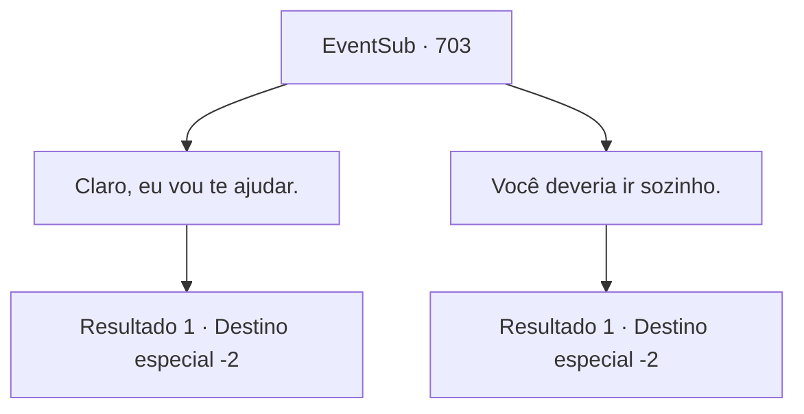

# Eventos secundários · 703

[Índice da tabela](index.md) · [Índice geral](../index.md)

ID: `pt:EventSub:703` · Fonte: `EventSub4` · Versão: 1.2.47.

Mapeamento estático dos arquivos; a disponibilidade e a execução dependem do estado da run.

## Texto do evento

*Sem texto no arquivo.*

## Dados de entrada

```json
{
  "id": 703,
  "grade": 1,
  "subEvent": "",
  "required": ""
}
```

## Mapa das escolhas



## Escolhas e resultados

### Escolha 1

Claro, eu vou te ajudar.

Requisitos e outros campos da escolha:

```json
{
  "required": ""
}
```

#### Resultado 1.1

Você concorda em ajudá-lo. Ele sorri amplamente, então lhe conta seu plano. 

 "Até onde sei, há uma pequena vila logo abaixo do Monte Tragia. Vamos nos encontrar lá, quando as preparações necessárias forem feitas."

 A jornada de Heta ao Monte Tragia é uma longa caminhada. Você se despede de Lei e retorna às suas aventuras.

Continuação registrada: [Destino especial `-2`](../destinos-especiais.md).

```json
{
  "required": "",
  "chance": "1",
  "nextEvent": -2,
  "type": 2,
  "reward": "12_11_2"
}
```

### Escolha 2

Você deveria ir sozinho.

Requisitos e outros campos da escolha:

```json
{
  "required": ""
}
```

#### Resultado 2.1

Você se recusa a ajudá-lo, dizendo que ele deve procurar por conta própria. Lei continua a te olhar com decepção, mas não te pede novamente. 

 "Se... se você mudar de ideia, por favor, me encontre no Monte Tragia."

 Você se despede de Lei e retorna às suas aventuras.

Continuação registrada: [Destino especial `-2`](../destinos-especiais.md).

```json
{
  "required": "",
  "chance": "1",
  "nextEvent": -2,
  "type": 2,
  "reward": "12_11_5"
}
```

## Referências que chegam a este evento

- [Evento 702 · escolha 3 · resultado 1](0702.md#escolha-3)
