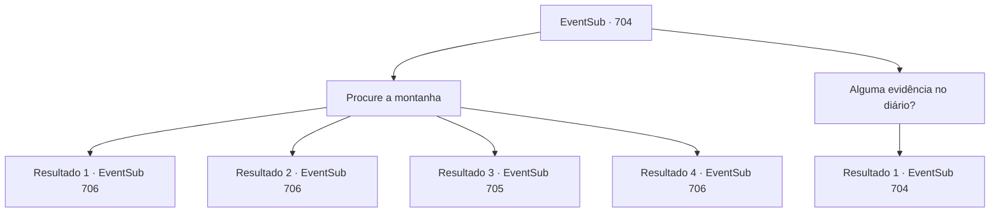

# Eventos secundários · 704

[Índice da tabela](index.md) · [Índice geral](../index.md)

ID: `pt:EventSub:704` · Fonte: `EventSub4` · Versão: 1.2.47.

Mapeamento estático dos arquivos; a disponibilidade e a execução dependem do estado da run.

## Texto do evento

Como o nome sugere, a Cordilheira Blade é o lar de ventos cortantes, uivantes e congelantes. O Monte Tragia, por fazer parte dessa cordilheira, não é diferente. As pessoas abaixo da montanha tradicionalmente apreciam álcool forte para combater o frio. Você está bebendo um licor destilado, quando um rosto familiar abre a porta e entra na taverna. Lei vê você e vem se sentar ao seu lado. 

 "Que bom ver você de novo. Espero que você não tenha tido problemas para encontrar este lugar."

 Após uma breve troca de palavras gentis, você pergunta a ele qual é o plano dele. Lei se perde em pensamentos por alguns segundos, então começa a explicar. 

 "Cheguei cedo e perguntei por aí, mas não descobri nada útil para nós. Ao que parece... escalar a montanha nós mesmos é o único jeito."


## Dados de entrada

```json
{
  "id": 704,
  "grade": 1,
  "subEvent": "",
  "required": "12_11_2"
}
```

## Mapa das escolhas



## Escolhas e resultados

### Escolha 1

Procure a montanha

Requisitos e outros campos da escolha:

```json
{
  "required": ""
}
```

#### Resultado 1.1

Assim que você passa pela entrada do Monte Tragia, o frio do norte corta sua pele. Você e Lei continuam subindo a montanha, segurando firmemente suas roupas. Um lugar tão frio e acidentado é inóspito para assentamento, então não há humanos por perto. Neve branca, árvores coníferas e rochedos irregulares são tudo o que você vê. A busca continua por alguns dias. 

 "...Espere! Sohyeop! Aqui! Venha ver isso!"

 Uma noite, Lei chama você para olhar algo que ele encontrou. É uma caverna, perfeitamente escondida entre uma cachoeira e um penhasco rochoso. 

 "Hm... Isso seria muito mais fácil com uma tocha ou algo assim..."

 Lei murmura para si mesmo, olhando dentro da caverna.

Continuação registrada: [Evento 706](0706.md) na mesma tabela.

```json
{
  "required": "21_8_1",
  "chance": "1|0_14_1",
  "nextEvent": 706,
  "type": 0,
  "reward": ""
}
```

#### Resultado 1.2

Assim que você passa pela entrada do Monte Tragia, o frio do norte corta sua pele. Você e Lei continuam subindo a montanha, segurando firmemente suas roupas. 

 "Cordilheira da Lâmina... Não é à toa que tem esse nome, né."

 Você é resistente ao frio, então não é difícil suportá-lo, mas aparentemente esse não é o caso de Lei. Um lugar tão frio e acidentado é inóspito para assentamentos, então não há humanos por perto. Neve branca, árvores coníferas e rochedos irregulares são tudo o que aparece aos seus olhos. A busca continua por alguns dias. 

 "...Espere! Sohyeop! Aqui! Venha ver isso!"

 Certa noite, Lei chama você para ver algo que encontrou. É uma caverna, escondida perfeitamente entre uma cachoeira e um penhasco rochoso. 

 "Hm... Isso seria muito mais fácil com uma tocha ou algo assim..."

 Lei murmura para si mesmo, olhando para dentro da caverna.

Continuação registrada: [Evento 706](0706.md) na mesma tabela.

```json
{
  "required": "20_8_1",
  "chance": "1",
  "nextEvent": 706,
  "type": 2,
  "reward": ""
}
```

#### Resultado 1.3

Assim que você passa pela entrada do Monte Tragia, o frio do norte corta sua pele. Você e Lei continuam subindo a montanha, segurando firmemente suas roupas. Um lugar tão frio e acidentado é inóspito para assentamento, então não há humanos por perto. Neve branca, árvores coníferas e rochedos irregulares são tudo o que você vê. Procurar em um lugar assim é puro tormento para você. Seu corpo começa a tremer, incapaz de suportar o frio por mais tempo. Lei pergunta se você está bem, preocupado. 

 "Você parece... muito frio. Tem certeza de que não quer voltar?"


Continuação registrada: [Evento 705](0705.md) na mesma tabela.

```json
{
  "required": "21_8_1",
  "chance": "16",
  "nextEvent": 705,
  "type": 1,
  "reward": ""
}
```

#### Resultado 1.4

Assim que você passa pela entrada do Monte Tragia, o frio do norte corta sua pele. Você consegue conjurar uma pequena fogueira com sua magia, mas o vento logo a apaga. Infelizmente, você e Lei continuam subindo a montanha, segurando firmemente suas roupas. Um lugar tão frio e acidentado é inóspito para assentamento, então não há humanos por perto. Neve branca, árvores coníferas e rochedos irregulares são tudo o que você vê. A busca continua por alguns dias. 

 "...Espere! Sohyeop! Aqui! Venha ver isso!"

 Uma noite, Lei chama você para olhar algo que ele encontrou. É uma caverna, perfeitamente escondida entre uma cachoeira e um penhasco rochoso. 

 "Hm... Isso seria muito mais fácil com uma tocha ou algo assim..."

 Lei murmura para si mesmo, olhando dentro da caverna.

Continuação registrada: [Evento 706](0706.md) na mesma tabela.

```json
{
  "required": "20_0_1",
  "chance": "1",
  "nextEvent": 706,
  "type": 2,
  "reward": ""
}
```

### Escolha 2

Alguma evidência no diário?

Requisitos e outros campos da escolha:

```json
{
  "required": "5_712_0"
}
```

#### Resultado 2.1

Lei te ouve e abre o diário imediatamente. 

 "A entrada deve ser uma caverna, localizada em algum lugar na montanha. Mas tenha em mente que o diário é muito antigo. Eu não ficaria surpreso se as descrições não corresponderem perfeitamente ao ambiente. ...Acho que devemos ir e verificar nós mesmos."

 Você pega o diário para examiná-lo, mas está escrito em uma língua que você não reconhece. Você o devolve a Lei e olha pela janela. O som do vento uivante pode ser ouvido.

Continuação registrada: [Evento 704](0704.md) na mesma tabela.

```json
{
  "required": "",
  "chance": "1",
  "nextEvent": 704,
  "type": 2,
  "reward": "5_712_10"
}
```

## Referências que chegam a este evento

- [Evento 704 · escolha 2 · resultado 1](0704.md#escolha-2)
