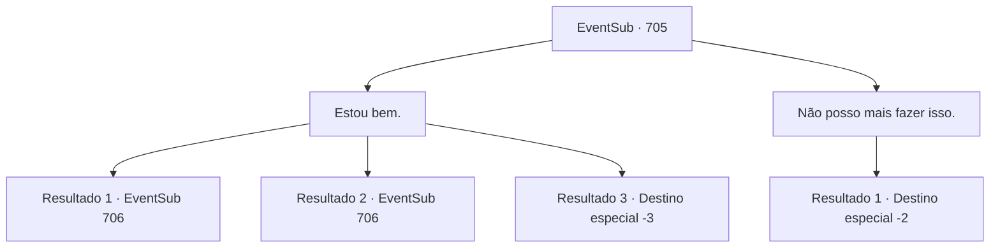

# Eventos secundários · 705

[Índice da tabela](index.md) · [Índice geral](../index.md)

ID: `pt:EventSub:705` · Fonte: `EventSub4` · Versão: 1.2.47.

Mapeamento estático dos arquivos; a disponibilidade e a execução dependem do estado da run.

## Texto do evento

*Sem texto no arquivo.*

## Dados de entrada

```json
{
  "id": 705,
  "grade": 1,
  "subEvent": "",
  "required": ""
}
```

## Mapa das escolhas



## Escolhas e resultados

### Escolha 1

Estou bem.

Requisitos e outros campos da escolha:

```json
{
  "required": ""
}
```

#### Resultado 1.1

Você tranquiliza Lei dizendo que está bem. Assim como você disse, seu corpo logo se adapta ao frio. 

 "...Espere! Sohyeop! Aqui! Venha ver isso!"

 Uma noite, Lei te chama para ver algo que ele encontrou. É uma caverna, perfeitamente escondida entre uma cachoeira e um penhasco rochoso. 

 "Hm... Isso seria muito mais fácil com uma tocha ou algo assim..."

 Lei murmura para si mesmo, olhando dentro da caverna.

Continuação registrada: [Evento 706](0706.md) na mesma tabela.

```json
{
  "required": "",
  "chance": "1|0_13_1",
  "nextEvent": 706,
  "type": 0,
  "reward": ""
}
```

#### Resultado 1.2

Você tranquiliza Lei dizendo que está bem. Mas seu corpo discorda de você. Não importa o quanto você tente, não consegue parar de tremer, e seu nariz continua escorrendo cada vez mais. 

 "...Espere! Sohyeop! Aqui! Venha ver isso!"

 Uma noite, Lei te chama para ver algo que ele encontrou. É uma caverna, perfeitamente escondida entre uma cachoeira e um penhasco rochoso. 

 "Hm... Isso seria muito mais fácil com uma tocha ou algo assim..."

 Lei murmura para si mesmo, olhando dentro da caverna.

Continuação registrada: [Evento 706](0706.md) na mesma tabela.

```json
{
  "required": "1_0_2",
  "chance": "20",
  "nextEvent": 706,
  "type": 1,
  "reward": "0_0_-1"
}
```

#### Resultado 1.3

Você tranquiliza Lei dizendo que está bem. Mas seu corpo discorda de você. Não importa o quanto você tente, não consegue parar de tremer, e seu nariz continua escorrendo cada vez mais. Logo, seu corpo desaba. 

 "E- espere! Sohyeop! Você está bem!?"

 Sua consciência se apaga na escuridão, com a voz preocupada de Lei sendo a última coisa que você ouve.

Continuação registrada: [Destino especial `-3`](../destinos-especiais.md).

```json
{
  "required": "2_0_2",
  "chance": "20",
  "nextEvent": -3,
  "type": 1,
  "reward": "0_0_-1"
}
```

### Escolha 2

Não posso mais fazer isso.

Requisitos e outros campos da escolha:

```json
{
  "required": ""
}
```

#### Resultado 2.1

Lei acena com decepção em resposta. 

 "Acho que não tem jeito. Obrigado pela ajuda até agora. Vou procurar um pouco mais."

 Você deixa Lei sozinho e desce a montanha.

Continuação registrada: [Destino especial `-2`](../destinos-especiais.md).

```json
{
  "required": "",
  "chance": "1",
  "nextEvent": -2,
  "type": 2,
  "reward": "12_11_-1"
}
```

## Referências que chegam a este evento

- [Evento 704 · escolha 1 · resultado 3](0704.md#escolha-1)
