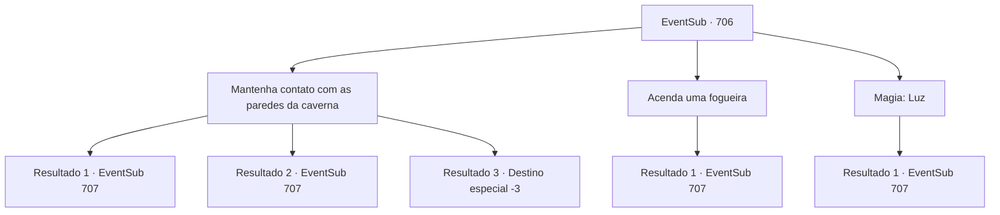

# Eventos secundários · 706

[Índice da tabela](index.md) · [Índice geral](../index.md)

ID: `pt:EventSub:706` · Fonte: `EventSub4` · Versão: 1.2.47.

Mapeamento estático dos arquivos; a disponibilidade e a execução dependem do estado da run.

## Texto do evento

*Sem texto no arquivo.*

## Dados de entrada

```json
{
  "id": 706,
  "grade": 1,
  "subEvent": "",
  "required": ""
}
```

## Mapa das escolhas



## Escolhas e resultados

### Escolha 1

Mantenha contato com as paredes da caverna

Requisitos e outros campos da escolha:

```json
{
  "required": ""
}
```

#### Resultado 1.1

Você e Lei colocam as mãos nas paredes da caverna e entram na caverna escura. Depois de alguns minutos caminhando, vocês veem uma luz fraca à distância. Quanto mais rápido vocês andam, mais perto a luz fica. Logo, vocês estão fora da caverna escura. 

 "Este lugar é..."

 O que aguardava vocês dois é a lua brilhante no céu noturno escuro e um penhasco íngreme. Abaixo do penhasco há um riacho, formado pelo derretimento da geleira. 

 "Huh... Um beco sem saída. Devemos voltar-..."

 Lei vira o olhar para trás e não consegue terminar sua frase. Da caverna escura que vocês acabaram de atravessar, surge um grupo de pessoas vestidas com trajes orientais. |drawing_Shao| 

 "Há quanto tempo, Lei. O que você está fazendo aqui? É essa a vida que você escolheu, depois de fugir do clã?"

 Uma mulher que parece ser a líder dirigiu-se friamente a Lei. 

 "Onde estão seus modos, criança? Você está olhando para o próximo Chefe do Clã, não vai mostrar algum respeito?"

 Mesmo antes de Lei poder responder, a mulher acrescenta. 

 "Ou sua mãe esqueceu de te ensinar isso?"


Continuação registrada: [Evento 707](0707.md) na mesma tabela.

```json
{
  "required": "",
  "chance": "1",
  "nextEvent": 707,
  "type": 2,
  "reward": ""
}
```

#### Resultado 1.2

Você e Lei colocam as mãos nas paredes da caverna e caminham para dentro da escuridão. Então, você bate a canela em algo e tropeça com um grito curto. 

 "A- você está bem, Sohyeop?!"

 Lei rapidamente te segura para evitar que você caia, e assim você mal consegue evitar que o queixo atinja o chão. Você esfrega a canela para aliviar a dor e começa a caminhar novamente. Depois de alguns minutos andando, você vê uma luz fraca à distância. Quanto mais rápido você caminha, mais perto a luz fica. Logo, vocês saem da caverna escura. O que esperava por vocês dois era a lua brilhante no céu noturno escuro e um penhasco íngreme. Abaixo do penhasco há um riacho, formado pelo derretimento das geleiras. 

 "Huh... Um beco sem saída. Devemos voltar-..."

 Lei vira o olhar para trás e não consegue terminar sua frase. Da caverna escura que vocês acabaram de atravessar, emerge um grupo de pessoas vestidas com trajes orientais. |drawing_Shao| 

 "Há quanto tempo, Lei. O que você está fazendo aqui? É essa a vida que você escolheu, depois de fugir do clã?"

 Uma mulher que parece ser a líder se dirige a Lei friamente. 

 "Onde estão os seus modos, garoto? Você está diante da próxima líder do clã, não vai mostrar respeito?"

 Antes que Lei pudesse responder, a mulher adiciona. 

 "Ou será que sua mãe esqueceu de te ensinar isso?"


Continuação registrada: [Evento 707](0707.md) na mesma tabela.

```json
{
  "required": "1_0_2",
  "chance": "1",
  "nextEvent": 707,
  "type": 2,
  "reward": "0_0_-1"
}
```

#### Resultado 1.3

Você e Lei colocam as mãos nas paredes da caverna e entram na caverna escura. Então, você bate a canela em algo e tropeça com um grito curto. Você bate a cabeça contra um estalagmite afiado no chão da caverna. Você imediatamente perde a consciência.

Continuação registrada: [Destino especial `-3`](../destinos-especiais.md).

```json
{
  "required": "2_0_2",
  "chance": "1",
  "nextEvent": -3,
  "type": 2,
  "reward": "0_0_-1"
}
```

### Escolha 2

Acenda uma fogueira

Requisitos e outros campos da escolha:

```json
{
  "required": "23_3_1"
}
```

#### Resultado 2.1

Você acende uma pequena fogueira e explora a caverna. É uma caverna de calcário - você nota estalagmites e estalactites aqui e ali. Gotas de água que caem delas tornam o chão da caverna escorregadio também. 

 "Esta teria sido uma caminhada muito perigosa sem a luz."

 As palavras de Lei são verdadeiras - a luz está cumprindo seu papel como guia nesta caverna completamente escura. Após alguns minutos de caminhada, você vê uma luz fraca à distância. Quanto mais rápido você anda, mais perto a luz fica. Logo, você está fora da caverna escura. 

 "Este lugar é..."

 O que aguardava vocês dois é a lua brilhante no céu noturno escuro e um penhasco íngreme. Abaixo do penhasco há um riacho, formado pelo derretimento da geleira. 

 "Huh... Um beco sem saída. Devemos voltar-..."

 Lei vira o olhar de volta e não consegue terminar sua frase. Da caverna escura que você acabou de passar, um grupo de pessoas vestidas com trajes orientais emerge. |drawing_Shao| 

 "Há quanto tempo, Lei. O que você está fazendo aqui? É esta a vida que você escolheu, depois de fugir do clã?"

 Uma mulher que parece ser a líder dirigiu-se friamente a Lei. 

 "Onde estão seus modos, criança? Você está olhando para o próximo Chefe do Clã, não vai mostrar algum respeito?"

 Mesmo antes que Lei pudesse responder, a mulher acrescenta. 

 "Ou sua mãe esqueceu de te ensinar isso?"


Continuação registrada: [Evento 707](0707.md) na mesma tabela.

```json
{
  "required": "",
  "chance": "1",
  "nextEvent": 707,
  "type": 2,
  "reward": ""
}
```

### Escolha 3

Magia: Luz

Requisitos e outros campos da escolha:

```json
{
  "required": "20_0_1"
}
```

#### Resultado 3.1

Você conjura uma luz e explora a caverna. É uma caverna de calcário - você nota estalagmites e estalactites aqui e ali. Gotas de água que caem delas tornam o chão da caverna escorregadio também. 

 "Esta teria sido uma caminhada muito perigosa sem a luz."

 As palavras de Lei são verdadeiras - a luz está cumprindo seu papel como guia nesta caverna completamente escura. Após alguns minutos de caminhada, você vê uma luz fraca à distância. Quanto mais rápido você anda, mais perto a luz fica. Logo, você está fora da caverna escura. 

 "Este lugar é..."

 O que aguardava vocês dois é a lua brilhante no céu noturno escuro e um penhasco íngreme. Abaixo do penhasco há um riacho, formado pelo derretimento da geleira. 

 "Huh... Um beco sem saída. Devemos voltar-..."

 Lei vira o olhar para trás e não consegue terminar sua frase. Da caverna escura que você acabou de atravessar, um grupo de pessoas vestidas com trajes orientais emerge. |drawing_Shao| 

 "Há quanto tempo, Lei. O que você está fazendo aqui? É esta a vida que você escolheu, depois de fugir do clã?"

 Uma mulher que parece ser a líder dirigiu-se friamente a Lei. 

 "Onde estão seus modos, criança? Você está olhando para o próximo Chefe do Clã, não vai mostrar algum respeito?"

 Mesmo antes que Lei pudesse responder, a mulher acrescenta. 

 "Ou sua mãe esqueceu de te ensinar isso?"


Continuação registrada: [Evento 707](0707.md) na mesma tabela.

```json
{
  "required": "",
  "chance": "1",
  "nextEvent": 707,
  "type": 2,
  "reward": ""
}
```

## Referências que chegam a este evento

- [Evento 704 · escolha 1 · resultado 1](0704.md#escolha-1)
- [Evento 704 · escolha 1 · resultado 2](0704.md#escolha-1)
- [Evento 704 · escolha 1 · resultado 4](0704.md#escolha-1)
- [Evento 705 · escolha 1 · resultado 1](0705.md#escolha-1)
- [Evento 705 · escolha 1 · resultado 2](0705.md#escolha-1)
