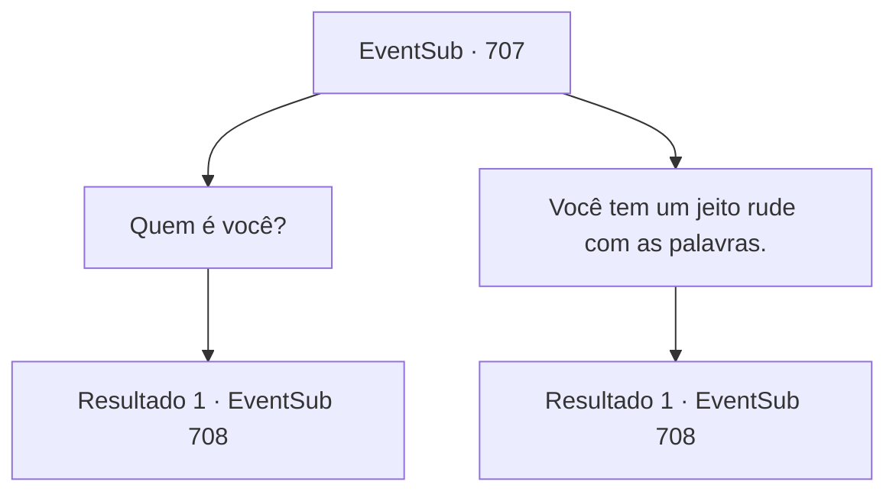

# Eventos secundários · 707

[Índice da tabela](index.md) · [Índice geral](../index.md)

ID: `pt:EventSub:707` · Fonte: `EventSub4` · Versão: 1.2.47.

Mapeamento estático dos arquivos; a disponibilidade e a execução dependem do estado da run.

## Texto do evento

*Sem texto no arquivo.*

## Dados de entrada

```json
{
  "id": 707,
  "grade": 1,
  "subEvent": "",
  "required": ""
}
```

## Mapa das escolhas



## Escolhas e resultados

### Escolha 1

Quem é você?

Requisitos e outros campos da escolha:

```json
{
  "required": ""
}
```

#### Resultado 1.1

A mulher sorri em resposta. 

 "Isso não tem nada a ver com você, bárbaro. Fique de boca fechada."

 Lei começa a explicar em vez disso. 

 "...Essa é Shao Ryu, uma das membros femininas do Clã Ryu. Ela também é a próxima herdeira legítima do meu clã, e..."

 Após ouvir a explicação de Lei, no entanto, Shao explode de raiva e interrompe. 

 "SEU clã? Ora, seu pirralho... Você se atreve a falar assim, plebeu?!"

 As palavras de Shao imediatamente criam uma atmosfera tensa. Ela ordena seus homens, olhando para Lei com olhos furiosos. 

 "Vou acabar com essa desgraça de criança aqui mesmo, para que a arrogância do pirralho não manche mais a reputação do meu clã! Livrem-se deles, Dragões Vermelhos! Matem essa coisa. E o bárbaro também!"


Continuação registrada: [Evento 708](0708.md) na mesma tabela.

```json
{
  "required": "",
  "chance": "1",
  "nextEvent": 708,
  "type": 2,
  "reward": ""
}
```

### Escolha 2

Você tem um jeito rude com as palavras.

Requisitos e outros campos da escolha:

```json
{
  "required": ""
}
```

#### Resultado 2.1

A mulher sorri em resposta enquanto você critica seu discurso. 

 "Isso não tem nada a ver com você, bárbaro. Fique de boca fechada."

 Lei começa a explicar em vez disso. 

 "...Essa é Shao Ryu, uma das membros femininas do Clã Ryu. Ela também é a próxima herdeira legítima do meu clã, e..."

 Após ouvir a explicação de Lei, no entanto, Shao explode de raiva e interrompe. 

 "SEU clã? Ora, seu pirralho... Você se atreve a falar assim, plebeu?!"

 As palavras de Shao imediatamente criam uma atmosfera tensa. Ela ordena seus homens, olhando para Lei com olhos furiosos. 

 "Vou acabar com essa desgraça de criança aqui mesmo, para que a arrogância do pirralho não manche mais a reputação do meu clã! Livrem-se deles, Dracos Vermelhos! Matem essa coisa. E o bárbaro também!"


Continuação registrada: [Evento 708](0708.md) na mesma tabela.

```json
{
  "required": "",
  "chance": "1",
  "nextEvent": 708,
  "type": 2,
  "reward": ""
}
```

## Referências que chegam a este evento

- [Evento 706 · escolha 1 · resultado 1](0706.md#escolha-1)
- [Evento 706 · escolha 1 · resultado 2](0706.md#escolha-1)
- [Evento 706 · escolha 2 · resultado 1](0706.md#escolha-2)
- [Evento 706 · escolha 3 · resultado 1](0706.md#escolha-3)
