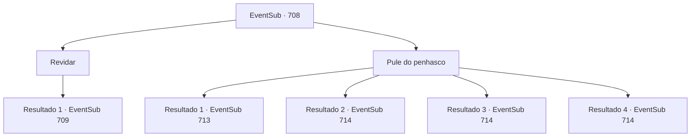

# Eventos secundários · 708

[Índice da tabela](index.md) · [Índice geral](../index.md)

ID: `pt:EventSub:708` · Fonte: `EventSub4` · Versão: 1.2.47.

Mapeamento estático dos arquivos; a disponibilidade e a execução dependem do estado da run.

## Texto do evento

*Sem texto no arquivo.*

## Dados de entrada

```json
{
  "id": 708,
  "grade": 1,
  "subEvent": "",
  "required": ""
}
```

## Mapa das escolhas



## Escolhas e resultados

### Escolha 1

Revidar

Requisitos e outros campos da escolha:

```json
{
  "required": ""
}
```

#### Resultado 1.1

Os espadachins orientais imediatamente cercam você e Lei, obedecendo às ordens de Shao. 

 "Cuidado, Sohyeop. Shao tem muitos lutadores sob seu comando, mas os Dragões Vermelhos são as verdadeiras forças de elite."

 Assim que Lei termina, os espadachins Dragões Vermelhos começam a atacar. Você rapidamente se prepara para revidar, observando seus movimentos.

Continuação registrada: [Evento 709](0709.md) na mesma tabela.

```json
{
  "required": "",
  "chance": "1",
  "nextEvent": 709,
  "type": 2,
  "reward": "6_3_179",
  "place": 6
}
```

### Escolha 2

Pule do penhasco

Requisitos e outros campos da escolha:

```json
{
  "required": ""
}
```

#### Resultado 2.1

As ordens de Shao são imediatamente executadas pelos espadachins do Leste. Eles cercam você e Lei, o que deixa vocês dois com apenas uma opção. Você sinaliza para Lei com os olhos, preparando-se para pular do penhasco. Lei a princípio pareceu surpreso, mas eventualmente acena com a cabeça em concordância. 

 "Parem-nos! Eles estão fugindo!"

 "Esperem! Eles estão pulando!"

 Vocês dois rompem a linha de espadachins e, sem hesitação, se jogam do penhasco. A corrente feroz do riacho engole vocês dois em um instante. 

 Você finalmente abre os olhos e se senta. Parece que você está em algum tipo de caverna. Ao seu lado está uma pequena fogueira, onde Lei está secando suas roupas molhadas. 

 "Ah... Sohyeop! Finalmente! Bom ver você de volta à ação."

 Lei disse, esboçando um sorriso constrangido.

Continuação registrada: [Evento 713](0713.md) na mesma tabela.

```json
{
  "required": "21_0_1|21_10_1|21_31_1",
  "chance": "1",
  "nextEvent": 713,
  "type": 2,
  "reward": ""
}
```

#### Resultado 2.2

As ordens de Shao são imediatamente executadas pelos espadachins do Leste. Eles cercam você e Lei, o que deixa vocês dois com apenas uma opção. Você sinaliza para Lei com os olhos, preparando-se para pular do penhasco. Lei a princípio pareceu espantado, mas eventualmente acena em concordância. 

 "Parem-nos! Eles estão fugindo!"

 "Esperem! Eles estão pulando!"

 Vocês dois rompem a linha de espadachins e, sem hesitação, se jogam do penhasco. A corrente feroz do riacho parece pronta para engolir vocês dois em um instante. 

 "...Sohyeop!!"

 Você segura firmemente as mãos de Lei e lança Queda Suave. Por um momento, seu corpo se sente sem peso. Vocês dois pousam com segurança em um campo de cascalho perto do riacho. Olhando ao redor, Lei avista outra caverna e fala. 

 "Ali! Uma caverna. Vamos nos esconder lá por enquanto."

 Você segue Lei para dentro da caverna. Lei solta um suspiro, olhando para dentro da caverna.

Continuação registrada: [Evento 714](0714.md) na mesma tabela.

```json
{
  "required": "20_0_1",
  "chance": "1",
  "nextEvent": 714,
  "type": 2,
  "reward": ""
}
```

#### Resultado 2.3

As ordens de Shao são imediatamente executadas pelos espadachins do Leste. Eles cercam você e Lei, o que deixa vocês dois com apenas uma opção. Você sinaliza para Lei com os olhos, preparando-se para pular do penhasco. Lei a princípio pareceu espantado, mas eventualmente acena com a cabeça em concordância. 

 "Parem-nos! Eles estão fugindo!"

 "Esperem! Eles estão pulando!"

 Vocês dois rompem a linha de espadachins e, sem hesitação, se jogam do penhasco. A corrente feroz do riacho parece pronta para engolir vocês dois em um instante. 

 "...Sohyeop!!"

 Você segura firmemente as mãos de Lei e voa. Então vocês descem lentamente ao chão. Vocês dois pousam com segurança em um campo de cascalho perto do riacho. Olhando ao redor, Lei avista outra caverna e fala. 

 "Ali! Uma caverna. Vamos nos esconder lá por enquanto."

 Você segue Lei para dentro da caverna. Lei solta um suspiro, olhando para dentro da caverna.

Continuação registrada: [Evento 714](0714.md) na mesma tabela.

```json
{
  "required": "20_10_1",
  "chance": "1",
  "nextEvent": 714,
  "type": 2,
  "reward": ""
}
```

#### Resultado 2.4

As ordens de Shao são imediatamente executadas pelos espadachins do Oriente. Eles cercam você e Lei, o que deixa vocês dois com apenas uma opção. Você sinaliza para Lei com os olhos, preparando-se para pular do penhasco. Lei a princípio pareceu espantado, mas eventualmente acena com a cabeça em concordância. 

 "Parem-nos! Eles estão fugindo!"

 "Esperem! Eles estão pulando!"

 Vocês dois rompem a linha de espadachins e, sem hesitação, se jogam do penhasco. A corrente feroz do riacho engole vocês dois em um instante. 

 "...Sohyeop!!"

 Você usa sua habilidade de respirar debaixo d'água e salva Lei de se afogar. Segurando Lei, você nada em direção à terra, para o campo de cascalho próximo. Vocês ainda estão vivos, mas é provável que os Dragões Vermelhos venham atrás de vocês. Olhando ao redor, Lei avista outra caverna e fala. 

 "*tosse*... *tosse*... Ali! Uma caverna. Vamos nos esconder lá por enquanto."

 Você segue Lei para dentro da caverna. Lei solta um suspiro, olhando para dentro da caverna.

Continuação registrada: [Evento 714](0714.md) na mesma tabela.

```json
{
  "required": "20_31_1",
  "chance": "1",
  "nextEvent": 714,
  "type": 2,
  "reward": ""
}
```

## Referências que chegam a este evento

- [Evento 707 · escolha 1 · resultado 1](0707.md#escolha-1)
- [Evento 707 · escolha 2 · resultado 1](0707.md#escolha-2)
