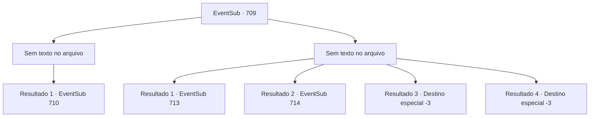

# Eventos secundários · 709

[Índice da tabela](index.md) · [Índice geral](../index.md)

ID: `pt:EventSub:709` · Fonte: `EventSub4` · Versão: 1.2.47.

Mapeamento estático dos arquivos; a disponibilidade e a execução dependem do estado da run.

## Texto do evento

*Sem texto no arquivo.*

## Dados de entrada

```json
{
  "id": 709,
  "grade": 1,
  "subEvent": "",
  "required": ""
}
```

## Mapa das escolhas



## Escolhas e resultados

### Escolha 1

*Sem texto no arquivo; o papel dessa opção depende da interface do jogo.*

Requisitos e outros campos da escolha:

```json
{
  "required": ""
}
```

#### Resultado 1.1

Você e Lei conseguem derrotar todos os Dracos Vermelhos. Você volta seu olhar para Shao, que está olhando maliciosamente para Lei. 

 "Hmph. Você sempre foi um fanfarrão no clã. Vejo que não era tudo sem fundamento. Pelo menos você é melhor do que aquela sua mãe de origem humilde. Tudo o que ela podia fazer era rir."

 Lei, em vez de enlouquecer com a provocação de Shao, aponta sua espada para ela em resposta. Shao aceita o desafio de Lei puxando sua própria espada. 

 "Tudo bem. Vou lutar com você eu mesma."

 Lei fica em silêncio por um tempo, depois olha para você. 

 "...Eu tenho um pedido, Sohyeop. Esta luta é minha, e eu desejo fazê-la sozinho."

 Você olha silenciosamente para Lei. Seu ombro direito está coberto de vermelho. Parece que ele se feriu na batalha anterior.

Continuação registrada: [Evento 710](0710.md) na mesma tabela.

```json
{
  "required": "",
  "chance": "1",
  "nextEvent": 710,
  "type": 2,
  "reward": ""
}
```

### Escolha 2

*Sem texto no arquivo; o papel dessa opção depende da interface do jogo.*

Requisitos e outros campos da escolha:

```json
{
  "required": ""
}
```

#### Resultado 2.1

Você instintivamente percebe que está prestes a ser derrotado. Você sinaliza para Lei e se prepara para pular do penhasco. Lei a princípio pareceu surpreso, mas eventualmente acena em concordância. 

 "Parem eles! Estão fugindo!"

 "Esperem! Estão pulando!"

 Vocês dois rompem a linha de espadachins e sem hesitação se jogam do penhasco. A corrente feroz do riacho engole vocês dois em um instante. 

 Você finalmente abre os olhos e se senta. Parece que você está em algum tipo de caverna. Ao seu lado está uma pequena fogueira, onde Lei está secando suas roupas molhadas. 

 "Ah... Sohyeop! Finalmente! Bom ver você de volta à ação."

 Lei disse, esboçando um sorriso constrangido.

Continuação registrada: [Evento 713](0713.md) na mesma tabela.

```json
{
  "required": "1_0_2|1_1_2|21_31_1",
  "chance": "1",
  "nextEvent": 713,
  "type": 2,
  "reward": "0_0_-1|0_1_-1"
}
```

#### Resultado 2.2

Você instintivamente percebe que está prestes a ser derrotado. Você sinaliza para Lei e se prepara para pular do penhasco. Lei a princípio pareceu espantado, mas eventualmente acena em concordância. 

 "Parem eles! Estão fugindo!"

 "Esperem! Estão pulando!"

 Vocês dois rompem a linha de espadachins e sem hesitação se jogam do penhasco. A corrente feroz do riacho engole vocês dois em um instante. 

 "...Sohyeop!!"

 Você usa sua habilidade de respirar debaixo d'água e salva Lei de se afogar. Segurando Lei, você nada em direção à terra, para o campo de cascalho próximo. Você ainda está vivo, mas é provável que os Dragões Vermelhos venham atrás de você. Olhando ao redor, Lei avista outra caverna e fala. 

 "*tosse*... *tosse*... Ali! Uma caverna. Vamos nos esconder lá por enquanto."

 Você segue Lei para dentro da caverna. Lei solta um suspiro, olhando para dentro da caverna.

Continuação registrada: [Evento 714](0714.md) na mesma tabela.

```json
{
  "required": "1_0_2|1_1_2|20_31_1",
  "chance": "1",
  "nextEvent": 714,
  "type": 2,
  "reward": "0_0_-1|0_1_-1"
}
```

#### Resultado 2.3

Você instintivamente percebe que está prestes a ser derrotado. Você tenta fugir, mas os Dracos Vermelhos já o encurralaram. 

 "...SOHYEOP, NÃO!!"

 Nesse momento, você ouve Lei gritando. Uma dor lancinante atinge você, como se tivesse tocado algo escaldante. Sangue jorra das suas costas. Seu corpo se sente impotente. Parece que você foi atacado por trás. Você tenta ao máximo se levantar, mas não consegue. Infelizmente, você cai e encontra seu fim.

Continuação registrada: [Destino especial `-3`](../destinos-especiais.md).

```json
{
  "required": "2_0_2",
  "chance": "1",
  "nextEvent": -3,
  "type": 2,
  "reward": "0_0_-1|0_1_-1"
}
```

#### Resultado 2.4

Você instintivamente percebe que está prestes a ser derrotado. Você tenta fugir, mas os Dracos Vermelhos já o encurralaram. 

 "...SOHYEOP, NÃO!!"

 Nesse momento, você ouve Lei gritando. Uma dor lancinante atinge você, como se tivesse tocado algo escaldante. Sangue jorra das suas costas. Seu corpo se sente impotente. Parece que você foi atacado por trás. Você tenta ao máximo se levantar, mas não consegue. Infelizmente, você cai e encontra seu fim.

Continuação registrada: [Destino especial `-3`](../destinos-especiais.md).

```json
{
  "required": "2_1_2",
  "chance": "1",
  "nextEvent": -3,
  "type": 2,
  "reward": "0_0_-1|0_1_-1"
}
```

## Referências que chegam a este evento

- [Evento 708 · escolha 1 · resultado 1](0708.md#escolha-1)
