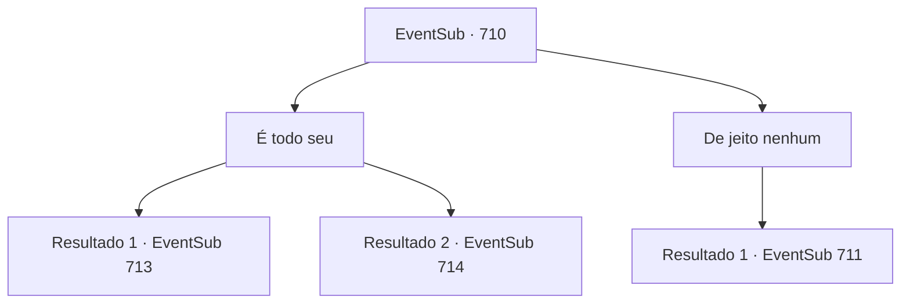

# Eventos secundários · 710

[Índice da tabela](index.md) · [Índice geral](../index.md)

ID: `pt:EventSub:710` · Fonte: `EventSub4` · Versão: 1.2.47.

Mapeamento estático dos arquivos; a disponibilidade e a execução dependem do estado da run.

## Texto do evento

*Sem texto no arquivo.*

## Dados de entrada

```json
{
  "id": 710,
  "grade": 1,
  "subEvent": "",
  "required": ""
}
```

## Mapa das escolhas



## Escolhas e resultados

### Escolha 1

É todo seu

Requisitos e outros campos da escolha:

```json
{
  "required": ""
}
```

#### Resultado 1.1

Você acena em resposta. Lei agradece com os olhos e se prepara para o duelo. Shao lhe dá um olhar condescendente e começa a balançar sua espada. O duelo não termina facilmente. Parece que as habilidades de Lei são superiores, mas seu ombro ferido lhe deu desvantagem. 

 'GRRRRRRRRR!!' 

 À medida que o duelo chega a um impasse, o chão começa a tremer. Não só isso, mas o penhasco começa a desmoronar, e logo não há nada sob seus pés. Uma mudança tão repentina de ambiente foi difícil de reagir. A feroz corrente do riacho engole vocês dois em um instante. 

 Você finalmente abre os olhos e se senta. Parece que você está em algum tipo de caverna. Ao seu lado está uma pequena fogueira, onde Lei está secando suas roupas molhadas. 

 "Ah... Sohyeop! Finalmente! Bom ver você de volta à ação."

 Lei disse, esboçando um sorriso constrangido.

Continuação registrada: [Evento 713](0713.md) na mesma tabela.

```json
{
  "required": "21_31_1",
  "chance": "1",
  "nextEvent": 713,
  "type": 2,
  "reward": ""
}
```

#### Resultado 1.2

Você acena em resposta. Lei te agradece com os olhos e se prepara para o duelo. Shao lhe dá um olhar condescendente e começa a balançar sua espada. O duelo não termina facilmente. Parece que as habilidades de Lei são superiores, mas seu ombro ferido lhe deu desvantagem. 

 'GRRRRRRRRR!!' 

 À medida que o duelo chega a um impasse, o chão começa a tremer. Não só isso, mas o penhasco começa a desmoronar, e logo não há nada sob seus pés. Uma mudança tão repentina de ambiente foi difícil de reagir. A feroz corrente do riacho engole vocês dois em um instante. 

 "...Sohyeop!!"

 Você usa sua habilidade de respirar debaixo d'água e salva Lei de se afogar. Segurando Lei, você nada em direção à terra, para o campo de cascalho próximo. Você ainda está vivo, mas é provável que os Dragões Vermelhos venham atrás de você. Olhando ao redor, Lei avista outra caverna e fala. 

 "*tosse*... *tosse*... Ali! Uma caverna. Vamos nos esconder lá por enquanto."

 Você segue Lei para dentro da caverna. Lei solta um suspiro, olhando para dentro da caverna.

Continuação registrada: [Evento 714](0714.md) na mesma tabela.

```json
{
  "required": "20_31_1",
  "chance": "1",
  "nextEvent": 714,
  "type": 2,
  "reward": ""
}
```

### Escolha 2

De jeito nenhum

Requisitos e outros campos da escolha:

```json
{
  "required": ""
}
```

#### Resultado 2.1

Você rejeita o pedido de Lei, dizendo que não vai deixá-lo fazer isso. Lei suspira, então acena com a cabeça. Shao continua a provocar vocês dois, apesar das probabilidades estarem contra ela. 

 "Hmph. Não importa. Vocês dois morrerão pelas minhas mãos."

 Shao fez o primeiro ataque. Com um salto forte, ela rapidamente fecha a distância e lança sua espada na garganta de Lei. Lei desvia, desequilibrando Shao. Você aproveita a oportunidade e ataca Shao.

Continuação registrada: [Evento 711](0711.md) na mesma tabela.

```json
{
  "required": "",
  "chance": "1",
  "nextEvent": 711,
  "type": 2,
  "reward": "6_2_178",
  "place": 6
}
```

## Referências que chegam a este evento

- [Evento 709 · escolha 1 · resultado 1](0709.md#escolha-1)
