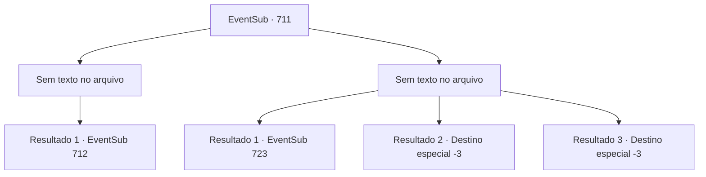

# Eventos secundários · 711

[Índice da tabela](index.md) · [Índice geral](../index.md)

ID: `pt:EventSub:711` · Fonte: `EventSub4` · Versão: 1.2.47.

Mapeamento estático dos arquivos; a disponibilidade e a execução dependem do estado da run.

## Texto do evento

*Sem texto no arquivo.*

## Dados de entrada

```json
{
  "id": 711,
  "grade": 1,
  "subEvent": "",
  "required": ""
}
```

## Mapa das escolhas



## Escolhas e resultados

### Escolha 1

*Sem texto no arquivo; o papel dessa opção depende da interface do jogo.*

Requisitos e outros campos da escolha:

```json
{
  "required": ""
}
```

#### Resultado 1.1

Com você ajudando Lei na luta, Shao lentamente começa a ficar sobrecarregada. Movendo-se constantemente durante a luta, Shao agora está encurralada no final do penhasco. Você faz um ataque decisivo para acabar com a batalha. Shao mal consegue bloquear você, mas perde o equilíbrio e cai do penhasco. 

 "...SHAO!!"

 Mas então, Lei alcança as mãos de Shao e a agarra. Shao olha fixamente para Lei por um segundo, depois logo franze a testa. 

 "...Não ouse ter pena de mim. Imunda plebeia."

 Então, ela solta a mão de Lei sozinha e cai. A feroz corrente do riacho engole Shao em um instante.

Continuação registrada: [Evento 712](0712.md) na mesma tabela.

```json
{
  "required": "",
  "chance": "1",
  "nextEvent": 712,
  "type": 2,
  "reward": ""
}
```

### Escolha 2

*Sem texto no arquivo; o papel dessa opção depende da interface do jogo.*

Requisitos e outros campos da escolha:

```json
{
  "required": ""
}
```

#### Resultado 2.1


 "...SOHYEOP, NÃO!!"

 À medida que o duelo chegava a um impasse, você não consegue defender o ataque rápido de Shao. Você ouve Lei gritando desesperadamente, mas não consegue reagir. Uma dor lancinante atinge você, e sua consciência lentamente se esvai. 

 O vento frio te acorda. Você ainda se sente tonto e suas costas queimam, mas é capaz de se mover. Olhando ao redor, você percebe que Lei e Shao desapareceram. Os Dragões Vermelhos também não estão em lugar algum. Tudo o que resta são poças de sangue.

Continuação registrada: [Evento 723](0723.md) na mesma tabela.

```json
{
  "required": "1_0_2|1_1_2",
  "chance": "1",
  "nextEvent": 723,
  "type": 2,
  "reward": "0_0_-1|0_1_-1"
}
```

#### Resultado 2.2

É dois contra um, então a luta deve estar a seu favor, mas Shao consegue lidar com vocês dois simultaneamente. O ombro ferido de Lei e o cansaço da batalha anterior devem estar cobrando seu preço. 

 "...SOHYEOP, NÃO!!"

 Quando o duelo chegou a um impasse, você não consegue defender o ataque rápido de Shao. Você ouve Lei gritando desesperadamente, mas não consegue reagir. Uma dor lancinante atinge você, e sua consciência lentamente se esvai.

Continuação registrada: [Destino especial `-3`](../destinos-especiais.md).

```json
{
  "required": "2_0_2",
  "chance": "1",
  "nextEvent": -3,
  "type": 2,
  "reward": "0_0_-1|0_1_-1"
}
```

#### Resultado 2.3

É dois contra um, então a luta deve estar a seu favor, mas Shao consegue lidar com vocês dois simultaneamente. O ombro ferido de Lei e o cansaço da batalha anterior devem estar cobrando seu preço. 

 "...SOHYEOP, NÃO!!"

 Quando o duelo chegou a um impasse, você não consegue defender o ataque rápido de Shao. Você ouve Lei gritando desesperadamente, mas não consegue reagir. Uma dor lancinante atinge você, e sua consciência lentamente se esvai.

Continuação registrada: [Destino especial `-3`](../destinos-especiais.md).

```json
{
  "required": "2_1_2",
  "chance": "1",
  "nextEvent": -3,
  "type": 2,
  "reward": "0_0_-1|0_1_-1"
}
```

## Referências que chegam a este evento

- [Evento 710 · escolha 2 · resultado 1](0710.md#escolha-2)
