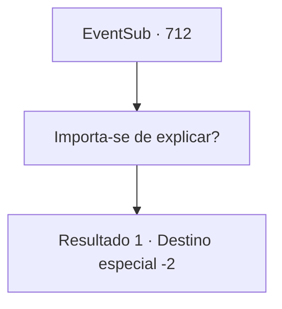

# Eventos secundários · 712

[Índice da tabela](index.md) · [Índice geral](../index.md)

ID: `pt:EventSub:712` · Fonte: `EventSub4` · Versão: 1.2.47.

Mapeamento estático dos arquivos; a disponibilidade e a execução dependem do estado da run.

## Texto do evento

*Sem texto no arquivo.*

## Dados de entrada

```json
{
  "id": 712,
  "grade": 1,
  "subEvent": "",
  "required": ""
}
```

## Mapa das escolhas



## Escolhas e resultados

### Escolha 1

Importa-se de explicar?

Requisitos e outros campos da escolha:

```json
{
  "required": ""
}
```

#### Resultado 1.1

Lei olha para baixo do penhasco por um momento, depois volta seu olhar para você. Ele mexe um pouco os lábios, como se quisesse dizer algo, mas então balança a cabeça. 

 "...Desculpe. Vou falar com você sobre isso mais tarde."

 Você ajuda Lei a descer a montanha, até a vila abaixo. Depois de levá-lo para seu quarto na pousada local, você passa a noite em silêncio. 

 Na manhã seguinte, você toma um banho rápido e vai procurar Lei. Mas o quarto dele está vazio. Parece que o dono da pousada também não tem ideia de onde ele foi. Sem Lei, é impossível procurar o legado do Mestre Long também. Infelizmente, você arruma suas coisas e deixa a vila.

Continuação registrada: [Destino especial `-2`](../destinos-especiais.md).

```json
{
  "required": "",
  "chance": "1",
  "nextEvent": -2,
  "type": 2,
  "reward": "5_714_1|12_11_6"
}
```

## Referências que chegam a este evento

- [Evento 711 · escolha 1 · resultado 1](0711.md#escolha-1)
