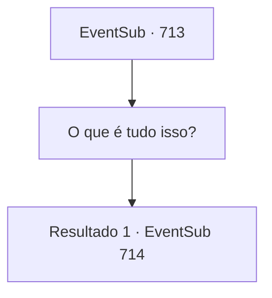

# Eventos secundários · 713

[Índice da tabela](index.md) · [Índice geral](../index.md)

ID: `pt:EventSub:713` · Fonte: `EventSub4` · Versão: 1.2.47.

Mapeamento estático dos arquivos; a disponibilidade e a execução dependem do estado da run.

## Texto do evento

*Sem texto no arquivo.*

## Dados de entrada

```json
{
  "id": 713,
  "grade": 1,
  "subEvent": "",
  "required": ""
}
```

## Mapa das escolhas



## Escolhas e resultados

### Escolha 1

O que é tudo isso?

Requisitos e outros campos da escolha:

```json
{
  "required": ""
}
```

#### Resultado 1.1

|drawing_FemaleLei| Parece que Lei estava enfaixando o peito. Enquanto ele - não, ela - torce suas roupas molhadas, gotas de água caem no chão. Lei joga mais lenha na fogueira e então explica. 

 "Você se lembra de pular do penhasco? Você perdeu a consciência. Então eu te trouxe para esta caverna. Sou apenas uma humilde espadachim, mas sou boa em nadar."

 Lei ri levemente de sua própria piada. Ela é quem quebra o breve silêncio, aparentemente tendo sentido seu olhar fixo nela. 

 "Eu não quis te enganar. Sempre me vestia como homem antes de sair, mesmo no Oriente. As circunstâncias em que estou me obrigam a esconder minha identidade. Além disso, viajar sozinha é uma opção muito melhor..."

 Lei veste suas roupas novamente, ainda não completamente secas, e continua. 

 "Portanto, peço que continue a me tratar como homem, como tem feito até agora."


Continuação registrada: [Evento 714](0714.md) na mesma tabela.

```json
{
  "required": "",
  "chance": "1",
  "nextEvent": 714,
  "type": 2,
  "reward": ""
}
```

## Referências que chegam a este evento

- [Evento 708 · escolha 2 · resultado 1](0708.md#escolha-2)
- [Evento 709 · escolha 2 · resultado 1](0709.md#escolha-2)
- [Evento 710 · escolha 1 · resultado 1](0710.md#escolha-1)
- [Evento 809 · escolha 2 · resultado 1](0809.md#escolha-2)
