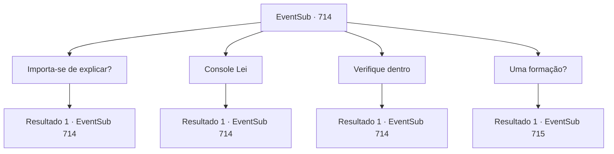

# Eventos secundários · 714

[Índice da tabela](index.md) · [Índice geral](../index.md)

ID: `pt:EventSub:714` · Fonte: `EventSub4` · Versão: 1.2.47.

Mapeamento estático dos arquivos; a disponibilidade e a execução dependem do estado da run.

## Texto do evento

*Sem texto no arquivo.*

## Dados de entrada

```json
{
  "id": 714,
  "grade": 1,
  "subEvent": "",
  "required": ""
}
```

## Mapa das escolhas



## Escolhas e resultados

### Escolha 1

Importa-se de explicar?

Requisitos e outros campos da escolha:

```json
{
  "required": "5_715_0"
}
```

#### Resultado 1.1

Você pede uma explicação a Lei. Lei hesita um pouco antes de falar novamente. 

 "*suspiro*... Meu pai é o Chefe do Clã Ryu. Mas minha mãe era uma prostituta. O clã nem sequer a reconheceu como concubina."

 Ou seja, Shao e Lei eram meias-irmãs. Lei sorri amargamente. 

 "Meu pai me aceitou como filha legítima, cuidou e me amou, apesar do meu status social. Ele nunca me obrigou a treinar com uma espada, mas fiz o meu melhor para retribuir sua bondade. Felizmente, eu tinha um talento humilde. Fui capaz de possuir habilidades que poderiam ser úteis para meu pai e o clã."

 Lei olha silenciosamente para suas mãos, cobertas de calos. 

 "Nem todos gostavam de mim, no entanto. Especialmente Shao. Ela me odiava, mesmo durante a infância. Depois que nosso Chefe do Clã ficou acamado, o desprezo de Shao e de seu povo por mim se tornou cada vez mais óbvio. É por isso que quero me provar. Ganhar a aprovação dos membros do clã."


Continuação registrada: [Evento 714](0714.md) na mesma tabela.

```json
{
  "required": "",
  "chance": "1",
  "nextEvent": 714,
  "type": 2,
  "reward": "5_715_1"
}
```

### Escolha 2

Console Lei

Requisitos e outros campos da escolha:

```json
{
  "required": "5_715_1"
}
```

#### Resultado 2.1

Você faz o seu melhor para confortar Lei. Ele te agradece com um sorriso fraco, então prossegue para te contar seu plano. 

 "Shao provavelmente vai procurar este lugar com seus homens. Seria melhor ficar escondido por um tempo."

 Felizmente, você e Lei estão em um bom lugar para se esconder. A caverna abaixo do penhasco acabou sendo bastante profunda. Você não tem ideia de onde ela leva, mas entra com Lei mesmo assim.

Continuação registrada: [Evento 714](0714.md) na mesma tabela.

```json
{
  "required": "",
  "chance": "1",
  "nextEvent": 714,
  "type": 2,
  "reward": "5_715_2"
}
```

### Escolha 3

Verifique dentro

Requisitos e outros campos da escolha:

```json
{
  "required": "5_715_2"
}
```

#### Resultado 3.1

Você examina o interior da caverna, andando por aí. Parece levar profundamente para o subsolo. O caminho serpenteia e se torce. Você sente como se tivesse perdido todo o senso de direção em algum momento. Então, Lei olha para trás, assustado. Atrás de vocês dois há um caminho completamente novo, um pelo qual você não se lembra de ter passado. O rosto de Lei fica molhado de suor. 

 "...Sohyeop. Tenho medo de que tenhamos caído em uma formação."


Continuação registrada: [Evento 714](0714.md) na mesma tabela.

```json
{
  "required": "",
  "chance": "1",
  "nextEvent": 714,
  "type": 2,
  "reward": "5_715_3"
}
```

### Escolha 4

Uma formação?

Requisitos e outros campos da escolha:

```json
{
  "required": "5_715_3"
}
```

#### Resultado 4.1


 "Uma formação é um tipo de magia frequentemente praticada no Oriente. Ao colocar humanos, itens naturais ou objetos específicos em um certo padrão, você causa o efeito desejado."

 Lei responde à sua curiosidade, explicando o uso das formações. Normalmente, as formações são usadas para dificultar a navegação dos invasores. Às vezes, elas também podem ser usadas para prender alguém. 

 "Devemos avançar, por enquanto. Mesmo se voltarmos daqui, só nos confundiremos ainda mais."

 Você ouve Lei e caminha para frente. À sua frente aparecem três caminhos. No caminho do meio está uma estátua de um dragão. No entanto, parece um pouco diferente do dragão que você conhece. Não tem asas, tem algo que parece chifres na cabeça, e a forma de seu corpo se assemelha à de uma cobra alongada. Seus braços e pernas parecem minúsculos em comparação com seu tamanho. Lei olha para a estátua e murmura para si mesma, 'O Dragão Azul?'

Continuação registrada: [Evento 715](0715.md) na mesma tabela.

```json
{
  "required": "",
  "chance": "1",
  "nextEvent": 715,
  "type": 2,
  "reward": ""
}
```

## Referências que chegam a este evento

- [Evento 708 · escolha 2 · resultado 2](0708.md#escolha-2)
- [Evento 708 · escolha 2 · resultado 3](0708.md#escolha-2)
- [Evento 708 · escolha 2 · resultado 4](0708.md#escolha-2)
- [Evento 709 · escolha 2 · resultado 2](0709.md#escolha-2)
- [Evento 710 · escolha 1 · resultado 2](0710.md#escolha-1)
- [Evento 713 · escolha 1 · resultado 1](0713.md#escolha-1)
- [Evento 714 · escolha 1 · resultado 1](0714.md#escolha-1)
- [Evento 714 · escolha 2 · resultado 1](0714.md#escolha-2)
- [Evento 714 · escolha 3 · resultado 1](0714.md#escolha-3)
- [Evento 809 · escolha 2 · resultado 2](0809.md#escolha-2)
