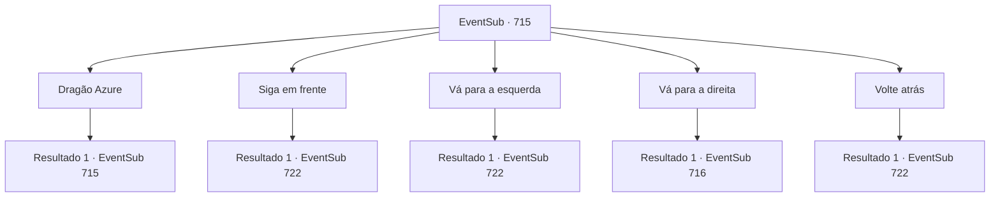

# Eventos secundários · 715

[Índice da tabela](index.md) · [Índice geral](../index.md)

ID: `pt:EventSub:715` · Fonte: `EventSub4` · Versão: 1.2.47.

Mapeamento estático dos arquivos; a disponibilidade e a execução dependem do estado da run.

## Texto do evento

*Sem texto no arquivo.*

## Dados de entrada

```json
{
  "id": 715,
  "grade": 1,
  "subEvent": "",
  "required": ""
}
```

## Mapa das escolhas



## Escolhas e resultados

### Escolha 1

Dragão Azure

Requisitos e outros campos da escolha:

```json
{
  "required": "5_715_3"
}
```

#### Resultado 1.1


 "Esta estátua deve ser uma representação do Dragão Azure, uma das Quatro Bestas Divinas. Ah, uh - as Quatro Bestas Divinas são criaturas sagradas adoradas no Oriente. Diz-se que o Dragão Azure protege as Regiões Orientais, supervisionando a primavera e a madeira."

 Lei continua a explicar sobre as Quatro Bestas Divinas. Assim como o Dragão Azure que governa o Leste, há outros - o Pássaro Vermilion, o Tigre Branco e a Tartaruga Negra que governam respeitosamente o Sul, o Oeste e o Norte.  

 "Hm... Presumo que essas estátuas sejam pistas para encontrar o caminho correto."

 Você olha mais de perto a estátua. Em seu canto, você vê um símbolo, embora não tenha ideia do que significa. Lei olha para o símbolo e então fala. 

 "Sim. Este símbolo nos dirá a direção. Viemos do Sul, então se continuarmos em frente, isso deve ser o Norte."


Continuação registrada: [Evento 715](0715.md) na mesma tabela.

```json
{
  "required": "",
  "chance": "1",
  "nextEvent": 715,
  "type": 2,
  "reward": "5_715_4"
}
```

### Escolha 2

Siga em frente

Requisitos e outros campos da escolha:

```json
{
  "required": ""
}
```

#### Resultado 2.1

Você e Lei decidem seguir em frente. O caminho longo e sinuoso te deixa tonto, e é difícil entender a direção em que estão andando. Vocês caminham e caminham. Eventualmente, parece que estão perdendo a noção do tempo também. Nesse momento, você sente uma súbita onda de frio vinda de longe. Parece que vocês chegaram à saída da caverna. Você e Lei saem apressadamente. Julgando pela paisagem, você acha que ainda estão na Cordilheira da Lâmina, mas não é a mesma entrada da caverna que vocês entraram antes. 

 "A formação deve ter nos tirado do curso. Parecia que estávamos lá por um dia ou algo assim. Mas, na realidade, vários dias devem ter se passado. Bem, ainda conseguimos sair inteiros, então acho que é isso."


Continuação registrada: [Evento 722](0722.md) na mesma tabela.

```json
{
  "required": "",
  "chance": "1",
  "nextEvent": 722,
  "type": 2,
  "reward": ""
}
```

### Escolha 3

Vá para a esquerda

Requisitos e outros campos da escolha:

```json
{
  "required": ""
}
```

#### Resultado 3.1

Você e Lei decidem ir para a esquerda. O caminho longo e sinuoso te deixa tonto, e é difícil entender a direção para a qual você está andando. Você anda e anda. Eventualmente, parece que você está perdendo a noção do tempo também. Nesse momento, você sente uma súbita onda de frio vindo de longe. Parece que você chegou à saída da caverna. Você e Lei saem apressadamente. Julgando pela paisagem, você acha que ainda está na Cordilheira da Lâmina, mas não é a mesma entrada da caverna que você entrou antes. 

 "A formação deve ter nos desviado do curso. Parecia que estávamos lá por um dia ou mais. Mas, na realidade, vários dias devem ter se passado. Bem, ainda conseguimos sair inteiros, então acho que é isso."


Continuação registrada: [Evento 722](0722.md) na mesma tabela.

```json
{
  "required": "",
  "chance": "1",
  "nextEvent": 722,
  "type": 2,
  "reward": ""
}
```

### Escolha 4

Vá para a direita

Requisitos e outros campos da escolha:

```json
{
  "required": ""
}
```

#### Resultado 4.1

Você e Lei decidem ir para a direita. 

 Cerca de dez minutos se passam enquanto vocês caminham. Mas então, outro cruzamento de três vias aparece à sua frente. A diferença é que desta vez, a estátua no caminho do meio não é a do Dragão Azure, mas de outra criatura. Parece uma tartaruga gigante, com uma cauda que se assemelha a uma cobra. Lei examina a estátua e então fala. 

 "Hm, este deve ser o Tartaruga Negra. Um dos Quatro Animais Divinos, assim como o Dragão Azure. Este governa o Norte."


Continuação registrada: [Evento 716](0716.md) na mesma tabela.

```json
{
  "required": "",
  "chance": "1",
  "nextEvent": 716,
  "type": 2,
  "reward": ""
}
```

### Escolha 5

Volte atrás

Requisitos e outros campos da escolha:

```json
{
  "required": ""
}
```

#### Resultado 5.1

Você e Lei decidem voltar pelo caminho que vieram. O longo e sinuoso caminho te deixa tonto, e é difícil compreender a direção para a qual estão andando. Vocês andam e andam. Eventualmente, parece que estão perdendo a noção do tempo também. Nesse momento, você sente uma súbita onda de frio vinda de longe. Parece que vocês chegaram à saída da caverna. Você e Lei saem apressadamente. Julgando pela paisagem, você acha que ainda estão na Cordilheira da Lâmina, mas não é a mesma entrada da caverna pela qual entraram antes. 

 "A formação deve ter nos desviado do curso. Parecia que estávamos lá por um dia ou algo assim. Mas, na realidade, vários dias devem ter se passado. Bem, ainda conseguimos sair inteiros, então acho que é isso."


Continuação registrada: [Evento 722](0722.md) na mesma tabela.

```json
{
  "required": "",
  "chance": "1",
  "nextEvent": 722,
  "type": 2,
  "reward": ""
}
```

## Referências que chegam a este evento

- [Evento 714 · escolha 4 · resultado 1](0714.md#escolha-4)
- [Evento 715 · escolha 1 · resultado 1](0715.md#escolha-1)
