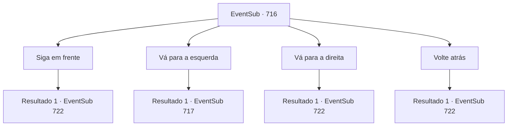

# Eventos secundários · 716

[Índice da tabela](index.md) · [Índice geral](../index.md)

ID: `pt:EventSub:716` · Fonte: `EventSub4` · Versão: 1.2.47.

Mapeamento estático dos arquivos; a disponibilidade e a execução dependem do estado da run.

## Texto do evento

*Sem texto no arquivo.*

## Dados de entrada

```json
{
  "id": 716,
  "grade": 1,
  "subEvent": "",
  "required": ""
}
```

## Mapa das escolhas



## Escolhas e resultados

### Escolha 1

Siga em frente

Requisitos e outros campos da escolha:

```json
{
  "required": ""
}
```

#### Resultado 1.1

Você e Lei decidem seguir em frente. O caminho longo e sinuoso te deixa tonto, e é difícil entender a direção em que estão andando. Vocês caminham e caminham. Eventualmente, parece que estão perdendo a noção do tempo também. Nesse momento, você sente uma súbita onda de frio vinda de longe. Parece que vocês chegaram à saída da caverna. Você e Lei saem apressadamente. Julgando pela paisagem, você acha que ainda estão na Cordilheira da Lâmina, mas não é a mesma entrada da caverna que vocês entraram antes. 

 "A formação deve ter nos tirado do curso. Parecia que estávamos lá por um dia ou algo assim. Mas, na realidade, vários dias devem ter se passado. Bem, ainda conseguimos sair inteiros, então acho que é isso."


Continuação registrada: [Evento 722](0722.md) na mesma tabela.

```json
{
  "required": "",
  "chance": "1",
  "nextEvent": 722,
  "type": 2,
  "reward": ""
}
```

### Escolha 2

Vá para a esquerda

Requisitos e outros campos da escolha:

```json
{
  "required": ""
}
```

#### Resultado 2.1

Você e Lei decidem ir para a esquerda. Após passar por um corredor longo e estreito, vocês dois avistam algo novo e param. |drawing_hwangloong| No centro da enorme câmara há um pedestal circular de forma estranha, sobre o qual está uma enorme estátua, dourada em amarelo. Parece algum tipo de cobra, mas em vez de características normais de cobra, ela tem galhadas na cabeça, braços e pernas de um lagarto, longos bigodes e uma cauda com espinhos. Dentes afiados como os de um jacaré decoram sua boca. Segurado firmemente nessa boca está uma esfera.

Continuação registrada: [Evento 717](0717.md) na mesma tabela.

```json
{
  "required": "",
  "chance": "1",
  "nextEvent": 717,
  "type": 2,
  "reward": "12_11_3"
}
```

### Escolha 3

Vá para a direita

Requisitos e outros campos da escolha:

```json
{
  "required": ""
}
```

#### Resultado 3.1

Você e Lei decidem ir para a direita. O caminho longo e sinuoso te deixa tonto, e é difícil entender a direção para a qual você está andando. Você anda e anda. Eventualmente, parece que você está perdendo a noção do tempo também. Nesse momento, você sente uma súbita onda de frio vinda de longe. Parece que você chegou à saída da caverna. Você e Lei saem apressadamente. Julgando pela paisagem, você acha que ainda está na Cordilheira da Lâmina, mas não é a mesma entrada da caverna que você entrou antes. 

 "A formação deve ter nos desviado do curso. Parecia que estávamos lá por um dia ou mais. Mas, na realidade, vários dias devem ter se passado. Bem, ainda conseguimos sair inteiros, então acho que é isso."


Continuação registrada: [Evento 722](0722.md) na mesma tabela.

```json
{
  "required": "",
  "chance": "1",
  "nextEvent": 722,
  "type": 2,
  "reward": ""
}
```

### Escolha 4

Volte atrás

Requisitos e outros campos da escolha:

```json
{
  "required": ""
}
```

#### Resultado 4.1

Você e Lei decidem voltar pelo caminho que vieram. O longo e sinuoso caminho te deixa tonto, e é difícil compreender a direção para a qual estão andando. Vocês andam e andam. Eventualmente, parece que estão perdendo a noção do tempo também. Nesse momento, você sente uma súbita onda de frio vinda de longe. Parece que vocês chegaram à saída da caverna. Você e Lei saem apressadamente. Julgando pela paisagem, você acha que ainda estão na Cordilheira da Lâmina, mas não é a mesma entrada da caverna pela qual entraram antes. 

 "A formação deve ter nos desviado do curso. Parecia que estávamos lá por um dia ou algo assim. Mas, na realidade, vários dias devem ter se passado. Bem, ainda conseguimos sair inteiros, então acho que é isso."


Continuação registrada: [Evento 722](0722.md) na mesma tabela.

```json
{
  "required": "",
  "chance": "1",
  "nextEvent": 722,
  "type": 2,
  "reward": ""
}
```

## Referências que chegam a este evento

- [Evento 715 · escolha 4 · resultado 1](0715.md#escolha-4)
