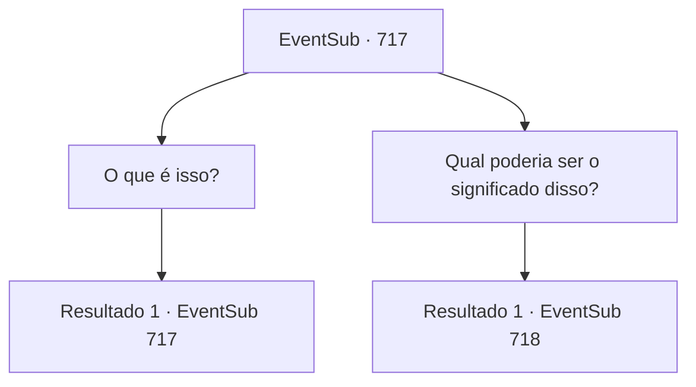

# Eventos secundários · 717

[Índice da tabela](index.md) · [Índice geral](../index.md)

ID: `pt:EventSub:717` · Fonte: `EventSub4` · Versão: 1.2.47.

Mapeamento estático dos arquivos; a disponibilidade e a execução dependem do estado da run.

## Texto do evento

*Sem texto no arquivo.*

## Dados de entrada

```json
{
  "id": 717,
  "grade": 1,
  "subEvent": "",
  "required": ""
}
```

## Mapa das escolhas



## Escolhas e resultados

### Escolha 1

O que é isso?

Requisitos e outros campos da escolha:

```json
{
  "required": "5_716_0"
}
```

#### Resultado 1.1

Você encara a estátua, enquanto Lei vem explicar. 

 "Esta criatura representada aqui é o Dragão Amarelo, Sohyeop. Ele é responsável pelo meio. Devemos estar no centro deste lugar."

 Lei olha ao redor, então percebe que há algo esculpido no chão. 

 "Aqui - vejo algumas letras no chão."

 Lei aponta para o chão, onde você encontra cinco círculos desenhados, colocados separados uns dos outros em um padrão circular. Dentro de cada círculo há uma letra que você não reconhece. Lendo a confusão em sua expressão, Lei começa a explicar novamente, mesmo antes de você poder perguntar. 

 "Inscritos no chão estão os Cinco Elementos. Está escrito... Madeira no Norte, Fogo no Nordeste, Terra no Sudeste, Metal no Sudoeste e Água no Noroeste."|drawing_fiveElemental|

Continuação registrada: [Evento 717](0717.md) na mesma tabela.

```json
{
  "required": "",
  "chance": "1",
  "nextEvent": 717,
  "type": 2,
  "reward": "5_716_1"
}
```

### Escolha 2

Qual poderia ser o significado disso?

Requisitos e outros campos da escolha:

```json
{
  "required": "5_716_1"
}
```

#### Resultado 2.1

Em resposta à sua pergunta, Lei lê a mensagem escrita abaixo do pedestal do Dragão Amarelo e responde. 

 "O Julgamento dos Cinco Elementos... Diz: 'Absorva o sopro do dragão e torne-se um com ele'."

 De repente, o orbe segurado pela estátua do Dragão Amarelo começa a brilhar em vermelho. Então, chamas violentas começam a emergir do orbe. 

 "Uh... Sohyeop? Isso está começando a parecer perigoso."


Continuação registrada: [Evento 718](0718.md) na mesma tabela.

```json
{
  "required": "",
  "chance": "1",
  "nextEvent": 718,
  "type": 2,
  "reward": "5_716_2"
}
```

## Referências que chegam a este evento

- [Evento 716 · escolha 2 · resultado 1](0716.md#escolha-2)
- [Evento 717 · escolha 1 · resultado 1](0717.md#escolha-1)
